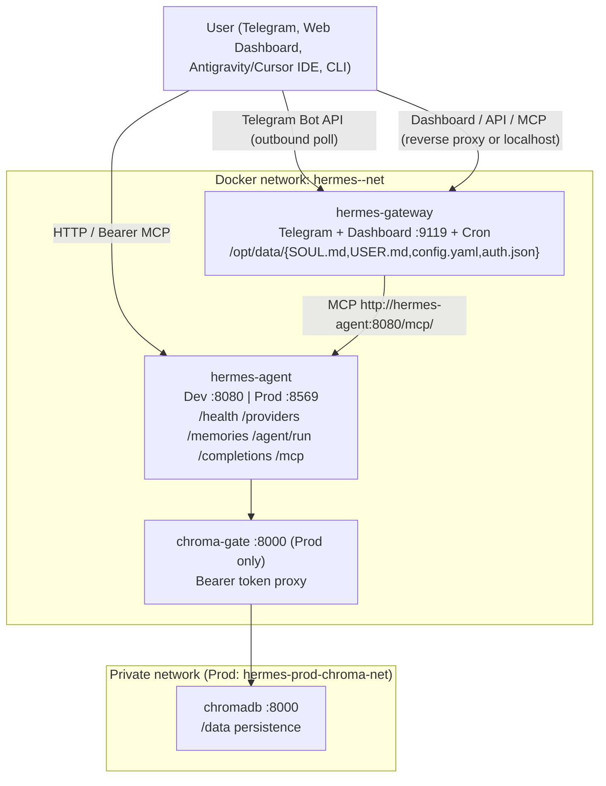

# AGENTS.md — Hermes Agent Builder & Runner Manual

> **MANDATORY FIRST READ:** Any builder, coding, deployment, or runner agent entering this repository **must read this file completely before modifying code, starting services, or deploying**. This document is the single source of truth to build, customize, test, run locally, deploy to Ubuntu Server 24.04+, configure Telegram, configure AI providers/OAuth subscriptions, connect IDE MCP, and troubleshoot the entire personal assistant stack without guesswork.

---

## 1. Purpose & Architecture Overview

**Hermes Agent** is a lean, self-hosted **Personal Assistant Operating System** built for everyday personal and professional use across:
- **Work & Software Engineering** (coding, debugging, architecture, DevOps/VPS workflows)
- **Daily Productivity, Learning & Habits** (morning priorities, goal tracking, study synthesis, weekly reviews)
- **Personal Financial Advisory & Planning** (budgeting, cashflow runway, scenario modeling — **strictly analytical & non-custodial**)
- **Life Admin & Knowledge Management** (drafting messages, travel/errands, persistent searchable notes)

It runs two coordinated services plus ChromaDB:
1. **`hermes-agent` (this Python repository — FastAPI + MCP + ChromaDB RAG + CLI):**
   - Persistent file-backed dotted memory (`profile.*`, `work.*`, `dev.*`, `goal.*`, `habit.*`, `study.*`, `finance.*`, `ops.*`)
   - Chunked semantic document store (`POST /documents`, `GET /documents/search`, hybrid vector + keyword RRF)
   - Concise `SKILL.md` skills (`storage/skills/*/SKILL.md`)
   - Autonomous multi-step tool loop (`POST /agent/run`, `hermes run`) that injects `gateway/SOUL.md`, `gateway/USER.md`, and `HERMES_TIMEZONE` clock context
   - Authenticated Streamable HTTP MCP endpoint (`/mcp`) exposing 9 shared tools
2. **`hermes-gateway` (`nousresearch/hermes-agent:latest`):**
   - Always-on **Telegram Bot** (outbound long-polling, optional DM Topics), **Web Dashboard** (`:9119`), scheduled **cron** briefings, and multi-provider **OAuth/API routing**, connected to `hermes-agent` over MCP (`http://hermes-agent:8080/mcp/`).



---

## 2. Hard Invariants (Do Not Violate)

Any builder or runner agent modifying or operating this repo **must preserve these invariants**:

1. **Non-Custodial Financial Safety:** Never add autonomous trading, bank/exchange mutations, payments, or credential storage (no bank logins, card numbers, PINs, or wallet seed phrases in memory files, docs, or code).
2. **Approved Provider & Gemini Subscription Policy:**
   - Today, **Gemini in Hermes runs on an API key** (`OPENROUTER_API_KEY` or `GOOGLE_API_KEY` / `GEMINI_API_KEY`), **not** consumer Gemini plans.
   - **Claude Pro/Max** and **ChatGPT Plus/Pro** subscriptions work in `hermes-gateway` today via official OAuth (`hermes model`).
   - **Nous Research + Google** are actively working on official Google-approved Gemini subscription support (**not live yet, no release date**).
   - **NEVER** implement, bundle, or suggest unapproved consumer Gemini web scrapers, cookie hijackers, or unofficial OAuth proxy bypasses.
3. **Secret Isolation:**
   - Untracked secret files (`.env.local`, `docker/env/.env.prod`, `docker/env/.env.gateway`, `/opt/data/.env`, `/opt/data/auth.json`) must stay gitignored.
   - Never log, echo, or return `HERMES_API_TOKEN`, `CHROMA_AUTH_TOKEN`, `HERMES_MODEL_API_KEY`, or `TELEGRAM_BOT_TOKEN` in `/health`, `/providers`, or logs.
   - Keep `docker/docker-compose.prod.yml` free of empty `${TELEGRAM_BOT_TOKEN:-}` overrides on `hermes-gateway` so interactive `/opt/data/.env` setup stays intact.
4. **Container & MCP Security:**
   - Keep `cap_drop: [ALL]` on `hermes-agent`, non-root `USER hermes` in `docker/Dockerfile`, and `chroma-gate` isolating `chromadb` in `prod`.
   - Keep destructive `delete_memory` off `/mcp` (9 MCP tools only: `complete`, `current_time`, `list_memories`, `list_skills`, `recall`, `remember`, `save_document`, `search_documents`, `search_memory`).
   - Direct `/tools` and `/agent/run` calls involving `delete_memory` must return `ask_person`.
5. **Line Endings & Contracts:**
   - All `docker/scripts/*.sh` files **must keep LF (`\n`) endings** (`.gitattributes` enforces `*.sh text eol=lf`) and pass `bash -n`.
   - All edits must keep `pytest -q -m "not integration"` passing with zero failures.

---

## 3. Repository & Code Map

| Path | Role |
| --- | --- |
| `AGENTS.md` | **This file** — complete Builder & Runner Agent manual. |
| `README.md` | Human quickstart & project overview. |
| `docs/DEPLOYMENT.md` | Ubuntu 24.04+ server, Docker, Telegram & provider operator guide. |
| `docs/CHANGELOG.md` | Release history. |
| `gateway/SOUL.md` | Assistant persona, everyday domains, non-custodial bounds, shared MCP rules. |
| `gateway/USER.md` | Personal user profile, timezone preference, style, and memory prefixes (**customize here**). |
| `gateway/config.yaml.example` | Default `hermes-gateway` model routing, fallbacks, Telegram DM topics, and MCP link. |
| `gateway/cron.yaml.example` | Everyday morning, evening, weekly review, and maintenance prompt templates. |
| `src/agent/core.py` | `HermesAgent` orchestrator, completions, `/agent/run` loop, RAG, provider status. |
| `src/agent/profile.py` | Generic loader injecting `SOUL.md`, `USER.md`, and clock into `run_agent()`. |
| `src/agent/tools.py` | 10 allowlisted tools (`9` open + `delete_memory` confirm-gated) and OpenAI tool schemas. |
| `src/agent/prompt.py` | Skill-index + optional RAG `## Context` assembly for `/completions`. |
| `src/api/app.py` | FastAPI factory (`/health`, `/providers`, `/memories`, `/documents`, `/completions`, `/agent/run`, `/tools`, `/mcp`). |
| `src/api/mcp_tools.py` | 9 shared MCP tools (`delete_memory` excluded). |
| `src/api/mcp_http.py` | Streamable HTTP `/mcp` server with host allowlist and bearer auth. |
| `src/cli/main.py` | CLI entrypoint (`hermes health`, `providers`, `skills`, `memories`, `remember`, `recall`, `run`, `migrate-documents`, `reindex-memory`). |
| `src/memory/store.py` | Safe file-backed `key -> text` storage (`storage/memory`). |
| `src/services/` | `chroma.py`, `chroma_gate.py`, `chunking.py`, `documents.py`, `embed.py`, `embedder.py`, `model.py`, `rerank.py`. |
| `src/skills/loader.py` | Parses YAML frontmatter + Markdown bodies from `storage/skills/*/SKILL.md`. |
| `src/utils/` | `auth.py`, `logging.py`, `runtime.py`, `settings.py`, `time.py` (`HERMES_TIMEZONE` with Windows offset fallback). |
| `storage/skills/` | 5 concise everyday skills (`autonomous-problem-solver`, `bootstrap-hermes-stack`, `personal-development-coach`, `personal-financial-advisor`, `software-engineering-architect`). |
| `docker/` | `Dockerfile`, `docker-compose.{dev,test,prod}.yml`, `env/.env.*`, `scripts/{init,build,push,deploy,bootstrap-gateway,cleanup-disk}.sh`. |
| `scripts/` | `start-local.ps1` (Windows launcher) and `eval_retrieval.py` (RAG eval). |
| `vector-db/` | Chroma 1.0.0 upstream config (`vector-db/config/chroma.yaml`, `vector-db/chromadb/README.md`). |
| `tests/` | Unit tests (`tests/unit/`), contract E2E (`tests/e2e/`), live Chroma integration (`tests/integration/`). |

---

## 4. Personalization Checklist (Before First Run)

Make personal customization cleanly in **configuration and `gateway/USER.md`**, not hardcoded inside Python source:

1. **Identity & Preferences:** Edit `gateway/USER.md` with your preferred name, schedule, communication style, active focus areas, and any domain-specific preferences.
2. **Environment & Timezone:** Copy `.env.example` → `.env.local` (for local dev) or `docker/env/.env.prod.example` → `docker/env/.env.prod` (for VPS prod) and set:
   - `HERMES_TIMEZONE` (e.g., `UTC`, `Asia/Singapore`, `Europe/London`, `America/New_York`, or `UTC+08:00`)
   - `GHCR_OWNER` (GitHub username/org hosting the GHCR image, e.g., `sadramst`)
   - `HERMES_MCP_ALLOWED_HOSTS` (e.g., `hermes-agent,api.hermes.yourdomain.com`)
3. **Gateway Template Defaults:** Adjust fallback models or optional Telegram DM topic labels in `gateway/config.yaml.example` and schedules in `gateway/cron.yaml.example`.

---

## 5. Local Build, Test & Run Procedure (Windows or Linux/macOS)

### 5.1 Python Environment & Offline Verification (Builder Checklist)

Run these commands from repo root:

```bash
# Linux / macOS
python3 -m venv .venv
source .venv/bin/activate
pip install -e ".[dev]"
pytest -q -m "not integration"
for s in docker/scripts/*.sh; do bash -n "$s"; done
```

```powershell
# Windows PowerShell
python -m venv .venv
.\.venv\Scripts\pip install -e ".[dev]"
.\.venv\Scripts\pytest -q -m "not integration"
```

Expected: all unit + contract tests pass cleanly (`0` failures; live Chroma integration test is deselected offline), and `git diff --check` exits `0`.

### 5.2 Run Locally on Windows Workstation

1. Copy `.env.example` to `.env.local`.
2. Fill in `HERMES_MODEL_API_KEY` (OpenRouter or Google AI Studio key) and adjust `HERMES_TIMEZONE` if desired.
3. Optional Chroma vector DB locally (runs Chroma on `:8000`):
   ```powershell
   docker compose --env-file docker/env/.env.dev -f docker/docker-compose.dev.yml up -d chromadb
   ```
4. Launch the API locally on `http://127.0.0.1:8080`:
   ```powershell
   .\scripts\start-local.ps1
   # Or launch the full Docker dev stack (agent + chromadb):
   .\scripts\start-local.ps1 -Docker
   ```
5. Verify local server:
   ```powershell
   Invoke-RestMethod http://127.0.0.1:8080/health
   ```

### 5.3 Run Full Docker Dev or Offline Test Stack

```bash
# Development stack (agent on :8080, chroma on :8000, bind-mounted storage/memory + storage/skills)
bash docker/scripts/deploy.sh dev

# Isolated Docker test runner (builds runtime + test targets and runs pytest against live Chroma)
bash docker/scripts/deploy.sh test
```

---

## 6. Production Deployment Procedure (Ubuntu Server 24.04+)

### Step 1: Host Prerequisites
Install `docker-ce` and `docker-compose-plugin` on Ubuntu 24.04+, add your user to the `docker` group, and clone the repository (for example `/opt/hermes-agent`). See `docs/DEPLOYMENT.md` for the exact apt repo commands.

### Step 2: Build or Pull the Container Image (`GHCR`)
- **CI Release (recommended):** Pushing a git tag `vX.Y.Z` triggers `.github/workflows/release.yml`, publishing `ghcr.io/<owner>/hermes-agent:vX.Y.Z` and `:latest`.
- **Manual build & push:**
  ```bash
  export GITHUB_USER="<github-user>" GHCR_OWNER="<owner>" IMAGE_TAG="v0.5.0"
  echo "$GITHUB_TOKEN" | docker login ghcr.io -u "$GITHUB_USER" --password-stdin
  bash docker/scripts/build.sh
  bash docker/scripts/push.sh
  ```
- If your GHCR package is private, run `docker login ghcr.io` on the production server with `read:packages` scope.

### Step 3: Create `docker/env/.env.prod` (gitignored)

```bash
cp docker/env/.env.prod.example docker/env/.env.prod
chmod 600 docker/env/.env.prod
openssl rand -hex 32   # -> CHROMA_AUTH_TOKEN
openssl rand -hex 32   # -> HERMES_API_TOKEN
openssl rand -hex 32   # -> HERMES_DASHBOARD_BASIC_AUTH_SECRET
```

Required fields in `docker/env/.env.prod`:
- `HERMES_ENV=prod`, `CHROMA_HOST=chroma-gate`, `CHROMA_PORT=8000`
- `CHROMA_AUTH_TOKEN`, `HERMES_API_TOKEN` (>= 16 chars, no spaces)
- `HERMES_MODEL_BASE_URL`, `HERMES_MODEL_NAME`, `HERMES_MODEL_API_KEY`
- Optional embeddings + RAG: `HERMES_EMBED_BASE_URL`, `HERMES_EMBED_MODEL`, `HERMES_EMBED_API_KEY`, `HERMES_RAG_MODE=soft`, `HERMES_MEMORY_INDEX=on`
- MCP & Gateway: `HERMES_MCP_ENABLED=on`, `HERMES_MCP_ALLOWED_HOSTS=hermes-agent,<your-api-domain>`, `HERMES_PROFILE_DIR=/app/gateway`, `HERMES_TIMEZONE=<your-tz>`, `HERMES_PROVIDER_AUTH_MODE=openrouter`
- Dashboard auth: `HERMES_DASHBOARD=1`, `HERMES_DASHBOARD_BASIC_AUTH_USERNAME`, `HERMES_DASHBOARD_BASIC_AUTH_PASSWORD`, `HERMES_DASHBOARD_BASIC_AUTH_SECRET`
- Image coordinates: `GHCR_OWNER=<owner>`, `IMAGE_TAG=latest`, `CHROMA_IMAGE=chromadb/chroma:1.0.0`

### Step 4: Configure `docker/env/.env.gateway` (gitignored)

`bash docker/scripts/deploy.sh prod` creates `docker/env/.env.gateway` from `.env.gateway.example` on first run (`chmod 600`).
Uncomment **only** the variables you set with real values (do **not** uncomment blank lines):
- `OPENROUTER_API_KEY` (everyday Gemini Flash / multi-model)
- `NVIDIA_API_KEY` (free fallback + compression)
- `GOOGLE_API_KEY` or `GEMINI_API_KEY` (direct Gemini API key)
- `COPILOT_GITHUB_TOKEN` (optional `github_pat_` with Copilot Requests)
- `TELEGRAM_BOT_TOKEN` & `TELEGRAM_ALLOWED_USERS` (or configure interactively inside `hermes-gateway` via `hermes gateway setup`, which writes `/opt/data/.env`)

### Step 5: Start Stack & Sync Personal Profile

```bash
bash docker/scripts/deploy.sh prod
bash docker/scripts/bootstrap-gateway.sh --force-config
```

- First deploy uses `--force-config` so `gateway/config.yaml.example` initializes `/opt/data/config.yaml` with `mcp_servers.hermes-api` pointing to `http://hermes-agent:8080/mcp/`.
- Later updates run `bash docker/scripts/bootstrap-gateway.sh` without flags: `SOUL.md` updates automatically with timestamped `.bak-*` backup, while custom `/opt/data/USER.md` and `/opt/data/config.yaml` are preserved unless `--force-user` or `--force-config` is passed.

### Step 6: Reverse Proxy (Nginx Proxy Manager / Caddy / Traefik) & Firewall
- **Web Dashboard:** Proxy `https://<dashboard-domain>` → `http://<server-ip>:9119` (WebSockets **ON**, Force SSL).
- **API & Public MCP:** Proxy `https://<api-domain>` → `http://<server-ip>:8569` (WebSockets **ON**, Force SSL, **preserve original `Host` header** matching `HERMES_MCP_ALLOWED_HOSTS` so `/mcp` does not return `421`).
- **Telegram:** Uses outbound HTTPS long-polling from `hermes-gateway` — **zero** inbound firewall port needed for Telegram.

---

## 7. Telegram Bot, Providers, OAuth & Gemini Subscriptions

### 7.1 Telegram Setup
1. Message `@BotFather` → `/newbot` → obtain `TELEGRAM_BOT_TOKEN`.
2. Optional for domain tabs: `@BotFather` → **Bot Settings** → turn off **Allow Groups?** (personal-only) and enable **Threaded Mode** for DM topics (matching `gateway/config.yaml.example`).
3. Message `@userinfobot` → copy your numeric user ID into `TELEGRAM_ALLOWED_USERS`.
4. Confirm Telegram responds by messaging `/start` or asking *"Check `hermes-api` current time and list memories"*.
5. Set up scheduled briefings using `hermes cron` inside `hermes-gateway` matching `gateway/cron.yaml.example` (schedules follow `TZ=${HERMES_TIMEZONE}`).

### 7.2 Providers & Subscriptions Matrix

| Option | Where | Live Status | Setup |
| --- | --- | --- | --- |
| **OpenRouter** (`google/gemini-2.5-flash` / `~google/gemini-flash-latest`) | API + Gateway | **Live today** | `HERMES_MODEL_API_KEY` (`.env.prod`) + `OPENROUTER_API_KEY` (`.env.gateway`) |
| **Google AI Studio** (`gemini-2.5-flash`, `GOOGLE_API_KEY` / `GEMINI_API_KEY`) | API + Gateway | **Live today (API key)** | API: `HERMES_MODEL_BASE_URL=https://generativelanguage.googleapis.com/v1beta/openai`; Gateway: `GOOGLE_API_KEY` in `.env.gateway` |
| **NVIDIA NIM** (`nvidia/nemotron-3.5-super-vl-120b-a12b`) | Gateway | **Live today** | `NVIDIA_API_KEY` in `.env.gateway` (fallback + context compression) |
| **GitHub Copilot** (`gpt-5.4`) | Gateway | **Live today** | Fine-grained `github_pat_` / `gho_` / `ghu_` in `COPILOT_GITHUB_TOKEN` |
| **Claude Pro / Max** | Gateway | **Live today** | `docker compose ... exec -it hermes-gateway hermes model` → Anthropic OAuth |
| **ChatGPT Plus / Pro** | Gateway | **Live today** | `docker compose ... exec -it hermes-gateway hermes model` → OpenAI Codex OAuth |
| **Nous Portal** | Gateway | **Live today** | `docker compose ... exec -it hermes-gateway hermes setup --portal` |
| **Google Gemini Subscription** | Gateway | **Coming soon (not live yet, no date)** | Waiting on official Nous Research + Google release. **Never** add unofficial consumer-plan bypasses. |

**Upgrade steps once Nous + Google release official Gemini Subscription OAuth:**
1. Pull updated `nousresearch/hermes-agent:latest` and recreate `hermes-gateway`.
2. Run `docker compose --env-file docker/env/.env.prod --env-file docker/env/.env.gateway -f docker/docker-compose.prod.yml exec -it hermes-gateway hermes model` and sign in with the official Google flow (persists in `/opt/data/auth.json`).
3. Update `model.provider` in `/opt/data/config.yaml` and optionally `HERMES_PROVIDER_AUTH_MODE` in `.env.prod`.

---

## 8. IDE MCP & CLI Usage

### 8.1 Connect Antigravity / Cursor / Claude MCP
- **Local URL:** `http://127.0.0.1:8080/mcp/` (with `HERMES_MCP_ENABLED=on`, `HERMES_API_TOKEN` set)
- **Production URL:** `https://<your-api-domain>/mcp/`
- **Header:** `Authorization: Bearer <HERMES_API_TOKEN>`
- **9 Exposed Tools:** `complete`, `current_time`, `list_memories`, `list_skills`, `recall`, `remember`, `save_document`, `search_documents`, `search_memory`

### 8.2 Essential CLI Commands
```bash
hermes health
hermes providers
hermes skills
hermes memories --prefix finance.
hermes remember goal.weekly "Ship clean refactor and review budget"
hermes recall goal.weekly
hermes run "Check my weekly goals and open work priorities" --max-steps 4
hermes migrate-documents --from hermes-documents
hermes reindex-memory
```

---

## 9. Runner Verification & Troubleshooting Playbook

### 9.1 Post-Deploy Smoke Checks (Always Run After Starting)
```bash
# 1. API health + assistant + provider readiness (no secrets leaked)
curl -sS http://127.0.0.1:8569/health

# 2. Provider auth mode + Gemini subscription status (prod)
curl -sS -H "Authorization: Bearer $HERMES_API_TOKEN" http://127.0.0.1:8569/providers

# 3. Verify Telegram gateway -> hermes-agent MCP connectivity (must list 9 tools)
docker compose --env-file docker/env/.env.prod --env-file docker/env/.env.gateway \
  -f docker/docker-compose.prod.yml exec hermes-gateway hermes mcp test hermes-api
```
Expected health fields: `status: "ok"`, `chroma.reachable: true`, `assistant.profile_loaded: true`, `mcp.enabled: true`.

### 9.2 Common Failures & Exact Fixes
- **`421 Misdirected Request` on `/mcp`:** `Host` header does not match `HERMES_MCP_ALLOWED_HOSTS`. Add your exact domain/host:port to `HERMES_MCP_ALLOWED_HOSTS` (max 8 entries) and ensure your reverse proxy preserves the `Host` header.
- **Telegram or OAuth token disappears on restart:** Either a blank variable was left uncommented in `.env.gateway` or `/opt/data` volume wasn't synced cleanly. Keep unused lines commented out in `.env.gateway`.
- **`chroma.reachable: false` in prod:** Check `CHROMA_AUTH_TOKEN` matches across `.env.prod` interpolation (`hermes-agent`, `chromadb`, `chroma-gate`) and inspect `docker compose logs chroma-gate chromadb`.
- **Documents uploaded before enabling embeddings missing from v2 searches:** Switching `HERMES_EMBED_*` moves collections to `hermes-documents-v2` / `hermes-memory-v2`. Run `hermes migrate-documents --from hermes-documents` and `hermes reindex-memory`.
- **`Bash` syntax error `\r` on Ubuntu scripts:** Normalize line endings (`sed -i 's/\r$//' docker/scripts/*.sh`) and verify `bash -n`.
- **Disk filling up from old GHCR layers:** Run `bash docker/scripts/cleanup-disk.sh --dry-run` then `bash docker/scripts/cleanup-disk.sh` (preserves named volumes).
