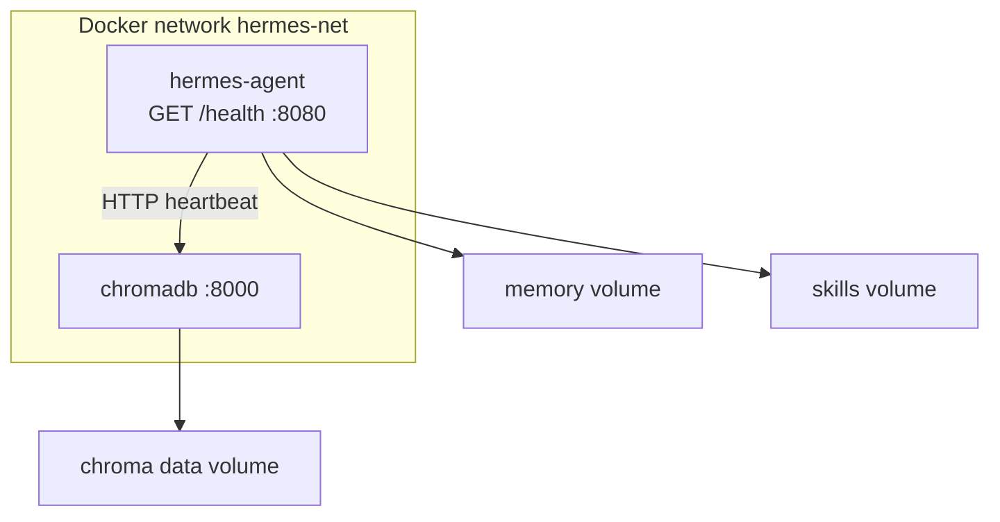

# Hermes Agent

Hermes Agent is a containerized service with persistent memory, file-based skills, and a ChromaDB companion container. DEV, TEST, and PROD each have a Compose file. The runtime image is built for GitHub Container Registry as `ghcr.io/<owner>/hermes-agent:<tag>`.



The big picture of the four containers is [docs/architecture/overview.md](docs/architecture/overview.md). The detailed diagrams are in [docs/architecture/current.md](docs/architecture/current.md). The next increment, Jev as a System One layer Hermes calls rather than a replacement for its reasoner, is [docs/architecture/jev-system-one.md](docs/architecture/jev-system-one.md). Cursor connects to this API as an MCP client when `HERMES_MCP_ENABLED=on`. The default is `off`. Hermes does not call Cursor and does not use Cursor's LLM. The plan is [docs/architecture/cursor-account.md](docs/architecture/cursor-account.md). Grok uses that same MCP route on `api.hermes.newplanetit.com.au`. The dashboard at `hermes.newplanetit.com.au` stays on port 9119. `delegate_to_grok` can post one task to Grok when `HERMES_GROK_HANDOFF=on`. The default is `off`. The setup steps are [docs/architecture/grok-hermes.md](docs/architecture/grok-hermes.md).

## Run

Install and test on the host:

```bash
python -m pip install -e ".[dev]"
pytest -q -m "not integration"
```

Start the dev stack:

```bash
docker/scripts/deploy.sh dev
```

Health in development: `http://127.0.0.1:8080/health`

Production publishes the agent on host port **8569**. Chroma is not published. Health: `http://127.0.0.1:8569/health`

`POST /completions` with `{"prompt":"..."}` loads the skill index and sends one completion to the model provider named by `HERMES_MODEL_BASE_URL`, `HERMES_MODEL_NAME`, and `HERMES_MODEL_API_KEY`. In production, document, completion, and tool routes require `Authorization: Bearer <HERMES_API_TOKEN>`. `POST /tools` runs an allowlist and asks a person before `delete_memory`. Shadow logs a `tool-call` judgment and still runs that allowlist. Soft holds a call unless Jev picked it and the score is clear. A Jev error in soft asks a person instead of running. Shadow and soft log a `model-router` tier and still call the frontier model named by `HERMES_MODEL_NAME`. Shadow logs a `supervisor` judgment and still returns the same tool results and the same completion text. Soft stops tool calls that follow a looping judgment and still returns the completion text. `GET /health` stays open and reports `jev.mode` (default `off`) and `jev.configured`. It omits `HERMES_JEV_API_KEY`. Completions call Jev when `HERMES_JEV_MODE` is `shadow` or `soft`. Shadow logs a skill suggestion and still sends the full skill index. Soft mode adds a `skill_relevance` block the model may ignore, and the skill index stays in the prompt. Search in those modes logs a passage judgment. Shadow returns every Chroma neighbor. Soft returns passages whose relevance score reaches the helping level. Shadow completions log a guardrail route and still return the model text. Soft completions withhold that text on review or block. Shadow memory writes log a kind and still store the record. Soft skips one-shot chatter. A Jev error still stores the record.

| Environment | Command |
| --- | --- |
| DEV | `docker/scripts/deploy.sh dev` |
| TEST | `docker/scripts/deploy.sh test` |
| PROD | `docker/scripts/deploy.sh prod` |

A step-by-step install for Ubuntu Server 24.04 and newer is in [docs/deployment/ubuntu-server.md](docs/deployment/ubuntu-server.md). Deployment detail is in [docs/deployment/docker.md](docs/deployment/docker.md). Environment variables are in [docs/deployment/environments.md](docs/deployment/environments.md). Image publish steps are in [docs/deployment/ghcr.md](docs/deployment/ghcr.md).

## Layout

- `src/` agent, API, memory, skills, Chroma client, CLI
- `docker/` Dockerfile, Compose files, env templates, scripts
- `storage/memory` and `storage/skills` host paths used by the dev bind mounts
- `vector-db/` Chroma connection notes
- `docs/` architecture, deployment, and testing
- `.github/workflows/` CI

## CLI

```bash
hermes health
hermes skills
```

`hermes health` prints JSON. `chroma.reachable` is false when Chroma is down; the process status stays `ok`.
