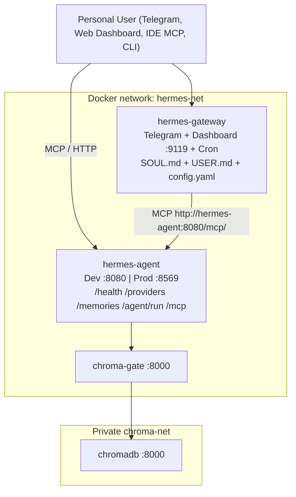

# Hermes Agent

> **Builder & Runner Agents:** Read [AGENTS.md](AGENTS.md) first before modifying code, running services locally, configuring Telegram/OAuth providers, or deploying to Ubuntu Server.

**Hermes Agent** is a lean, self-hosted **Personal Assistant OS** for everyday use across work and software engineering, daily productivity and habits, non-custodial personal finance tracking, and knowledge management.

It connects two Docker Compose services over Model Context Protocol (`/mcp/`):
1. **`hermes-agent` (this Python repository — `FastAPI` + `MCP` + `ChromaDB`)**: persistent dotted-namespace memory (`profile.*`, `work.*`, `dev.*`, `goal.*`, `habit.*`, `study.*`, `finance.*`, `ops.*`), semantic RAG (`hermes-documents-v2`), file-based `SKILL.md` skills, and an autonomous multi-step loop (`POST /agent/run`).
2. **`hermes-gateway` (`nousresearch/hermes-agent:latest`)**: always-on **Telegram Bot**, **Web Dashboard** (`:9119`), scheduled cron briefings, `SOUL.md` / `USER.md` identity, and multi-provider OAuth/API routing synced to `hermes-agent` over MCP.



## Documentation

- **Builder & Runner Manual (complete end-to-end spec):** [AGENTS.md](AGENTS.md)
- **Ubuntu Server 24.04+, Telegram & Provider Setup Guide:** [docs/DEPLOYMENT.md](docs/DEPLOYMENT.md)
- **Changelog:** [docs/CHANGELOG.md](docs/CHANGELOG.md)
- **ChromaDB service notes:** [vector-db/chromadb/README.md](vector-db/chromadb/README.md)

## Quick Start

### 1. Personalize & Run Locally (Windows / Linux)

Edit [gateway/USER.md](gateway/USER.md) and copy `.env.example` → `.env.local` (add your OpenRouter or Google AI Studio API key and local `HERMES_TIMEZONE`):

```powershell
# Windows (.venv)
python -m venv .venv
.\.venv\Scripts\pip install -e ".[dev]"
.\.venv\Scripts\pytest -q -m "not integration"

Copy-Item .env.example .env.local
.\scripts\start-local.ps1
```

### 2. Docker Compose Stack (`dev`, `test`, `prod`)

```bash
# Development stack (agent :8080, chromadb :8000)
bash docker/scripts/deploy.sh dev

# Offline CI-style test suite inside Docker
bash docker/scripts/deploy.sh test

# Production Ubuntu VPS (agent :8569, dashboard :9119, gateway :8642)
bash docker/scripts/deploy.sh prod
bash docker/scripts/bootstrap-gateway.sh --force-config
```

## Providers & Official Gemini Subscription Status

- **Live today on `hermes-agent` & `hermes-gateway`:** OpenRouter (`google/gemini-2.5-flash` / `~google/gemini-flash-latest`), Google AI Studio API (`GOOGLE_API_KEY` / `GEMINI_API_KEY`), NVIDIA NIM free fallback & compression (`nvidia/nemotron-3.5-super-vl-120b-a12b`), GitHub Copilot (`gpt-5.4`), plus **Claude Pro/Max OAuth**, **ChatGPT/Codex OAuth**, and **Nous Portal** inside `hermes-gateway` (`hermes model` / `hermes setup --portal`).
- **Gemini Subscriptions (official status):** Today Gemini in Hermes runs on an API key, not consumer Gemini plans. Nous Research is working with Google to bring Gemini subscriptions into Hermes the Google-approved way (**not live yet, no release date**). Inspect readiness anytime via `GET /providers`, `GET /health`, or `hermes providers`.

## Key Endpoints & CLI

- **HTTP / MCP:** `GET /health`, `GET /providers`, `GET /memories`, `GET /memory/search`, `POST /documents`, `GET /documents/search`, `POST /completions`, `POST /agent/run`, `POST /tools`, and `/mcp` (9 shared tools; `delete_memory` stays off `/mcp` and requires confirmation).
- **CLI:** `hermes health`, `hermes providers`, `hermes skills`, `hermes memories`, `hermes remember`, `hermes recall`, `hermes run "..."`, `hermes migrate-documents`, `hermes reindex-memory`.

## Repository Layout

- [AGENTS.md](AGENTS.md) — Authoritative builder/runner setup, deploy, Telegram, provider & verification handbook
- `gateway/` — Everyday personal templates (`SOUL.md`, `USER.md`, `config.yaml.example`, `cron.yaml.example`)
- `src/` — Agent loop, generic profile loader, timezone utilities, FastAPI + MCP server, memory, RAG, CLI
- `storage/skills/` — 5 concise everyday skills (`autonomous-problem-solver`, `bootstrap-hermes-stack`, `personal-development-coach`, `personal-financial-advisor`, `software-engineering-architect`)
- `docker/` — `Dockerfile`, `docker-compose.{dev,test,prod}.yml`, env templates, deploy & gateway sync scripts
- `scripts/` — Windows local launcher (`start-local.ps1`) and retrieval evaluator (`eval_retrieval.py`)
- `docs/` — Operator deployment guide ([DEPLOYMENT.md](docs/DEPLOYMENT.md)) & changelog ([CHANGELOG.md](docs/CHANGELOG.md))
