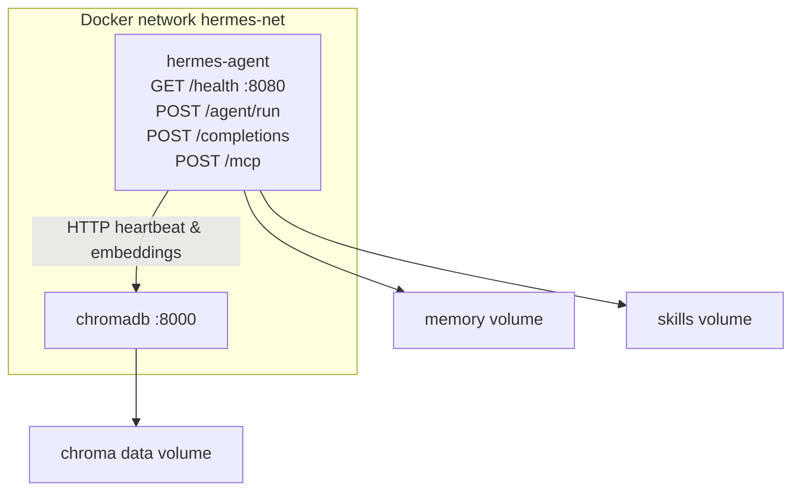

# Hermes Agent

Hermes Agent is a containerized Python AI agent service (`FastAPI` + `MCP` + `ChromaDB`) with persistent memory, file-based skills, semantic RAG search, and an autonomous multi-step tool-calling loop. DEV, TEST, and PROD each have a Compose file. The runtime image is built for GitHub Container Registry as `ghcr.io/sadramst/hermes-agent:<tag>`.



The big picture of the four containers is [docs/architecture/overview.md](docs/architecture/overview.md). The detailed diagrams are in [docs/architecture/current.md](docs/architecture/current.md). The optional System-One layer is [docs/architecture/jev-system-one.md](docs/architecture/jev-system-one.md). Antigravity, Cursor, and other MCP clients connect to this API at `/mcp` when `HERMES_MCP_ENABLED=on` (default `off`); see [docs/architecture/cursor-account.md](docs/architecture/cursor-account.md). External channel handoffs on `api.hermes.sadramst.dev` and the dashboard at `hermes.sadramst.dev` (port 9119) are documented in [docs/architecture/grok-hermes.md](docs/architecture/grok-hermes.md).

## Quick Start (Windows / Local & Docker)

### 1. Native Windows `.venv`

```powershell
python -m venv .venv
.\.venv\Scripts\pip install -e ".[dev]"
.\.venv\Scripts\pytest -q -m "not integration"

# Copy .env.example to .env.local, add your OpenRouter key, and start the local server:
Copy-Item .env.example .env.local
.\scripts\start-local.ps1
```

### 2. Docker Compose Stack

```bash
# Start local Docker dev stack (agent on :8080, Chroma on :8000)
docker/scripts/deploy.sh dev
# Or on Windows PowerShell:
.\scripts\start-local.ps1 -Docker
```

Health in development: `http://127.0.0.1:8080/health`

Production publishes the agent on host port **8569**. Chroma is not published on the host. Health: `http://127.0.0.1:8569/health`

## API & Autonomous Multi-Step Loop

- **`POST /agent/run`** (`{"prompt": "...", "max_steps": 4}`): Runs the full multi-step OpenAI-compatible tool-calling loop (`HermesAgent.run_agent`). The model can autonomously invoke allowlisted tools across multiple turns (`recall`, `remember`, `search_memory`, `search_documents`, `save_document`, `list_skills`, `read_skill`), enforce human-in-the-loop holds on irreversible tools (`delete_memory`), and synthesize a grounded final answer with step traces (`steps`).
- **`POST /completions`** (`{"prompt": "...", "autonomous": false}`): Loads the skill index (plus optional retrieved RAG context when `HERMES_RAG_MODE=soft`) and sends a single completion—or runs the full multi-step tool loop when `"autonomous": true` is passed.
- **`POST /documents`** & **`GET /documents/search`**: Chunk, embed, and search documents in ChromaDB with hybrid vector + keyword fusion.
- **`GET /memory/search`**: Search indexed memory files by meaning when `HERMES_MEMORY_INDEX=on`.
- **`POST /tools`**: Execute an allowlisted batch of tool calls directly (`recall`, `remember`, `search_memory`, `search_documents`, `save_document`, `list_skills`, `read_skill`, `delete_memory`, `delegate_to_grok`).
- **`/mcp`**: Streamable HTTP MCP server when `HERMES_MCP_ENABLED=on`.

| Environment | Command |
| --- | --- |
| DEV | `docker/scripts/deploy.sh dev` |
| TEST | `docker/scripts/deploy.sh test` |
| PROD | `docker/scripts/deploy.sh prod` |

A step-by-step install for Ubuntu Server 24.04 and newer is in [docs/deployment/ubuntu-server.md](docs/deployment/ubuntu-server.md). Deployment detail is in [docs/deployment/docker.md](docs/deployment/docker.md). Environment variables are in [docs/deployment/environments.md](docs/deployment/environments.md). Image publish steps are in [docs/deployment/ghcr.md](docs/deployment/ghcr.md).

## Layout

- `src/` — Agent core & autonomous loop, FastAPI + MCP server, memory store, skills loader, Chroma & embedding clients, CLI
- `docker/` — Dockerfile, Compose files (`dev`, `test`, `prod`), env templates (`.env.dev`, `.env.prod.example`, `.env.agent.example`, `.env.gateway.example`), scripts
- `storage/memory` & `storage/skills` — Persistent memory files and `SKILL.md` definitions (`bootstrap-hermes-stack`, `autonomous-problem-solver`)
- `scripts/` — Windows local launcher (`start-local.ps1`) and evaluation scripts
- `vector-db/` — Chroma connection notes and config
- `docs/` — Architecture, deployment, and testing documentation
- `.github/workflows/` — GitHub Actions CI/CD

## CLI

```bash
hermes health
hermes skills
hermes run "Summarize our deployment ports and save a note" --max-steps 4
hermes migrate-documents --from hermes-documents
hermes reindex-memory
```
