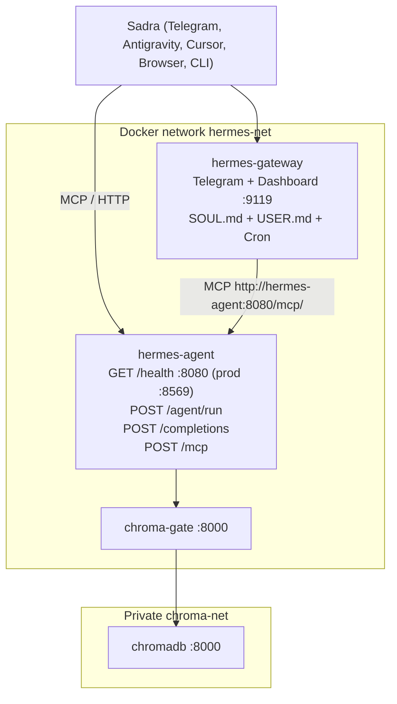

# Hermes Agent — Personal Assistant OS (`Sadramst`)

Hermes Agent is Sadra Tabarestani's permanent personal assistant stack across **software engineering & VPS operations**, **personal development & daily execution**, **personal financial advisory & tracking**, and **Telegram + IDE knowledge sync**.

It combines two tightly integrated Docker Compose services:
1. **`hermes-agent` (this Python repository — `FastAPI` + `MCP` + `ChromaDB`)**: persistent dotted-namespace memory (`profile.*`, `work.*`, `dev.*`, `goal.*`, `habit.*`, `study.*`, `finance.*`, `ops.*`), semantic RAG document store (`hermes-documents-v2`), file-based `SKILL.md` skills, and an autonomous multi-step tool loop (`POST /agent/run`).
2. **`hermes-gateway` (`nousresearch/hermes-agent:latest`)**: persistent **Telegram Bot**, **Web Dashboard** (`https://hermes.sadramst.dev` on `:9119`), scheduled cron briefings, `SOUL.md` / `USER.md` identity, and multi-provider OAuth/API routing connected back to `hermes-agent` over MCP (`/mcp/`).

The runtime image is built for GitHub Container Registry as `ghcr.io/sadramst/hermes-agent:<tag>`.



## Documentation

- **Documentation index:** [docs/README.md](docs/README.md)
- **Personal Assistant OS & memory namespaces:** [docs/architecture/personal-assistant.md](docs/architecture/personal-assistant.md)
- **Telegram personal assistant & cron setup:** [docs/architecture/telegram-gateway.md](docs/architecture/telegram-gateway.md)
- **Providers, OAuth subscriptions & Gemini status:** [docs/architecture/providers-and-subscriptions.md](docs/architecture/providers-and-subscriptions.md)
- **Ubuntu Server 24.04+ install & operations:** [docs/deployment/ubuntu-server.md](docs/deployment/ubuntu-server.md)
- **Changelog:** [docs/changelogs/CHANGELOG.md](docs/changelogs/CHANGELOG.md)

## Latest Hermes Provider & Gemini Subscription Status

- **Live today on `hermes-agent` & `hermes-gateway`:** OpenRouter (`google/gemini-2.5-flash` / `~google/gemini-flash-latest`), Google AI Studio API (`GOOGLE_API_KEY` / `GEMINI_API_KEY`), NVIDIA NIM free fallback & compression (`nvidia/nemotron-3.5-super-vl-120b-a12b`), GitHub Copilot (`gpt-5.4`), plus **Claude Pro/Max OAuth**, **ChatGPT/Codex OAuth**, and **Nous Portal** inside `hermes-gateway` (`hermes model` / `hermes setup --portal`).
- **Gemini Subscriptions (Coming Soon — Official Status):** Today Gemini in Hermes runs on an API key, not consumer Gemini plans. Nous Research is working with Google to bring Gemini subscriptions into Hermes in an officially Google-approved way (not live yet, no date). This repository strictly avoids unofficial consumer-plan scrapers and documents the clean upgrade path in [docs/architecture/providers-and-subscriptions.md](docs/architecture/providers-and-subscriptions.md).

## Quick Start (Windows Workstation & Ubuntu VPS)

### 1. Native Windows `.venv` (Local Development & CLI)

```powershell
python -m venv .venv
.\.venv\Scripts\pip install -e ".[dev]"
.\.venv\Scripts\pytest -q -m "not integration"

# Copy .env.example to .env.local, paste your OpenRouter or Google AI Studio key, and start:
Copy-Item .env.example .env.local
.\scripts\start-local.ps1
```

### 2. Docker Compose Stack (DEV / TEST / PROD)

```bash
# Local Docker dev stack (agent on :8080, Chroma on :8000)
bash docker/scripts/deploy.sh dev

# Production VPS stack (agent on :8569, dashboard on :9119, gateway API on :8642)
bash docker/scripts/deploy.sh prod
# Sync Sadra's gateway SOUL.md, USER.md, and config.yaml into hermes-gateway:
bash docker/scripts/bootstrap-gateway.sh
```

- Development health: `http://127.0.0.1:8080/health`
- Production health: `http://127.0.0.1:8569/health` (`https://api.hermes.sadramst.dev/health`)
- Production dashboard: `https://hermes.sadramst.dev` (host port **9119**)

## API, MCP & Autonomous Multi-Step Loop

- **`POST /agent/run`** (`{"prompt": "...", "max_steps": 4}`): Injects Sadra's personal `SOUL.md` / `USER.md` (`HERMES_PROFILE_DIR`) and `HERMES_TIMEZONE` clock context as a `system` message, then runs the OpenAI-compatible multi-step tool loop (`recall`, `remember`, `list_memories`, `search_memory`, `search_documents`, `save_document`, `list_skills`, `read_skill`, `current_time`). Irreversible tools (`delete_memory`) enforce human confirmation (`ask_person`).
- **`POST /completions`** (`{"prompt": "...", "autonomous": false}`): Prefixes the skill index (plus optional RAG context when `HERMES_RAG_MODE=soft`) for single-shot completions, or delegates to `run_agent` when `"autonomous": true`.
- **`POST /documents` & `GET /documents/search`**: Chunk (1500 chars / 200 overlap), embed, and search documents in ChromaDB with hybrid vector + keyword RRF fusion.
- **`GET /memories` & `GET /memory/search`**: List memory keys by prefix (`?prefix=finance.`) or search indexed memories semantically (`HERMES_MEMORY_INDEX=on`).
- **`GET /providers` & `GET /health`**: Secret-free provider auth mode, timezone/profile readiness, and Gemini subscription status.
- **`POST /tools`**: Execute an allowlisted tool batch directly (`delete_memory` still requires `ask_person`).
- **`/mcp`**: Streamable HTTP MCP server (`HERMES_MCP_ENABLED=on`) exposing 9 shared tools (`complete`, `current_time`, `list_memories`, `list_skills`, `recall`, `remember`, `save_document`, `search_documents`, `search_memory`), keeping `delete_memory` strictly off `/mcp`.

## Repository Layout

- `gateway/` — Version-controlled personal assistant templates (`SOUL.md`, `USER.md`, `config.yaml.example`, `cron.yaml.example`)
- `src/` — Agent core & autonomous loop, personal profile loader, FastAPI + MCP server, memory store, skills loader, Chroma & embedder clients, CLI
- `storage/skills/` — Personal & stack skills (`autonomous-problem-solver`, `software-engineering-architect`, `personal-development-coach`, `personal-financial-advisor`, `telegram-assistant-ops`, `provider-and-subscription-routing`, `bootstrap-hermes-stack`)
- `docker/` — Dockerfile, Compose files (`dev`, `test`, `prod`), env templates, `deploy.sh`, `bootstrap-gateway.sh`, `cleanup-disk.sh`
- `scripts/` — Windows launcher (`start-local.ps1`) and retrieval eval script (`eval_retrieval.py`)
- `docs/` — Architecture, Telegram, provider/subscription, and Ubuntu deployment docs
- `vector-db/` — Chroma configuration & notes

## CLI

```bash
hermes health
hermes providers
hermes skills
hermes memories --prefix finance.
hermes remember goal.q4 "Ship personal assistant OS v0.5.0"
hermes recall goal.q4
hermes run "Summarize today's priorities from goal. and work. memories" --max-steps 4
hermes migrate-documents --from hermes-documents
hermes reindex-memory
```
