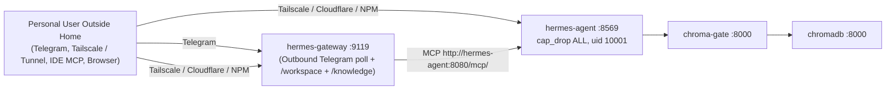

# Ubuntu Server 24.04+, Mini PC Brain, Telegram & Provider Deployment Guide

This guide deploys **Hermes Agent** (`hermes-agent` + `hermes-gateway` + `chroma-gate` + `chromadb`) on either an **always-on Mini PC Home Brain** (`minipc` overlay with mounted `/workspace` projects + `/knowledge` Brain vault) or a **cloud VPS** (`prod`) running Ubuntu Server 24.04+.

> **Agent Automation Note:** If you are using an AI coding/ops agent to configure or run your Mini PC or server, tell it to read [AGENTS.md](../AGENTS.md) and [MINIPC_ARCHITECTURE.md](MINIPC_ARCHITECTURE.md) first.

## Stack Topology

| Container | Role | Host Ports (`prod` / `minipc`) |
| --- | --- | --- |
| `hermes-agent` | FastAPI + MCP + Chroma RAG + Sandboxed Workspace Commander + Autonomous Loop. | **8569** |
| `hermes-gateway` | Nous personal gateway (`nousresearch/hermes-agent:latest`) running Telegram, Cron, and Web Dashboard. | **9119** (Dashboard), **8642** (Gateway API) |
| `chroma-gate` | Bearer-token proxy (`CHROMA_AUTH_TOKEN`) guarding `chromadb`. | None (internal Docker only) |
| `chromadb` | Vector database (`chromadb/chroma:1.0.0`). | None (private `hermes-prod-chroma-net`) |
| `cloudflared` | Optional public HTTPS Zero-Trust tunnel (`minipc` `--profile tunnel`). | None (outbound tunnel only) |



## 1. Install Docker on Ubuntu 24.04+

```bash
sudo apt-get update && sudo apt-get upgrade -y
sudo apt-get install -y ca-certificates curl git acl openssl

sudo apt-get remove -y docker.io docker-compose docker-compose-v2 docker-doc podman-docker containerd runc || true
sudo install -m 0755 -d /etc/apt/keyrings
sudo curl -fsSL https://download.docker.com/linux/ubuntu/gpg -o /etc/apt/keyrings/docker.asc
sudo chmod a+r /etc/apt/keyrings/docker.asc
echo "deb [arch=$(dpkg --print-architecture) signed-by=/etc/apt/keyrings/docker.asc] https://download.docker.com/linux/ubuntu $(. /etc/os-release && echo "$VERSION_CODENAME") stable" | sudo tee /etc/apt/sources.list.d/docker.list > /dev/null

sudo apt-get update
sudo apt-get install -y docker-ce docker-ce-cli containerd.io docker-buildx-plugin docker-compose-plugin
sudo systemctl enable --now docker
sudo usermod -aG docker "$USER"
```

Log out and back in, then clone your repository:

```bash
git clone https://github.com/Sadramst/hermes-agent.git ~/hermes-agent
cd ~/hermes-agent
```

## 2. Option A — Always-On Mini PC Home Brain Setup (Recommended)

1. Run the idempotent pre-flight setup (creates `.env.prod`, `.env.gateway`, `.env.minipc`, generates random tokens, and configures `workspace/` + `knowledge/` + `backups/` with `uid=10001` ACLs):
   ```bash
   bash docker/scripts/setup-minipc.sh --no-start
   ```
2. Customize [gateway/USER.md](../gateway/USER.md) and edit:
   - `docker/env/.env.prod`: set `HERMES_TIMEZONE`, `HERMES_MODEL_API_KEY` (+ optional `HERMES_EMBED_*`), Dashboard Basic Auth credentials, and `HERMES_MCP_ALLOWED_HOSTS` (include Tailscale MagicDNS node/port or Cloudflare hostname).
   - `docker/env/.env.gateway`: uncomment **only** keys you provide (`OPENROUTER_API_KEY`, `NVIDIA_API_KEY`, `GOOGLE_API_KEY`, `TELEGRAM_BOT_TOKEN`, `TELEGRAM_ALLOWED_USERS`).
   - `docker/env/.env.minipc`: point `HERMES_HOST_PROJECTS_DIR` and `HERMES_HOST_KNOWLEDGE_DIR` to your local projects and Obsidian/docs vault, set `HERMES_WORKSPACE_MODE=rw`, and optionally set `CLOUDFLARE_TUNNEL_TOKEN`.
3. Build, launch, sync identity, and index your Brain vault + projects:
   ```bash
   bash docker/scripts/deploy.sh minipc
   bash docker/scripts/bootstrap-gateway.sh --force-config
   bash docker/scripts/sync-brain.sh --projects
   ```

## 3. Option B — Cloud VPS Deployment (`prod`)

1. Copy env templates (`docker/env/.env.prod.example` → `docker/env/.env.prod`, `docker/env/.env.gateway.example` → `docker/env/.env.gateway`, `chmod 600`), generate 32-byte hex tokens via `openssl rand -hex 32`, and fill `GHCR_OWNER`, `IMAGE_TAG`, API keys, and `HERMES_MCP_ALLOWED_HOSTS`.
2. Deploy & sync gateway:
   ```bash
   bash docker/scripts/deploy.sh prod
   bash docker/scripts/bootstrap-gateway.sh --force-config
   ```

## 4. Access From Outside the House

1. **Telegram (Always Available):** Outbound HTTPS polling — zero router port-forwarding required.
2. **Tailscale Mesh VPN (Private Dashboard, API, `/mcp`, SSH):**
   ```bash
   curl -fsSL https://tailscale.com/install.sh | sh
   sudo tailscale up --ssh
   sudo tailscale serve --bg --https=443 http://127.0.0.1:9119
   sudo tailscale serve --bg --https=8443 http://127.0.0.1:8569
   ```
   Add `<node>.<tailnet>.ts.net` and `<node>.<tailnet>.ts.net:8443` to `HERMES_MCP_ALLOWED_HOSTS` inside `.env.prod`.
3. **Optional Cloudflare Tunnel (`--profile tunnel`):** Put `CLOUDFLARE_TUNNEL_TOKEN=...` in `.env.minipc`, add your public API domain to `HERMES_MCP_ALLOWED_HOSTS`, and run `bash docker/scripts/deploy.sh minipc`.
4. **Reverse Proxy (VPS / Nginx Proxy Manager):** Forward `https://<dashboard-domain>` → `:9119` and `https://<api-domain>` → `:8569` (WebSockets ON, preserve `Host` header for `/mcp`).

## 5. Telegram, OAuth Subscriptions & Official Gemini Status

### Telegram Setup
1. Open **`@BotFather`** → `/newbot` → copy `TELEGRAM_BOT_TOKEN`.
2. Optional: in `@BotFather` → **Bot Settings**, disable group invites if personal-only and enable **Threaded Mode** for DM topics (see [gateway/config.yaml.example](../gateway/config.yaml.example)).
3. Open **`@userinfobot`** → copy your numeric user ID into `TELEGRAM_ALLOWED_USERS`.
4. Add scheduled check-ins with `hermes cron` inside `hermes-gateway` using templates from [gateway/cron.yaml.example](../gateway/cron.yaml.example).

### Providers, OAuth Subscriptions & Gemini Subscriptions
- **Live today:** OpenRouter, Google AI Studio API key (`GOOGLE_API_KEY` / `GEMINI_API_KEY`), NVIDIA NIM free fallback, GitHub Copilot (`COPILOT_GITHUB_TOKEN`), **Claude Pro/Max OAuth**, **ChatGPT Plus/Pro OAuth** (`hermes model` inside `hermes-gateway`), and **Nous Portal** (`hermes setup --portal`).
- **Google Gemini Subscription (official status):** Gemini in Hermes currently runs on an **API key**, not consumer Gemini plans. Nous Research is working with Google on official Google-approved Gemini subscription OAuth (**not live yet, no release date**). Avoid unofficial consumer-plan bypasses; when Nous ships official support:
  ```bash
  docker compose --env-file docker/env/.env.prod --env-file docker/env/.env.gateway \
    -f docker/docker-compose.prod.yml pull hermes-gateway && \
  docker compose --env-file docker/env/.env.prod --env-file docker/env/.env.gateway \
    -f docker/docker-compose.prod.yml up -d hermes-gateway && \
  docker compose --env-file docker/env/.env.prod --env-file docker/env/.env.gateway \
    -f docker/docker-compose.prod.yml exec -it hermes-gateway hermes model
  ```

## 6. Routine Updates, Brain Sync & Backups

```bash
# Re-index knowledge/ and workspace project docs into ChromaDB
bash docker/scripts/sync-brain.sh --projects

# Compressed snapshot of memory, skills, ChromaDB, and gateway volumes (keeps latest 14)
bash docker/scripts/backup-brain.sh --keep 14

# Pull latest git changes and rebuild/restart Mini PC stack
git pull && bash docker/scripts/deploy.sh minipc
bash docker/scripts/bootstrap-gateway.sh

# Reclaim unused Docker build/image cache safely
bash docker/scripts/cleanup-disk.sh --dry-run
bash docker/scripts/cleanup-disk.sh
```
