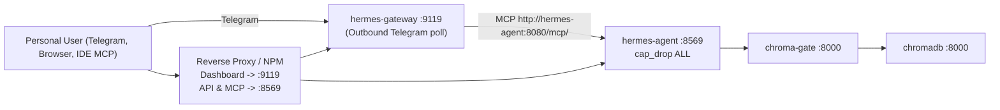

# Ubuntu Server 24.04+, Telegram & Provider Deployment Guide

This guide deploys **Hermes Agent** (`hermes-agent` + `hermes-gateway` + `chroma-gate` + `chromadb`) on Ubuntu Server 24.04+ using Docker Compose and Nginx Proxy Manager (or another TLS reverse proxy).

> **Agent Automation Note:** If you are using an AI coding/ops agent to configure or deploy this server, tell it to read [AGENTS.md](../AGENTS.md) first.

## Stack Topology

| Container | Role | Host Ports (PROD) |
| --- | --- | --- |
| `hermes-agent` | FastAPI + MCP + Chroma RAG + Autonomous Tool Loop (`ghcr.io/<owner>/hermes-agent`). | **8569** |
| `hermes-gateway` | Nous personal gateway (`nousresearch/hermes-agent:latest`) running Telegram, Cron, and Web Dashboard. | **9119** (Dashboard), **8642** (Gateway API) |
| `chroma-gate` | Bearer-token proxy (`CHROMA_AUTH_TOKEN`) guarding `chromadb`. | None (internal Docker only) |
| `chromadb` | Vector database (`chromadb/chroma:1.0.0`). | None (private `hermes-prod-chroma-net`) |



## 1. Install Docker on Ubuntu 24.04+

```bash
sudo apt-get update && sudo apt-get upgrade -y
sudo apt-get install -y ca-certificates curl git

sudo apt-get remove -y docker.io docker-compose docker-compose-v2 docker-doc podman-docker containerd runc || true
sudo install -m 0755 -d /etc/apt/keyrings
sudo curl -fsSL https://download.docker.com/linux/ubuntu/gpg -o /etc/apt/keyrings/docker.asc
sudo chmod a+r /etc/apt/keyrings/docker.asc
echo "deb [arch=$(dpkg --print-architecture) signed-by=/etc/apt/keyrings/docker.asc] https://download.docker.com/linux/ubuntu $(. /etc/os-release && echo "$VERSION_CODENAME") stable" | sudo tee /etc/apt/sources.list.d/docker.list > /dev/null

sudo apt-get update
sudo apt-get install -y docker-ce docker-ce-cli containerd.io docker-buildx-plugin docker-compose-plugin
sudo systemctl enable --now docker
sudo usermod -aG docker "$USER"
```

Log out and back in, then clone your repository (e.g. into `/opt/hermes-agent`):

```bash
sudo mkdir -p /opt/hermes-agent && sudo chown "$USER:$USER" /opt/hermes-agent
git clone https://github.com/Sadramst/hermes-agent.git /opt/hermes-agent
cd /opt/hermes-agent
```

## 2. Configure Profile & Environment Files

1. Customize [gateway/USER.md](../gateway/USER.md) (name, communication style, timezone preference, domains).
2. Generate tokens and create `docker/env/.env.prod`:
   ```bash
   cp docker/env/.env.prod.example docker/env/.env.prod
   chmod 600 docker/env/.env.prod
   openssl rand -hex 32   # CHROMA_AUTH_TOKEN
   openssl rand -hex 32   # HERMES_API_TOKEN
   openssl rand -hex 32   # HERMES_DASHBOARD_BASIC_AUTH_SECRET
   ```
   Fill in `HERMES_TIMEZONE`, `GHCR_OWNER`, `HERMES_MODEL_*`, optional `HERMES_EMBED_*`, and add your API hostname to `HERMES_MCP_ALLOWED_HOSTS` (e.g., `hermes-agent,api.hermes.example.com`).
3. Create and configure `docker/env/.env.gateway`:
   - `cp docker/env/.env.gateway.example docker/env/.env.gateway && chmod 600 docker/env/.env.gateway`
   - Uncomment **only** keys you actually populate (`OPENROUTER_API_KEY`, `NVIDIA_API_KEY`, `GOOGLE_API_KEY`, `TELEGRAM_BOT_TOKEN`, `TELEGRAM_ALLOWED_USERS`).
   - Leave unused lines commented so empty Compose variables never shadow `/opt/data/.env`.

## 3. Deploy & Sync Gateway

```bash
cd /opt/hermes-agent
bash docker/scripts/deploy.sh prod
bash docker/scripts/bootstrap-gateway.sh --force-config
```

Verify health, providers, and MCP:

```bash
curl -sS http://127.0.0.1:8569/health
docker compose --env-file docker/env/.env.prod --env-file docker/env/.env.gateway \
  -f docker/docker-compose.prod.yml exec hermes-gateway hermes mcp test hermes-api
```

Expected: `status: "ok"`, `chroma.reachable: true`, `assistant.profile_loaded: true`, `mcp.enabled: true`, and all 9 MCP tools (`complete`, `current_time`, `list_memories`, `list_skills`, `recall`, `remember`, `save_document`, `search_documents`, `search_memory`).

## 4. Telegram, OAuth Subscriptions & Official Gemini Status

### Telegram Setup
1. Open **`@BotFather`** → `/newbot` → copy `TELEGRAM_BOT_TOKEN`.
2. Optional: in `@BotFather` → **Bot Settings**, disable group invites if personal-only and enable **Threaded Mode** for DM topics (see [gateway/config.yaml.example](../gateway/config.yaml.example)).
3. Open **`@userinfobot`** → copy your numeric user ID into `TELEGRAM_ALLOWED_USERS`.
4. Add scheduled check-ins with `hermes cron` inside `hermes-gateway` using templates from [gateway/cron.yaml.example](../gateway/cron.yaml.example).

### Providers, OAuth Subscriptions & Gemini Subscriptions
- **Live today:** OpenRouter, Google AI Studio API key (`GOOGLE_API_KEY` / `GEMINI_API_KEY`), NVIDIA NIM free fallback, GitHub Copilot (`COPILOT_GITHUB_TOKEN`), **Claude Pro/Max OAuth**, **ChatGPT Plus/Pro OAuth** (`hermes model` inside `hermes-gateway`), and **Nous Portal** (`hermes setup --portal`).
- **Google Gemini Subscription (official status):** Gemini in Hermes currently runs on an **API key**, not consumer Gemini plans. Nous Research is working with Google on official Google-approved Gemini subscription OAuth (**not live yet, no release date**). Avoid unofficial consumer-plan bypasses; when Nous ships official support:
  ```bash
  docker compose --env-file docker/env/.env.prod --env-file docker/env/.env.gateway \
    -f docker/docker-compose.prod.yml pull hermes-gateway && \
  docker compose --env-file docker/env/.env.prod --env-file docker/env/.env.gateway \
    -f docker/docker-compose.prod.yml up -d hermes-gateway && \
  docker compose --env-file docker/env/.env.prod --env-file docker/env/.env.gateway \
    -f docker/docker-compose.prod.yml exec -it hermes-gateway hermes model
  ```

## 5. Reverse Proxy, Firewall & Maintenance

- **Dashboard:** Forward `https://<dashboard-domain>` → `http://<vps-ip>:9119` (WebSockets ON, SSL forced).
- **API & MCP:** Forward `https://<api-domain>` → `http://<vps-ip>:8569` (WebSockets ON, SSL forced, **preserve `Host` header** matching `HERMES_MCP_ALLOWED_HOSTS`).
- **Firewall:** Only open `OpenSSH`, `8569/tcp` (if proxied remotely), and `9119/tcp` (if proxied remotely). Telegram needs no inbound port.
- **Routine updates & cleanup:**
  ```bash
  git pull && bash docker/scripts/deploy.sh prod
  bash docker/scripts/bootstrap-gateway.sh
  bash docker/scripts/cleanup-disk.sh --dry-run
  bash docker/scripts/cleanup-disk.sh
  ```
