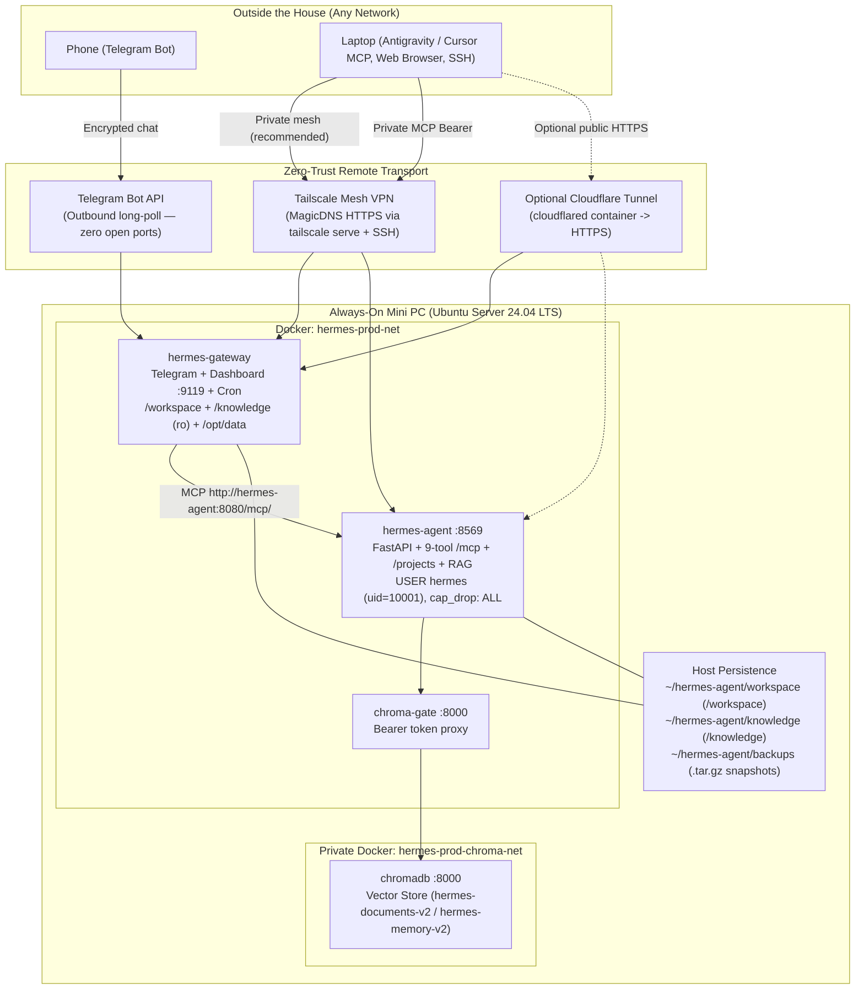

# Mini PC Home Brain & Multi-Project Architecture (`Sadramst`)

This blueprint defines how **Hermes Agent** runs continuously on a dedicated home Mini PC (`Ubuntu Server 24.04 LTS`), turning it into an always-on personal Brain LLM, knowledge store, and multi-project workspace commander reachable securely from anywhere outside the house.

---

## 1. End-to-End Topology



---

## 2. Two Complementary Brains + Project Control

| Layer | Storage / Mount | Purpose | Sync & Backup |
| --- | --- | --- | --- |
| **Structured Personal Memory** | `hermes-prod-memory` volume (`/app/storage/memory`) + optional `hermes-memory-v2` | Crisp dotted facts (`profile.*`, `work.*`, `dev.*`, `goal.*`, `habit.*`, `study.*`, `finance.*`, `ops.*`) across Telegram, Dashboard, IDE MCP, CLI. | Snapshot daily via `backup-brain.sh`. |
| **Semantic Knowledge Brain** | Host `knowledge/` -> `/knowledge:ro` + ChromaDB `hermes-documents-v2` | Long notes, Obsidian vault, books, runbooks, architecture specs, financial plans. Indexed cleanly with SHA-256 deduplication and `[label]` citations. | Run `bash docker/scripts/sync-brain.sh`. |
| **Multi-Project Commander** | Host `workspace/` -> `/workspace` (`rw` or `ro`) | Inspect files, search code, edit files, run tests/git inside ANY repository on your Mini PC via Telegram, Dashboard, HTTP `/projects/*`, or `hermes-agent` autonomous loop. | Host git + IDE + ACL `uid=10001` permissions. |

---

## 3. Defense-in-Depth Security Boundaries

Remote AI power requires strict guardrails so an external prompt or typo cannot leak credentials or wipe work:

1. **Authentication & Network Isolation:**
   - Default private-first access uses **Telegram `TELEGRAM_ALLOWED_USERS`** (outbound polling only, no exposed home IP/router ports) plus **Tailscale Mesh VPN** (`tailscale serve` TLS + Tailscale ACLs).
   - Optional **Cloudflare Tunnel (`cloudflared` profile)** gives public HTTPS without port-forwarding, protected by `HERMES_API_TOKEN` bearer auth (`>= 32` chars), Dashboard Basic Auth, and `HERMES_MCP_ALLOWED_HOSTS` DNS-rebinding checks.
   - `chromadb` never sits on the public/application network — all vector queries flow through `chroma-gate` (`CHROMA_AUTH_TOKEN`).
2. **Secret File Denylist (Workspace & Brain Ingestion):**
   - `WorkspaceManager` and `ingest_directory` unconditionally block `.git/**`, `.env`, `.env.*` (except `.env.*.example` / `.env.*.sample`), `auth.json`, `credentials.json`, SSH keys (`id_*`), and certificate/keystore extensions (`.pem`, `.key`, `.p12`, `.pfx`, `.jks`, `.keystore`, `.kdbx`).
   - Absolute paths, `..` traversal, and symlinks pointing outside a project root are rejected (`403`).
3. **Allowlisted Non-Shell Command Execution:**
   - `run_project_command` executes binaries with `shell=False` strictly against `HERMES_WORKSPACE_ALLOWED_CMDS` (default: `git`, `pytest`, `python3`, `python`, `ruff`, `npm`, `node`, `ls`, `find`, `make`, `cat`, `head`, `tail`, `wc`). Path-qualified binaries (`/bin/sh`) are forbidden.
4. **Irreversible Action Confirmation Gates (`ask_person`):**
   - `delete_memory` and destructive commands (`rm`, `rmdir`, `shred`, `dd`, `mkfs`, `sudo`, `shutdown`, `reboot`, `git push --force`, `git reset --hard`, `git clean -f`, `git branch -D`, `git checkout .`, `git restore .`) halt autonomous execution with `ask_person` (`409` on HTTP) and require explicit human approval.
5. **MCP Surface Invariant:**
   - Streamable HTTP `/mcp` preserves the exact 9-tool contract (`complete`, `current_time`, `list_memories`, `list_skills`, `recall`, `remember`, `save_document`, `search_documents`, `search_memory`).

---

## 4. Hardware & OS Always-On Reliability (Mini PC)

Apply these one-time host settings so the Mini PC recovers automatically after power cuts or kernel updates:

1. **BIOS / UEFI Power Recovery:** Enable **Restore on AC Power Loss -> Power On** (sometimes called *AC Back -> Always On*) so the Mini PC boots immediately when power returns.
2. **Linux Services Auto-Start:**
   - `sudo systemctl enable --now docker` (all Compose services have `restart: unless-stopped`)
   - `sudo systemctl enable --now tailscaled` (keeps remote VPN & SSH up before user login)
3. **Host File Permissions (`uid=10001` ACL):**
   - `hermes-agent` runs as non-root `USER hermes` (`uid=10001`). Running `bash docker/scripts/setup-minipc.sh` uses `setfacl` so both your host SSH user and `uid=10001` read/write `workspace/` cleanly without chown loops.
4. **Automated Unattended OS Security Updates:**
   - `sudo apt-get install -y unattended-upgrades && sudo dpkg-reconfigure -plow unattended-upgrades`
5. **Automated Daily Brain Sync & Backups (Host Cron):**
   ```cron
   30 2 * * * cd /opt/hermes-agent && bash docker/scripts/sync-brain.sh >> /var/log/hermes-sync.log 2>&1
   0 3 * * *  cd /opt/hermes-agent && bash docker/scripts/backup-brain.sh --keep 14 >> /var/log/hermes-backup.log 2>&1
   ```
