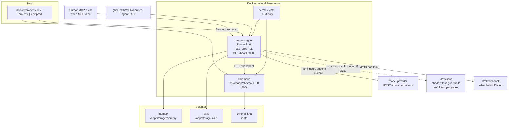
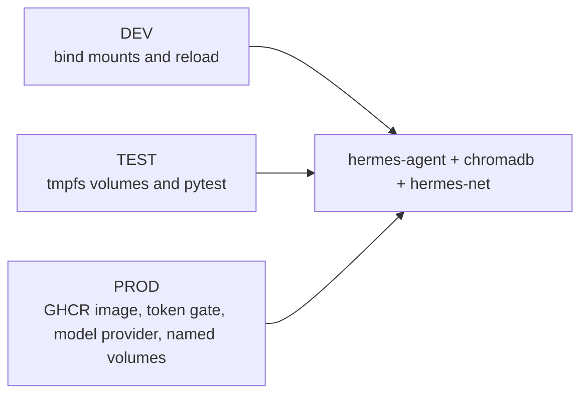

# Current architecture

The plain-language map of the four containers is [overview.md](overview.md).

The Hermes Agent runs as a container on a dedicated Docker network with ChromaDB. Memory and skills persist on mounted storage. Embeddings persist on the Chroma data volume. Completion requests go to a model provider configured by environment variables. `POST /completions` still makes one generative call. Hermes code loads the skill index from `storage/skills/*/SKILL.md` and prefixes it onto the caller's prompt before that call. Chroma search joins the completion path only when `HERMES_RAG_MODE` is `soft`; memory stays off it. A Jev client exists for `POST /v1/systemone`. `HERMES_JEV_MODE` defaults to `off`, which makes no Jev call. Shadow mode calls the skill-suggestion pack, logs the winner next to the skill names already in the prompt, and leaves that prompt unchanged. Soft mode calls the same pack and inserts a `skill_relevance` block between the skill index and the request. The model may ignore that block. The full skill index stays in the prompt. `GET /documents/search` still runs when Jev is down. Shadow logs a `chroma-passage` judgment and returns every Chroma neighbor. Soft returns only passages whose relevance score reaches the level that says the passage states an answer. Completions in shadow and soft log a `guardrails` route for the caller prompt and the model reply. Shadow still returns the model text. Soft withholds that text on `review` or `block`, and a Jev error on that pack logs `review` and withholds it too. Shadow memory writes log a kind and still store the record. Soft skips one-shot chatter. A Jev error on that pack still stores the record. Mode off makes no Jev call on search. `POST /tools` runs an allowlist in code, stops at a step limit, and asks a person before `delete_memory`. Shadow logs a `tool-call` judgment and still runs that allowlist. Soft holds a call unless Jev picked it and the score is clear. A Jev error in soft asks a person instead of running. `delete_memory` still asks a person. Shadow and soft log a `model-router` tier for a completion. Shadow always calls the frontier model named by `HERMES_MODEL_NAME`. Soft may call `HERMES_MODEL_SMALL` when that env is set and the judge returns tier `small` with reason `ok`; otherwise soft stays on `HERMES_MODEL_NAME`. Low confidence logs frontier. Production runs soft with `HERMES_MODEL_SMALL` unset. Shadow and soft log a `supervisor` judgment for a tool batch and for a completion. The judgment names whether the steps are looping and whether the gathered evidence looks complete. Shadow still returns the same tool results. Soft stops calls that follow a looping judgment. The completion text and the step limit stay unchanged. The model reply stays out of that judgment. A Jev error still returns the original tool result.

Inside the Docker network the agent listens on port 8080 and Chroma listens on port 8000. Development publishes those same ports on the host. Production publishes host port 8569 for the agent (`8569:8080`) and does not publish Chroma. The agent reaches Chroma through `chroma-gate`, which checks `Authorization: Bearer <CHROMA_AUTH_TOKEN>` and is the only container that can open a connection to `chromadb`.

`POST /documents`, `GET /documents/search`, `GET /memory/search`, `POST /completions`, and `POST /tools` require `Authorization: Bearer <HERMES_API_TOKEN>` when that variable is set. Production requires it. `GET /health` stays open for the container healthcheck and omits tokens, the model key, and `HERMES_JEV_API_KEY`. It reports `jev.mode`, `jev.configured`, `mcp.enabled`, and `grok.handoff`. Compose runs the agent with `cap_drop: ALL`. On startup the process checks that `HERMES_PORT` is 1024 or higher and that the memory directory is writable, then it serves.

`HERMES_MCP_ENABLED` defaults to `off`. While it is off, `/mcp` answers 404 and the process makes no MCP handshake. When it is `on`, `/mcp` is a streamable HTTP MCP server that Cursor calls with the same bearer token. The tools are `list_skills`, `recall`, `remember`, `search_documents`, `search_memory`, `complete`, and `suggest_skill`. Each `search_documents` result starts with a `[label]` line the caller can cite. `delete_memory` is not one of them. `delegate_to_grok` is not one of them. `complete` still uses `HERMES_MODEL_NAME`. Hermes does not call Cursor and does not use Cursor's LLM. A process-wide cap of 60 requests in 60 seconds answers 429. An enabled server requires `HERMES_API_TOKEN` at startup. `HERMES_MCP_ALLOWED_HOSTS` names any public hostname besides localhost.

Documents are chunked before they are embedded: up to 1500 characters per chunk with a 200-character overlap, stored as `<doc-id>::<nnnn>` with `doc_id`, `chunk`, `doc_sha256`, `embedder`, and an optional `source`. Saving unchanged text skips the embedding call. Vectors come from the 64-dimension hash embedding until `HERMES_EMBED_BASE_URL`, `HERMES_EMBED_MODEL`, and `HERMES_EMBED_API_KEY` are set together. A provider moves the default collections to `hermes-documents-v2` and `hermes-memory-v2`, and `hermes migrate-documents --from hermes-documents` re-embeds the old rows. Search fetches twice the requested neighbors and reorders them with a keyword ranking before the `chroma-passage` pack. `HERMES_RAG_MODE` defaults to `off`, which makes no search on a completion. `shadow` searches with the prompt and logs the passage labels. `soft` adds a `## Context` block between the skill index and the request and returns the labels as `sources`. Passages are delimited, described as data, and trimmed to fit the prompt cap. Under Jev soft the block is screened by the inbound guardrail and dropped on `review` or `block`. A search failure completes without context. `HERMES_MEMORY_INDEX` defaults to `off`. `on` mirrors kept memory writes into the memory collection for `search_memory`, and `hermes reindex-memory` indexes existing files. Health reports `retrieval` with the mode, embedder name, and collections, and omits the embedding key.

`HERMES_GROK_HANDOFF` defaults to `off`. `delegate_to_grok` is on the `POST /tools` allowlist. The only argument is `task`, capped at 2000 characters. `off` refuses the call. `ask` asks a person and does not POST. `on` POSTs `handoffId` and `task` to `HERMES_GROK_WEBHOOK_URL` and returns the id when the status is 202. The webhook URL must be `https` and end in `/v1/channels/hermes/task`. Redirects are rejected. Health reports `grok.handoff` and omits the alias token. Production loads those values from `docker/env/.env.agent` on `hermes-agent` only.

## Component responsibilities

| Component | Path | Responsibility |
| --- | --- | --- |
| API | `src/api/` | FastAPI app, `GET /health`, document routes, `POST /completions`, `POST /tools`, optional `/mcp`, and the API credential |
| Agent | `src/agent/` | Loads skills and memory, probes Chroma, saves or searches documents, requests completions, and runs the tool allowlist. Completions assemble a skill index plus the caller prompt in `src/agent/prompt.py` |
| Model client | `src/services/model.py` | One OpenAI-compatible `POST /chat/completions` call. Redirects are rejected |
| Jev client | `src/services/jev.py` | One `POST /systemone` call. Redirects are rejected. Shadow and soft skill suggestion, the `chroma-passage` pack, `guardrails`, `memory-write`, `tool-call`, `model-router`, and `supervisor` call it. Mode off does not |
| Decisions | `src/agent/decisions/` | Fixed question packs, named state, compose, and the audit record. `ACTIVE_PACKS` is `skill-suggestion`, `chroma-passage`, `guardrails`, `memory-write`, `tool-call`, `model-router`, and `supervisor`. Shadow logs the suggestion. Soft adds a `skill_relevance` block the model may ignore. Soft search returns passages at the helping relevance level. Shadow search returns every neighbor. Guardrail routes are logged. Shadow returns the model reply. Soft withholds it on review or block. Shadow memory writes are logged and still stored. Soft skips one-shot chatter. A Jev error still stores the record. Shadow logs a tool-call judgment and still runs the allowlist. Soft holds a call unless Jev picked it and the score is clear. The model router logs a tier and the completion stays on `HERMES_MODEL_NAME`. The supervisor logs a loop and a completion judgment. Shadow leaves the tool results unchanged. Soft stops calls that follow a looping judgment. The completion text stays unchanged |
| Chroma client | `src/services/chroma.py` | Heartbeat, plus chunk upsert, delete, page, and query on one collection (`hermes-documents` by default) |
| Embedder | `src/services/embedder.py` | Hash vectors, or one OpenAI-compatible `POST /embeddings` call when the embed settings are set. Redirects are rejected |
| Chunking and fusion | `src/services/chunking.py`, `src/services/rerank.py` | Overlapping chunks with stable ids, and the keyword ranking fused into vector order |
| Context | `src/agent/context.py` | The delimited `## Context` block for `HERMES_RAG_MODE=soft` |
| Chroma gate | `src/services/chroma_gate.py` | Production bearer-token proxy. `chromadb/chroma:1.0.0` does not enforce tokens itself |
| Runtime check | `src/utils/runtime.py` | Confirms an unprivileged port and writable memory before serving |
| Memory | `src/memory/` | One file per key under the memory directory |
| Skills | `src/skills/` | Loads `storage/skills/*/SKILL.md` |
| CLI | `src/cli/` | `hermes health` and `hermes skills` |
| Settings | `src/utils/settings.py` | Reads environment variables, including the model provider, `HERMES_API_TOKEN`, `HERMES_JEV_MODE`, `HERMES_MCP_ENABLED`, and `HERMES_GROK_HANDOFF` |
| Grok client | `src/services/grok.py` | One POST of `handoffId` and `task`. Redirects are rejected. A 202 returns the handoff id |
| Chroma service | Compose `chromadb` | Stores embeddings on its data volume |
| Bootstrap skill | `storage/skills/bootstrap-hermes-stack/` | Describes how to bring the stack up |

The image build publishes the runtime stage to `ghcr.io/<owner>/hermes-agent:<tag>`. The Dockerfile's final stage is the test stage, so `docker/scripts/build.sh` passes `--target runtime`.
