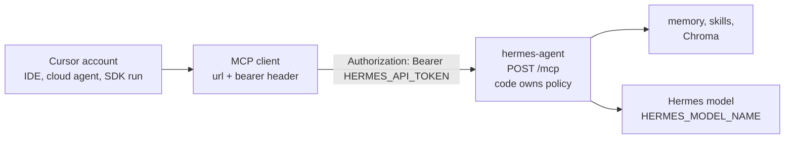

# Cursor connects to Hermes

Cursor opens the connection. The logged-in Cursor app calls this API over MCP. Hermes does not call Cursor, and Hermes does not use Cursor's LLM.

A reply inside Cursor is written by the model already selected in that Cursor chat. When that chat needs Hermes, Cursor calls a tool on `/mcp`. The `complete` tool still sends one generation to the provider named by `HERMES_MODEL_BASE_URL` and `HERMES_MODEL_NAME`. That provider is Hermes's own model. It is a different model from the one in the Cursor chat, and the call does not bill the Cursor account.

MCP is the account connection. The Cursor user adds this service as a remote MCP server. Hermes does not hold a Cursor API key, and it does not become a Cursor agent.

The Python SDK (`cursor-sdk` 1.0.38) is the wrong tool for this job. `Cursor.me()` does not call `https://api.cursor.com` from Python. It uses a default client that launches a vendored Node bridge (`cursor_sdk/_vendor/bridge/bin/node` and `cursor-sdk-bridge`) unless `CURSOR_SDK_BRIDGE_URL` is already set. That bridge's shell tools inherit the process environment. This container's environment holds `HERMES_API_TOKEN`, `HERMES_MODEL_API_KEY`, `HERMES_JEV_API_KEY`, and `CHROMA_AUTH_TOKEN`. A model-driven shell beside those secrets breaks the control split this repository already fixed.

Current running shape is [current.md](current.md). Jev stays the decision layer in [jev-system-one.md](jev-system-one.md).

## Why MCP

The logged-in Cursor account is already an MCP client. The IDE, a cloud agent, and an SDK run on that account can call tools on servers the user configured. Hermes is already an HTTP service with a bearer token, an allowlist, and Jev gates. MCP is the protocol those Cursor surfaces speak. No second loop is required.

| Path | What it binds | What it does to this process |
| --- | --- | --- |
| MCP remote server | The Cursor account calls Hermes | One more route on the existing FastAPI app. Same token, same allowlist, same Jev gates |
| Python SDK / Cloud Agents API | Hermes calls Cursor | A bridge or a second agent runtime. The SDK is not a `POST /chat/completions` API, so it cannot sit behind `HERMES_MODEL_NAME` |
| BDK (`@cursor/bdk`) | A new `bot/` project on the Cursor account | Replaces this Python loop. Memory would move to the host key-value store. Out of scope |



The Nous `hermes-gateway` container is not this connection. Cursor talks to the API in this repository (production host port 8569), not to the gateway dashboard on 9119 or the gateway API on 8642.

## What the user configures

The server definition lives with the Cursor user, not in this git repo. A committed `.cursor/mcp.json` would either omit the credential or check it in. Headers in that file are literal. Cursor does not treat them as environment references.

User-level `~/.cursor/mcp.json`, or the same shape in the Cursor dashboard for a team:

```json
{
  "mcpServers": {
    "hermes": {
      "url": "https://hermes.example/mcp",
      "headers": {
        "Authorization": "Bearer <HERMES_API_TOKEN>"
      }
    }
  }
}
```

Three reachability rules:

| Caller | URL that works |
| --- | --- |
| Cursor IDE on the same machine as the published port | `http://127.0.0.1:8080/mcp` in development, `http://127.0.0.1:8569/mcp` in production |
| Cursor cloud agent on that account | A public `https://` hostname. Cloud agents cannot open `127.0.0.1` on the Hermes host. Cursor's backend applies the `headers` and redacts them before the VM sees them |
| A service-account SDK run | No user OAuth fallback. The Hermes bearer still has to be passed as an HTTP header if that run should call Hermes |

`HERMES_API_TOKEN` stays the Hermes credential. A Cursor user API key, a service-account key, and a team admin key are not added to Compose.

## Server shape

Mount a streamable HTTP MCP app on the existing FastAPI process at `/mcp`. No second port, no second container, no stdio server inside the image. From `v0.3.6`, a request to bare `/mcp` is rewritten to `/mcp/` in-process (no **307**), so clients that drop `Authorization` on redirects still authenticate. Prefer the trailing-slash URL in client configs anyway.

`HERMES_MCP_ENABLED` defaults to `off`. While it is off, `/mcp` answers 404 and the process makes no MCP handshake. `GET /health` reports `mcp.enabled` and stays open. It still omits every token.

Production already requires `HERMES_API_TOKEN`. The MCP route uses that same `Authorization: Bearer` check. An enabled server with no token is a configuration error at startup, including in development, so a published URL cannot be anonymous.

Tools map onto methods the agent already runs. Names and argument keys stay the allowlist's names. The MCP handler does not grow its own policy.

| MCP tool | Existing path | Notes |
| --- | --- | --- |
| `list_skills` | tool allowlist | No arguments |
| `recall` | tool allowlist | `key` only |
| `remember` | tool allowlist | `key` and `value`. The memory-write gate still applies |
| `search_documents` | `GET /documents/search` | The chroma-passage gate still applies |
| `complete` | `POST /completions` | One generative call on `HERMES_MODEL_NAME`. Guardrails still apply |

`delete_memory` is not an MCP tool. It asks a person and does not delete. An MCP session has no person sitting on that route.

Jev mode is unchanged. `off` skips Jev. `shadow` logs. `soft` still filters passages, holds weak tool calls, and withholds a guarded completion. The MCP layer does not pass caller text into Jev question instructions.

A public `/mcp` needs a fixed request cap in code, reviewed the way `MAX_STEPS` is reviewed, before the hostname is reachable from the internet. The cap refuses the call. It does not queue work.

## What stays in code

- `HERMES_API_TOKEN`, `CHROMA_AUTH_TOKEN`, the model key, and the Jev key
- `HERMES_MODEL_NAME` and the single completion call
- The tool allowlist, the step limit, and the person gate on `delete_memory`
- Jev packs, thresholds, and fallbacks
- The Nous gateway image, its model, and its volume
- Redirect rejection on the model client and the Jev client

## Sequence

Each step is its own pull request.

0. **This plan.** Done. No `cursor-sdk` dependency.
1. **Disabled endpoint.** Done. Streamable HTTP is mounted at `/mcp` when `HERMES_MCP_ENABLED=on`. The default is `off`, and `/mcp` answers 404. Health reports `mcp.enabled`. An enabled server without `HERMES_API_TOKEN` fails at startup.
2. **Tool mapping.** Done. The five tools call the existing agent methods. `delete_memory` is absent. An unknown argument key is refused.
3. **Deployment note.** Done. The user `mcp.json`, the development and production URLs, and the public HTTPS requirement are in [docker.md](../deployment/docker.md). The token is not committed. The URL is this API, not `hermes-gateway`.

## Anti-patterns this plan rejects

| Anti-pattern | What happens | Rule |
| --- | --- | --- |
| `cursor-sdk` inside `hermes-agent` | `Cursor.me()` launches the Node bridge, and that bridge's shell inherits Hermes secrets | No Cursor SDK in this image |
| Cursor as `HERMES_MODEL_NAME` | The SDK and the Cloud Agents API are not a chat-completions API | Completions stay on the configured provider |
| BDK rewrite | The Python loop, file memory, and Chroma store are replaced | Hermes stays this service |
| MCP pointed at `hermes-gateway` | Cursor attaches to the Nous dashboard agent instead of this API | URL is this service's `/mcp` |
| Token in `.cursor/mcp.json` in git | The bearer becomes a repo secret | User config or the dashboard only |
| `delete_memory` exported | The person gate is skipped by a chat tool | Tool is absent |
| Anonymous `/mcp` | The published port is an open agent | Enabled MCP requires `HERMES_API_TOKEN` |
| Account key in the shared env file | `hermes-gateway` loads `docker/env/.env.prod` too | No `CURSOR_API_KEY` in that file |

## When the SDK would be a different project

A later job whose purpose is "Hermes starts a Cursor cloud agent against a GitHub repository" is not this connection. That job runs outside the `hermes-agent` container, with a user or service-account key that never shares a process with Hermes secrets. Team admin keys are not accepted by the SDK. Recheck the bridge behaviour if `cursor-sdk` moves past 1.0.38 before that job is designed. It does not change `HERMES_MODEL_NAME`, Jev, or this MCP server.

## Tests

Default CI stays offline.

- Unit: disabled route is 404, enabled route rejects a missing or wrong bearer, health omits tokens and reports `mcp.enabled`, registered tools are the five names above, `delete_memory` is absent, a bad argument key is refused, `complete` still goes through the guardrail path
- Contract: this file contains Mermaid, and `planned.md` links it
- No live Cursor account in CI

## Sources

- [Model Context Protocol in Cursor](https://cursor.com/docs/mcp)
- [MCP integrations](https://cursor.com/help/customization/mcp)
- [Cursor APIs](https://cursor.com/docs/api), including the note that the SDKs are not a chat-completions API
- [Cursor Python SDK](https://cursor.com/docs/sdk/python), authentication and MCP sections
- `cursor-sdk` 1.0.38 wheel: `Cursor.me()` in `cursor_sdk/_cursor.py` calls `_default_client()`, and `_default_client()` in `cursor_sdk/_client.py` calls `Bridge.launch()` when no bridge URL is set
