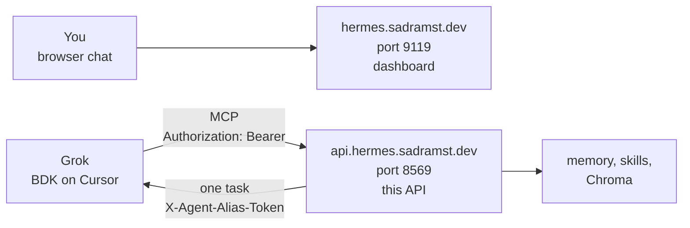

# Grok and Hermes

Grok calls this API. A later tool on this API hands one bounded task to Grok. The browser chat at `https://hermes.sadramst.dev` stays the Nous dashboard.

Completions on this service stay on `HERMES_MODEL_BASE_URL` and `HERMES_MODEL_NAME`. Grok's own turns stay on the Cursor account. The MCP server in [cursor-account.md](cursor-account.md) is already in the image and defaults to off.



## The hostname you have

`https://hermes.sadramst.dev` is the dashboard. Nginx Proxy Manager forwards that name to `http://192.168.16.113:9119`, as [ubuntu-server.md](../deployment/ubuntu-server.md) records. `GET /health` on that name returns the dashboard sign-in page.

The Python API listens on host port **8569**. `/mcp` is on that port when `HERMES_MCP_ENABLED=on`. That route is not behind the dashboard name.

| Name | Forwards to | What answers |
| --- | --- | --- |
| `hermes.sadramst.dev` | `192.168.16.113:9119` | Dashboard sign-in |
| `api.hermes.sadramst.dev` | `192.168.16.113:8569` | This API. JSON health. `/mcp` when enabled |
| `127.0.0.1:8569` on the server | the agent container | The same API, for checks on the machine |

Leave the dashboard name on port 9119. Add the `api` name for Grok and for any other MCP client.

## What each direction carries

| Direction | Call | Body | Credential |
| --- | --- | --- | --- |
| Grok to Hermes | `POST https://api.hermes.sadramst.dev/mcp` | One tool name and its arguments | `Authorization: Bearer <HERMES_API_TOKEN>` |
| Hermes to Grok | `POST $AGENT_ALIAS_URL/v1/channels/hermes/task` | `handoffId` and `task` | `X-Agent-Alias-Token` and `X-Hermes-Handoff` |

The task is the job text. Memory rows, Chroma passages, and tokens stay on this machine. During the turn, Grok calls MCP when it needs a fact. When the turn finishes, channel code writes one short memory. The key is `grok-result-<handoffId>`.

Cursor-managed hosting answers that webhook with `202` and an empty body before the handler runs. Hermes records the handoff id and returns. The completion that proposed the handoff does not wait for Grok.

`delete_memory` stays off MCP. An MCP session has no person on that route.

## Order

Finish each step before the next. Steps 1–4 are on the Hermes server. Step 5 is in the Grok project. Step 6 is in this service and stays off until you set it. Step 7 is a later pull request in the Grok project, after a live `list_skills` call succeeds.

### 1. Publish the API hostname

Add a DNS record for `api.hermes.sadramst.dev` on the same address as `hermes.sadramst.dev`.

In Nginx Proxy Manager, add a proxy host:

| Field | Value |
| --- | --- |
| Domain | `api.hermes.sadramst.dev` |
| Scheme | `http` |
| Forward hostname | `192.168.16.113` |
| Forward port | `8569` |
| Websockets support | on |
| SSL | Request a certificate and force SSL |

Send the original `Host` header upstream. A rewritten host of `192.168.16.113` makes `/mcp` answer **421**. Leave `hermes.sadramst.dev` pointed at port **9119**.

From a machine other than the server:

```bash
curl -sS https://api.hermes.sadramst.dev/health
curl -sS https://hermes.sadramst.dev/health | head -c 200
```

The API body is JSON and contains `mcp`. The dashboard body is HTML and contains `Sign in`. A failed API curl is a proxy or agent problem. Fix that before changing MCP settings.

### 2. Run an image that contains `/mcp`

The MCP server is on `main` at `ede1470`. Production runs `ghcr.io/$GHCR_OWNER/hermes-agent:$IMAGE_TAG`. Set `IMAGE_TAG` in `docker/env/.env.prod` to a build of that commit or a later one. On the server, from `/opt/hermes-agent`:

```bash
docker/scripts/deploy.sh prod
curl -sS http://127.0.0.1:8569/health
```

`mcp.enabled` is false until step 3. The field is present. Health still omits every token.

### 3. Turn MCP on for the API hostname

`docker/env/.env.prod` is gitignored. On the server, set:

```bash
HERMES_MCP_ENABLED=on
HERMES_MCP_ALLOWED_HOSTS=api.hermes.sadramst.dev
```

`HERMES_API_TOKEN` is already required in production. If that line is empty, generate one with `openssl rand -hex 32` and store it only in this file. An enabled MCP server with an empty token fails at startup.

Recreate the agent so it reads the file. The gateway can keep its current container:

```bash
docker compose --env-file docker/env/.env.prod \
  -f docker/docker-compose.prod.yml up -d hermes-agent
```

The code allows that hostname exactly, and it also allows `api.hermes.sadramst.dev:*`. Localhost is already allowed. At most eight hosts are accepted.

### 4. Prove the public MCP route

On the server:

```bash
curl -sS http://127.0.0.1:8569/health
```

`mcp.enabled` is true. The JSON has no token, model key, Jev key, or Chroma token.

From outside:

```bash
curl -sS https://api.hermes.sadramst.dev/health
curl -sS -o /dev/null -w '%{http_code}\n' \
  -X POST https://api.hermes.sadramst.dev/mcp \
  -H 'content-type: application/json' \
  -H 'accept: application/json, text/event-stream' \
  -d '{}'
```

The public health body matches the server. The POST without a bearer is **401**.

| Status | Meaning |
| --- | --- |
| 401 | The route is up and the bearer is required |
| 421 | `Host` is not `api.hermes.sadramst.dev` |
| 404 | `HERMES_MCP_ENABLED` is still off, or the proxy still points at 9119 |
| 429 | Sixty requests landed inside sixty seconds. The cap counts calls with no bearer |

A 403 that the server-local curl does not show is the proxy filtering the body. Adjust that proxy rule and repeat the POST.

The same URL and bearer go in a Cursor user's `~/.cursor/mcp.json` when the IDE should call Hermes too. Headers there are literal. That file stays out of git. The shape is in [cursor-account.md](cursor-account.md).

### 5. Point Grok at Hermes

This file belongs in the Grok BDK project. Name it `bot/mcp-connections/hermes.ts`. A file named `cursor.ts` is the wrong slot.

```ts
import { defineConnection } from "@cursor/bdk";

export default defineConnection({
  // Trailing slash: bare /mcp can 307 to /mcp/ and drop Authorization on hosted clients.
  url: "https://api.hermes.sadramst.dev/mcp/",
  headers: {
    Authorization: "Bearer ${HERMES_API_TOKEN}",
  },
  advertiseTools: true,
});
```

In `bot/agent.ts`, the hosting block names the egress host and the secret:

```ts
hosting: {
  egressDomains: ["api.hermes.sadramst.dev"],
  secretNames: ["HERMES_API_TOKEN"],
}
```

`${HERMES_API_TOKEN}` is the template text. Commit the template. Set the value after deploy, at the hidden prompt:

```bash
bdk secrets set <slug> HERMES_API_TOKEN
```

Deploy that git ref. Ask Grok to call `list_skills`. A skill list, or the sentence that no skills are loaded, means the connection works.

The tools Grok can call are `list_skills`, `recall`, `remember`, `search_documents`, and `complete`. `complete` uses `HERMES_MODEL_NAME`. `delete_memory` is absent. Jev mode is unchanged: `off` skips Jev, `shadow` logs, `soft` still filters.

Grok's instructions say to read Hermes with `recall` and `search_documents`, and to store a durable fact with `remember`. With the handoff left at `off`, a Hermes chat does not start a Grok turn. Grok can already use Hermes memory.

### 6. Hermes hands one task to Grok

`delegate_to_grok` is on the allowlist in `src/agent/tools.py`. It is absent from `/mcp`. The only argument key is `task`. The value is a string. A code constant caps it at 2000 characters, reviewed the way `MAX_STEPS` is reviewed. A longer task is refused.

Copy `docker/env/.env.agent.example` to `docker/env/.env.agent` on the server before the next production start. `deploy.sh prod` copies it when the file is missing. Put the webhook URL and the two secrets in that file, then set the mode.

The tool generates `handoffId` and POSTs this JSON:

```json
{"handoffId": "<id>", "task": "<task text>"}
```

The URL is `HERMES_GROK_WEBHOOK_URL`, which is the Grok alias URL plus `/v1/channels/hermes/task`. The headers are `X-Agent-Alias-Token: $HERMES_GROK_ALIAS_TOKEN` and `X-Hermes-Handoff: $HERMES_GROK_HANDOFF_SECRET`. The POST uses a short timeout. On HTTP 202 the tool result is the handoff id. Any other outcome is an error, and the tool does not claim that Grok accepted the job.

`HERMES_GROK_HANDOFF` controls the send:

| Value | What the tool does |
| --- | --- |
| `off` | Refuses. This is the default |
| `ask` | Returns the person-gate sentence and does not POST |
| `on` | POSTs the task and returns the handoff id |

The first production value is `ask`. Switch to `on` after one person-approved call returns a handoff id.

Those variables live in a new gitignored file, `docker/env/.env.agent`, loaded only by `hermes-agent`. `hermes-gateway` keeps loading `docker/env/.env.prod` and does not load `.env.agent`. The alias token stays out of the shared file.

`delegate_to_grok` is not an MCP tool. A Grok session does not hand work to itself through `/mcp`.

### 7. Grok writes the result back

This is a later pull request in the Grok project. The file is `bot/channels/hermes.ts`.

The route is `POST /task`, mounted at `/v1/channels/hermes/task`. The Zod body is `handoffId` and `task`, both strings, with the same 2000-character cap. `continuationToken` is `handoff:<handoffId>`, so a repeat of the same id resumes one conversation.

Channel auth is `sharedSecretAuth` on header `X-Hermes-Handoff` and secret `HERMES_GROK_HANDOFF_SECRET`. Leave `publicEndpoint()` unset. Managed hosting still requires `X-Agent-Alias-Token`. A missing alias token or a bad shared secret answers **401** before the handler runs. The handler returns `202`. Hosting sends that `202` before the handler runs, so Hermes never reads a session id from the HTTP response.

On `message.completed`, channel code calls Hermes MCP `remember` (not `POST /tools`). The key is `grok-result-<handoffId>`. The value is a short summary, capped in that same code. Soft tool-call does not hold MCP writes; soft memory-write still applies (`stored` required). An empty reply, or a finish reason of `tool_call`, writes nothing. The model may call `recall` and `search_documents` during the turn. The result write is code, so a forgotten tool call still stores it.

In the Hermes chat, `recall` with argument key `key` (not `query`) and value `grok-result-<handoffId>` shows the result.

### Ops notes (production)

| Item | Value |
| --- | --- |
| Cursor Teams id for `bdk deploy --team` | `60586919` (from Team settings; not a hex lookalike) |
| Hermes image that accepts Cursor nested webhook paths | `v0.3.5` or newer (`HERMES_GROK_WEBHOOK_URL` may end with `/v1/channels/hermes/task` under `/engine/…`) |
| Grok MCP URL | Prefer `…/mcp/`; Hermes `v0.3.6+` also accepts bare `/mcp` without a 307 |
| `POST /tools` recall | `{"name":"recall","arguments":{"key":"grok-result-<handoffId>"}}` |

## Where each secret lives

| Secret | Where it is set | Where it must not go |
| --- | --- | --- |
| `HERMES_API_TOKEN` | `docker/env/.env.prod` on the server, and `bdk secrets set` for Grok | Git, chat, `~/.cursor/mcp.json` committed to a repo |
| `HERMES_GROK_ALIAS_TOKEN` | `docker/env/.env.agent` on the agent service | `docker/env/.env.prod`, the gateway container, git |
| `HERMES_GROK_HANDOFF_SECRET` | `.env.agent` and `bdk secrets set` | Git, the task JSON, the dashboard container |
| `HERMES_GROK_WEBHOOK_URL` | `.env.agent` | The shared env file |

The first `bdk deploy` prints the alias token once. Store it in `.env.agent` with mode `0600`. `bdk rotate-token <slug>` replaces a lost token. A redeploy does not print it again.

## Anti-patterns this plan rejects

| Anti-pattern | What happens | Rule |
| --- | --- | --- |
| MCP URL on `https://hermes.sadramst.dev` | The client attaches to the dashboard on 9119 | API hostname, port 8569 |
| Alias token in `docker/env/.env.prod` | `hermes-gateway` loads that file | `.env.agent` on `hermes-agent` only |
| Memory or tokens inside the webhook | Private material leaves the machine inside the task | `handoffId` and `task` only |
| Hermes waits on the Grok reply | The completion hangs after hosting already returned 202 | Return the handoff id |
| `publicEndpoint()` on the channel | The route no longer requires the alias token | Alias token plus `X-Hermes-Handoff` |
| `cursor-sdk` in this image | The bridge inherits Hermes secrets | No Cursor SDK in this image |
| `delete_memory` on `/mcp` | The person gate is skipped | The tool stays absent |
| `delegate_to_grok` on `/mcp` | Grok can start another Grok turn | The tool is allowlist-only |
| Handoff mode `on` for the first call | A model send leaves the machine with no person | First runs stay on `ask` |

## Tests

Default CI stays offline (`pytest -q -m "not integration"`). The tool tests are in that run. The Grok channel in step 7 is still unbuilt.

- `off` refuses `delegate_to_grok`. `ask` does not open a socket. `on` POSTs `handoffId` and `task`, treats 202 as success, and treats anything else as an error
- The POST body has those two keys only
- Compose gives `.env.agent` to `hermes-agent` and leaves it off `hermes-gateway`
- This file keeps its Mermaid diagram, and [planned.md](planned.md) links it

## Sources

- [Webhooks](https://cursor.com/docs/bdk/guides/webhooks)
- [Channels](https://cursor.com/docs/bdk/reference/channels), including `sharedSecretAuth` and the hosted `202`
- [Deployment](https://cursor.com/docs/bdk/deployment), including `X-Agent-Alias-Token` on the alias URL
- [ubuntu-server.md](../deployment/ubuntu-server.md) for the dashboard proxy on port 9119
- [cursor-account.md](cursor-account.md) for the MCP server this plan turns on
