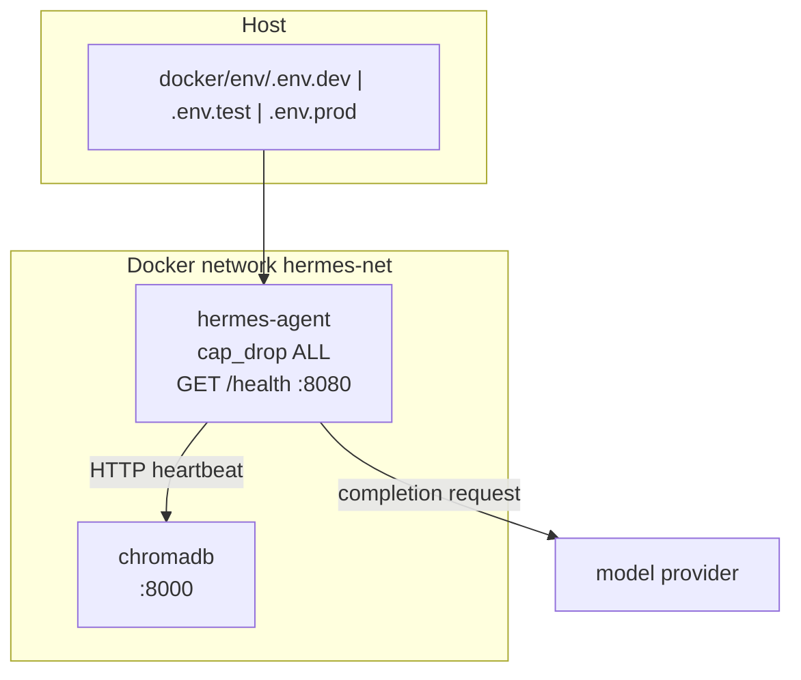

# Architecture after the model provider

Date: 2026-10-18

The agent sends completion requests to a provider configured by environment variables. Document and completion routes require `HERMES_API_TOKEN` in production. The agent container drops all Linux capabilities after the startup check.

