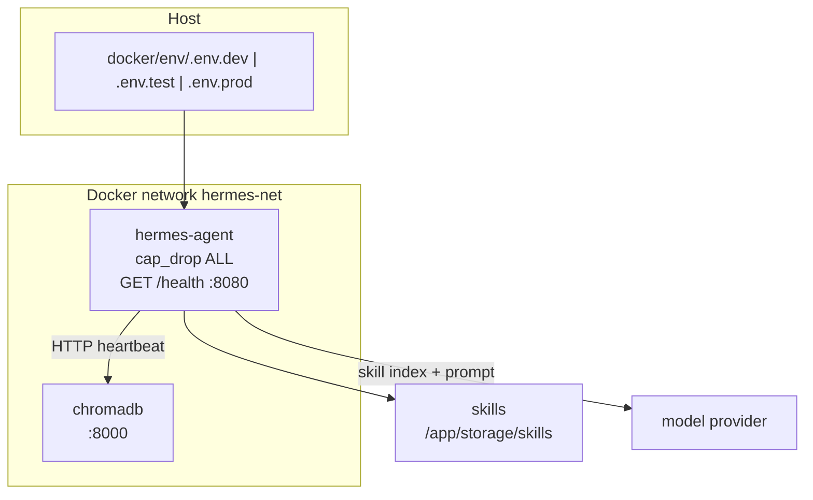

# Architecture after the completion skill index

Date: 2026-10-19

`POST /completions` still sends one chat completion. Hermes code loads the skill index and prefixes it onto the caller's prompt. Jev is not in the running stack.

