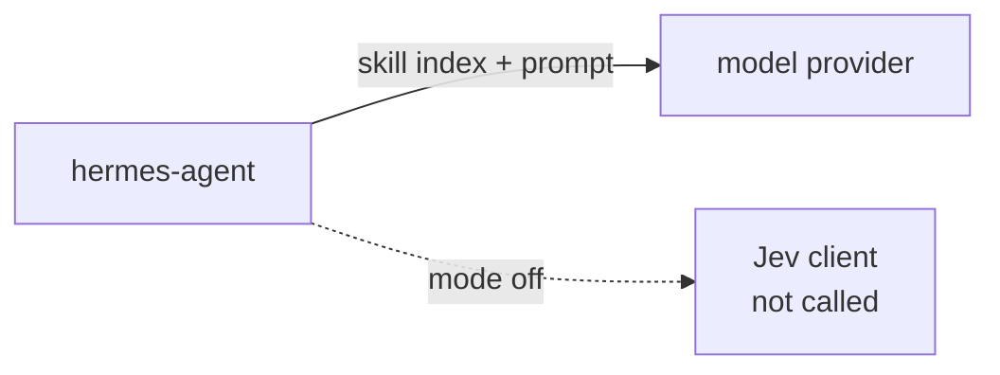

# Architecture after the Jev client

Date: 2026-10-19

The process can call TypeSafe System One. `HERMES_JEV_MODE` defaults to `off`. No question pack is registered, so `POST /completions` still sends only the skill index and the caller prompt to the generative model.

