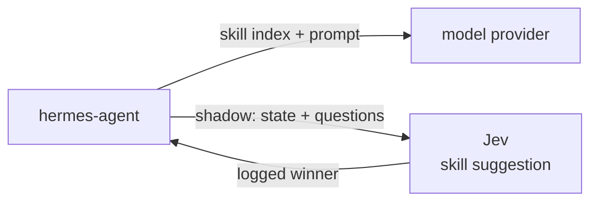

# Architecture after skill suggestion in shadow

Date: 2026-10-19

`HERMES_JEV_MODE` still defaults to `off`. In shadow, completions call the skill-suggestion pack (wide rank, then a shortlist check) and log Jev's winner against the skill index Hermes already put in the prompt. The generative prompt does not gain a `skill_relevance` line.

