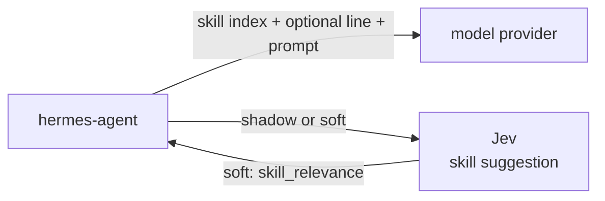

# Architecture after advisory skill suggestion

Date: 2026-10-19

`HERMES_JEV_MODE` still defaults to `off`. Shadow still logs the skill-suggestion winner and leaves the completion prompt unchanged. Soft mode runs the same pack and inserts a `skill_relevance` block between the skill index and the request. The model may ignore that block. The full skill index stays in the prompt.

