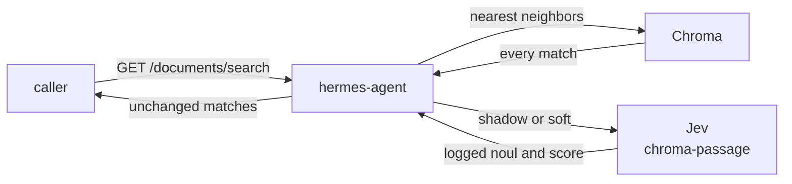

# Architecture after the Chroma passage filter in shadow

Date: 2026-10-19

`HERMES_JEV_MODE` still defaults to `off`. `GET /documents/search` still returns every Chroma neighbor. In shadow and soft, the `chroma-passage` pack logs one Noul and one relevance Score per match. Those answers do not drop a match. Completions are unchanged: shadow logs a skill winner, and soft may add a `skill_relevance` block.

