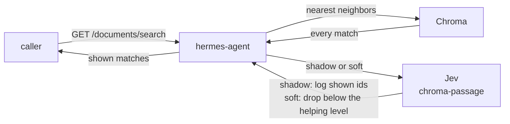

# Architecture after the Chroma passage filter in soft mode

Date: 2026-10-19

`HERMES_JEV_MODE` still defaults to `off`. Shadow still logs a `chroma-passage` judgment and returns every Chroma neighbor. Soft mode returns only passages whose relevance score reaches the level that says the passage states an answer. A Jev error still returns every neighbor, so search is not blocked. Completions are unchanged: shadow logs a skill winner, and soft may add a `skill_relevance` block.

