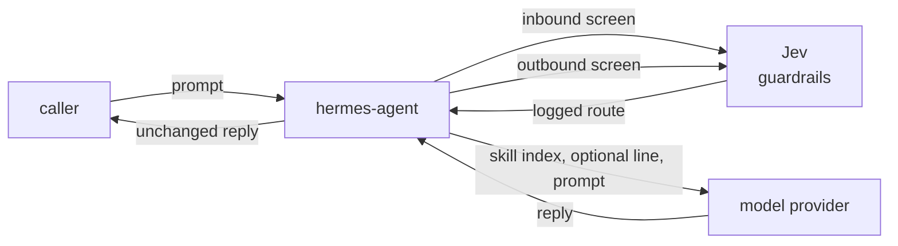

# Architecture after guardrails in shadow

Date: 2026-10-19

`HERMES_JEV_MODE` still defaults to `off`. A completion in shadow or soft logs a `guardrails` route for the caller prompt and another for the model reply. The routes are `pass`, `review`, or `block`. They do not change the completion. An irreversible blast radius logs `block`. A Jev error logs `review`. Soft mode may still add a `skill_relevance` block. Search behavior is unchanged.

