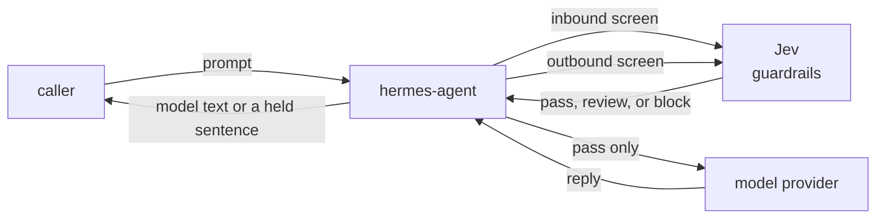

# Architecture after guardrails in soft mode

Date: 2026-10-19

`HERMES_JEV_MODE` still defaults to `off`. Shadow still logs a `guardrails` route and returns the model reply. Soft mode returns that reply only when the route is `pass`. `review` and `block` replace it with a fixed sentence, and the model is not called when the inbound screen holds the turn. A Jev error logs `review`. In soft mode that also withholds the model reply.

