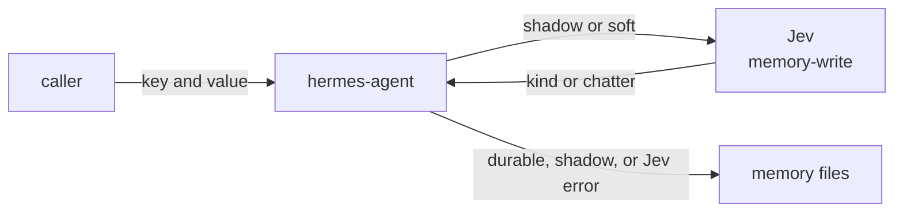

# Architecture after the memory write gate in soft mode

Date: 2026-10-19

`HERMES_JEV_MODE` still defaults to `off`. A memory write in shadow or soft asks the `memory-write` pack: one Noul for whether the value is durable, and one Choice for its kind, including `none`. Shadow still stores the file. Soft skips one-shot chatter and stores a durable kind. A Jev error still stores the file. Soft mode may still add a `skill_relevance` block and may still withhold a guarded reply.

