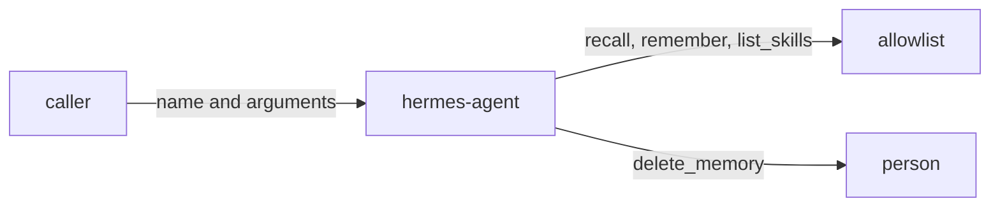

# Architecture after the tool runner

Date: 2026-10-19

`HERMES_JEV_MODE` still defaults to `off`. `POST /tools` accepts a batch of calls whose arguments Hermes already wrote. Code runs `recall`, `remember`, and `list_skills`. A batch past the step limit runs nothing. `delete_memory` asks a person and does not delete. The runner does not call Jev. Soft mode may still add a `skill_relevance` block, withhold a guarded reply, and skip one-shot memory writes.

