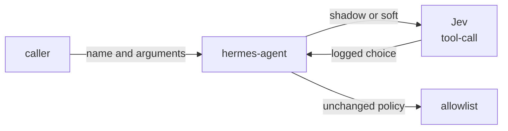

# Architecture after the tool-call gate in shadow

Date: 2026-10-19

`HERMES_JEV_MODE` still defaults to `off`. `POST /tools` still runs the allowlist in code. In shadow or soft, one `tool-call` request logs whether a tool is needed, which tool Jev would pick, and a safety score for each call. Hermes still runs `recall`, `remember`, and `list_skills`. `delete_memory` still asks a person. A Jev error still runs the batch. Soft mode may still add a `skill_relevance` block, withhold a guarded reply, and skip one-shot memory writes.

