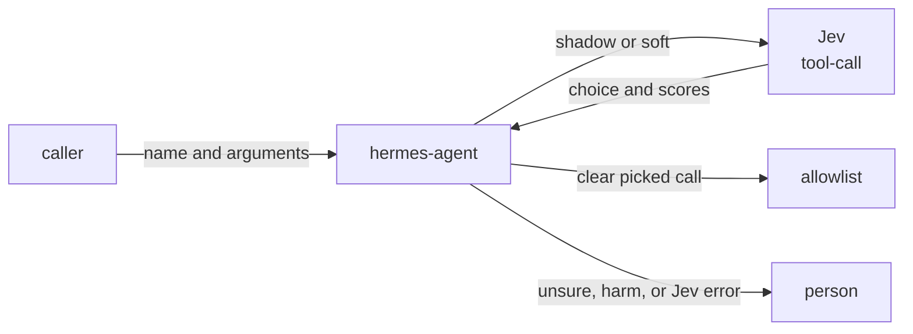

# Architecture after the tool-call gate in soft mode

Date: 2026-10-19

`HERMES_JEV_MODE` still defaults to `off`. `POST /tools` still runs an allowlist in code. Shadow logs a `tool-call` judgment and still runs that allowlist. Soft holds a call unless Jev picked that tool, the need noul is not below the label, the safety noul is above unsure, and the blast score is below the irreversible level. A Jev error in soft asks a person instead of running. `delete_memory` still asks a person. Soft mode may still add a `skill_relevance` block, withhold a guarded reply, and skip one-shot memory writes.

