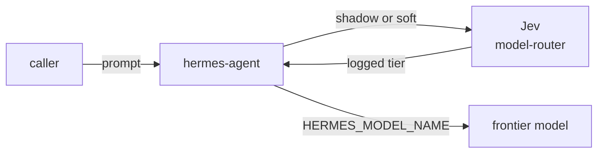

# Architecture after the model router in shadow

Date: 2026-10-19

`HERMES_JEV_MODE` still defaults to `off`. A completion in shadow or soft asks the `model-router` pack which tier fits the caller prompt. Low confidence logs `frontier`. The generative call still uses `HERMES_MODEL_NAME`. A Jev error still uses that model. An inbound guardrail hold skips the router. Soft mode may still add a `skill_relevance` block, withhold a guarded reply, skip one-shot memory writes, and hold an unclear tool call.

