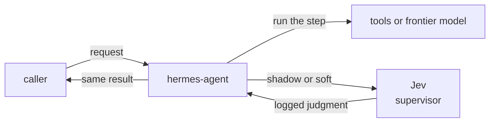

# Architecture after the loop and completion supervisors in shadow

Date: 2026-10-19

`HERMES_JEV_MODE` still defaults to `off`. A tool batch and a completion in shadow or soft ask the `supervisor` pack whether the steps are looping, how far the gathered evidence has come, and whether that evidence shows the task is complete. The log does not change the tool results or the completion text. A Jev error still returns those results. An empty batch and a batch past the step limit make no supervisor call. The model reply and the caller prompt stay out of the supervisor state. Soft mode may still add a `skill_relevance` block, withhold a guarded reply, skip one-shot memory writes, hold an unclear tool call, and log a `model-router` tier. The completion stays on the frontier model named by `HERMES_MODEL_NAME`.

