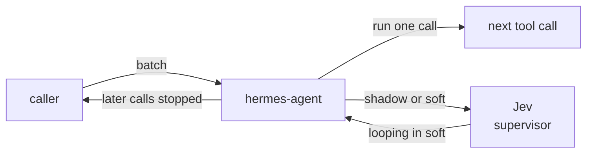

# Architecture after the supervisor stop in soft mode

Date: 2026-10-19

`HERMES_JEV_MODE` still defaults to `off`. A tool batch in soft mode asks the `supervisor` pack after each call that ran. A looping judgment stops the calls that follow it. Those calls do not run. Shadow still logs the same judgment and runs the whole batch. A Jev error still runs the rest of the batch. The completion text stays as the model wrote it, in shadow and in soft. The step limit still runs nothing when the batch is too long. The model reply and the caller prompt stay out of the supervisor state. The completion stays on the frontier model named by `HERMES_MODEL_NAME`.

