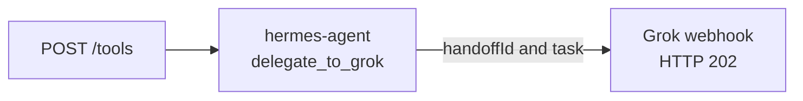

# Architecture after the Grok handoff tool

Date: 2026-10-21

`HERMES_GROK_HANDOFF` defaults to `off`. `delegate_to_grok` is on the `POST /tools` allowlist and absent from `/mcp`. The only argument is `task`, capped at 2000 characters. `off` refuses the call. `ask` asks a person and does not POST. `on` POSTs `handoffId` and `task` to `HERMES_GROK_WEBHOOK_URL` and returns the id when the status is 202. Health reports `grok.handoff` and omits the alias token. The webhook values load from `docker/env/.env.agent` on `hermes-agent` only.

