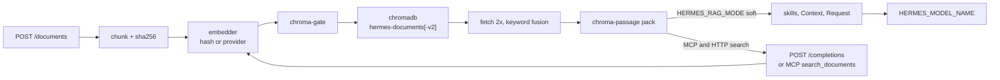

# Architecture after retrieval-augmented completions

Date: 2026-10-26

`POST /documents` splits text into chunks of up to 1500 characters with a 200-character overlap. Each chunk is stored as `<doc-id>::<nnnn>` with metadata `doc_id`, `chunk`, `chunks`, `doc_sha256`, `embedder`, and an optional `source`. Saving the same text again skips the embedding call. Saving changed text deletes the old chunks first, including a whole-document row written before chunking.

Vectors come from the hash embedding until `HERMES_EMBED_BASE_URL`, `HERMES_EMBED_MODEL`, and `HERMES_EMBED_API_KEY` are set together. The provider client posts to `{base}/embeddings`, rejects redirects, and normalizes every vector. A provider moves the defaults to `hermes-documents-v2` and `hermes-memory-v2`, because hash vectors and provider vectors cannot share a collection. `hermes migrate-documents --from hermes-documents` copies the old rows across and embeds them again.

`GET /documents/search` fetches twice the requested neighbors and reorders them with a keyword ranking (reciprocal rank fusion) before the `chroma-passage` pack runs. It returns at most the requested number.

`HERMES_RAG_MODE` defaults to `off`, which makes no search on a completion. `shadow` searches with the caller prompt and logs the passage labels it would add. `soft` adds a `## Context` block between the skill index and the request, and returns the labels as `sources`. Passages are wrapped in `<passage>` tags, the preamble says they are data and not instructions, and a passage cannot close its own tag. Lower-ranked passages are dropped until the prompt fits under 16000 characters. When `HERMES_JEV_MODE` is also `soft`, the block is screened by the inbound guardrail first, and a `review` or `block` route drops the context instead of withholding the reply. A search failure completes without context.

`HERMES_MEMORY_INDEX` defaults to `off`. `on` mirrors each kept memory write into the memory collection. The memory file stays the source of truth, and an index failure still keeps the write. `search_memory` on `/mcp` and `GET /memory/search` return keys by meaning. `hermes reindex-memory` indexes existing files.

