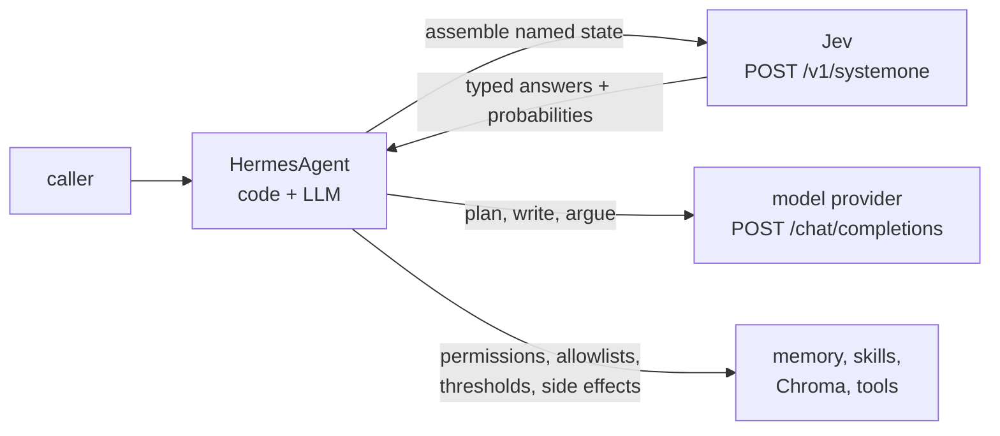
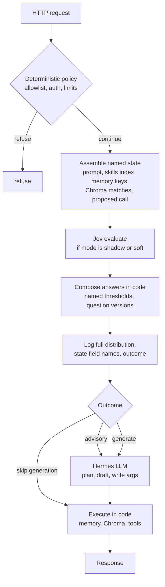

# Jev as System One under Hermes

Jev is TypeSafe's System One model: a fast, typed decision layer under Hermes control. Hermes remains the System Two reasoner. Jev sits **beside** the agent loop as a judge the agent calls. It does not become the agent, the model behind `POST /completions`, or the process that runs tools.

This is the next architecture increment. Current running shape is [current.md](current.md). History snapshots stay in [history/](history/).

## Why this split

Most of an agent harness's cheap steps are bounded judgments: which skill to load, whether a Chroma match is relevant, whether a proposed tool call is safe to run, whether the loop is stuck, whether the task is done. Hermes today answers those, when it answers them at all, with the same generative model that writes the plan.

That is the wrong tool for a closed set of answers:

- The model returns free text that code then has to parse.
- There is no calibrated probability to threshold.
- The same question can get a different label on the next run.
- The call is slow and costly enough that checks quietly drop out of the middle of a long task.

Jev takes a `state` plus typed questions and returns one answer per question. It cannot write a sentence, invent an option outside the set you defined, or execute a side effect. TypeSafe's own coding-agent guidance is explicit: Jev is not a drop-in replacement for the LLM behind an agent. You keep the agent, and you write code that asks Jev questions.

The System One name is Kahneman's: fast, focused judgments. System Two is slower, deliberate generation. Hermes stays System Two. Jev is System One **only when Hermes asks**.

## Control inversion (non-negotiable)

Three owners, never one:

| Owner | Job | Must not |
| --- | --- | --- |
| Hermes LLM | Plan, draft replies, write free-form tool arguments, explain | Be the only check on an irreversible action; parse its own JSON as a gate |
| Jev | Answer Choice / Score / Noul questions about a state Hermes assembled | Generate text, pick arguments, grant permissions, run tools, own the loop |
| Hermes code | Assemble state, enforce policy, combine answers, execute, log | Put untrusted text inside Jev's question instructions |

A Jev answer is an **input** to Hermes code. Code still checks the caller, the allowlist, spend caps, and arithmetic before anything runs. If Jev is down, misconfigured, or below threshold, Hermes falls back to its own reasoning or refuses. Jev never fails the stack closed on an advisory path, and never fails the stack open on an irreversible path.

TypeSafe's Hermes skill-suggestion cookbook is the reference pattern: Jev may write one extra line into the system prompt (`Relevant to the current request: <name>. Ignore this if it does not fit`). The agent keeps its full skill index and its own judgement. That is the shape every later gate copies.

## What the running agent can and cannot do today

The Python service in this repository is a facade, not a multi-step harness.

`HermesAgent.complete()` in `src/agent/core.py` sends one generative call. Hermes code prefixes a skill index (name, version, purpose line) onto the caller's prompt. It does not inject memory or retrieved documents. `src/services/jev.py` can call `POST /v1/systemone`, and `GET /health` reports `jev.mode` and `jev.configured`. Mode defaults to `off`, so a completion makes no Jev call until mode is `shadow` or `soft`. Shadow runs the skill-suggestion pack and leaves the suggestion out of the prompt. Soft runs the same pack and inserts a `skill_relevance` block the model may ignore. `GET /documents/search` still runs when Jev fails. Shadow logs a `chroma-passage` judgment and returns every neighbor. Soft returns only passages whose relevance score reaches the helping level. Completions in shadow log a `guardrails` route for the caller prompt and the model reply and still return the model text. Soft withholds that text on `review` or `block`. A Jev error on that pack logs `review` and, in soft mode, withholds the model text. Shadow memory writes log a `memory-write` judgment and still store the record. Soft skips one-shot chatter. A Jev error still stores the record.

Production Compose also runs `nousresearch/hermes-agent` as `hermes-gateway`. That process is a separate agent with its own loop, dashboard, and skill roster. **Do not** set its model to `jev-latest`. Jev cannot stream tokens, call tools, or edit files. The gateway stays on a generative model.

Two Hermes surfaces, one rule:

| Surface | Path | Jev's job |
| --- | --- | --- |
| This repo's Python agent | `src/agent/`, `POST /completions` | Decision layer the agent calls before and after generation |
| Nous gateway | Compose service `hermes-gateway` | Out of scope until there is a documented control-plane hook. Do not replace its LLM |

The first implementation work is therefore not "swap the model". It is to give **this** agent a control plane that can ask Jev questions without surrendering reasoning.

## Jev interface (as Hermes will call it)

- Endpoint: `POST https://api.typesafe.ai/v1/systemone`
- Auth: `Authorization: Bearer <TYPESAFE_API_KEY>`
- Model: pin a versioned id (`jev-1.13.0` at time of writing). Aliases move. Thresholds fitted on `jev-latest` drift when TypeSafe retargets the alias. `jev-preview` currently points at `jev-1.14.0`.
- Input: `state` (string, object, or array of text) plus `questions`
- Output: one typed answer per question id, plus `usage.input_tokens`
- Latency TypeSafe reports: roughly 70 to 500 ms. Price: about $0.042 per million **input** tokens; output is free
- Context: 64k per request / 32k per question by default; long context is an explicit header and is slower and less accurate
- Input: text only. Images, audio, and video are not used in this plan
- Training: Jev is not fine-tuned per customer. Domain fit comes from `state`, `instructions`, and `criteria`

Primitives Hermes is allowed to ask:

| Primitive | Returns | Use in this agent | Watch |
| --- | --- | --- | --- |
| Choice | `choice`, `probabilities`, `confidence` | Skill, tool, model tier, intent | Always include `none`. Cap is 255 options |
| Score | `score`, `legend`, `probabilities`, `confidence` | Blast radius, progress, severity | 2 to 10 ordered levels with definitions |
| Noul | `noul` in `[0, 1]` (no separate confidence) | Gates: need a skill, safe to run, task complete | One claim per question. Near 0.5 is "I don't know" |

Ask several questions in one request. They share one state, run in parallel, and are independent. Split compound questions. Untrusted text (user prompt, tool args, retrieved docs, model output) goes in **named state fields**. Question `instructions` stay fixed strings in code.

Low confidence is a first-class outcome. Code must escalate, fall back to the Hermes LLM, or ask the caller. Picking the top option regardless throws away the signal Jev exists to provide.

## Target loop

Jev is off the execution path. The LLM proposes. Jev judges. Code decides. A person takes the cases code routes to them.

## Decision catalog

These are the only Jev jobs this plan authorizes. Each job is a named question pack with a version, a mode, and thresholds reviewed like code. New jobs get a new pack. They do not get a free-form prompt.

### 1. Skill suggestion (first advisory job)

TypeSafe already measured this against the Nous Hermes roster (182 skills, 488 requests, `jev-1.12` + Haiku):

| Arm | Wrong skill load | Load when nothing fits |
| --- | --- | --- |
| Agent with roster only | 16.8% | 9.8% |
| Agent plus TypeSafe suggestion | 7.3% | 4.0% |
| Agent handed the gold skill | 2.5% | 1.2% |

The third row is the floor: even a perfect suggestion does not force the agent to load it. That is the desired property.

Two Jev requests per turn, then one extra system-prompt line:

1. Wide rank: Choice over every loaded skill name (index description as criteria) plus three Nouls (`acts_on_user_system`, `would_follow_documented_procedure`, `prose_suffices`). Mean of the gate Nouls below `0.30` suggests nothing.
2. Shortlist check: top three skills, now with a `SKILL.md` excerpt. Choice among those three plus a Noul per candidate. Best "fits" Noul under `0.30` suggests nothing.
3. Hermes still sees the full skill index. The suggestion is advisory. The agent may ignore it.

This repository currently has one skill (`bootstrap-hermes-stack`). The same `suggest()` shape still applies: one Choice, a none option, and a Noul that can say no. Shadow logs the winner and omits the advisory line. Soft mode inserts that line and leaves the skill index in place.

### 2. Chroma passage filter

`GET /documents/search` returns nearest neighbors from `hermes-documents`. Before those matches reach the model, one Noul per match (`does this passage help answer the query?`) plus a Score for relevance. Code drops weak matches. The model never sees a dump of the collection. Pattern: TypeSafe "Classifying RAG passages". Shadow logs that Noul and Score and still returns every neighbor. Soft drops a passage whose relevance score is below the level that says it states an answer. A Jev error returns every neighbor, so search is not blocked. Cookbook passage cutoffs are not applied.

### 3. Memory write gate

`MemoryStore` writes whatever key the caller sends. A Noul (`is this worth persisting as durable memory?`) plus a Choice of memory kind keeps the store from filling with one-shot chatter. Hermes still performs the write when the record is kept. Pattern: TypeSafe "Simple memory system". Shadow logs the kind and still writes. Soft skips a choice of `none`, an unknown kind, or a worth noul below the label. Exactly that label can keep. A Jev error still writes, because memory is an advisory job.

### 4. Prompt and reply guardrails

Screen the inbound prompt and the outbound completion with one request each: Nouls for jailbreak, credential harvest, and self-harm, plus a Score for blast radius. Code routes `pass`, `review`, `block`. The generative model's own refusal is not the policy. Pattern: TypeSafe "Guardrails for LLMs". Shadow logs the route and still returns the model text. Soft withholds the model text on `review` or `block`. An irreversible blast radius logs `block`. A Jev error logs `review`. Cookbook probability cutoffs are not applied.

### 5. Tool-call gate (after a tool runner exists)

`POST /tools` runs an allowlist in code: `recall`, `remember`, `list_skills`, `delete_memory`, and `delegate_to_grok`. A batch longer than the step limit runs nothing. `delete_memory` asks a person and does not delete. `HERMES_GROK_HANDOFF` defaults to `off`, which refuses `delegate_to_grok`. `ask` asks a person and does not POST. `on` POSTs one task when this gate allows the call. Shadow asks one `tool-call` request per batch and still runs that policy. Soft runs a call only when Jev picked that tool, the need noul is not below the label, the safety noul is above unsure, and the blast score is below the irreversible level. A safety noul at the unsure line asks a person. A Jev error in soft asks a person instead of running. Cookbook probability cutoffs are not applied. Deterministic policy still runs first. Irreversible tools (`IRREVERSIBLE`) always ask a person, at any Jev confidence.

Jev picks the tool (Choice + none + a Noul "does this need a tool"). Hermes or code writes arguments. Jev does not fill free-form ids, dates, or message bodies.

### 6. Model router

A Choice over model tiers for the **next** generative turn. Easy turns may use a smaller model. Planning and hard reasoning stay on the frontier model named by `HERMES_MODEL_NAME`. Low router confidence defaults **up**, never down. Shadow logs that tier and still calls `HERMES_MODEL_NAME`. Soft may call `HERMES_MODEL_SMALL` when it is set and the judge returns tier `small` with reason `ok`; otherwise soft stays on `HERMES_MODEL_NAME`. A confidence at or below the unsure line logs `frontier`. The frozen comparison artifact is `tests/test_data/router/all-frontier-run.json` against `tests/test_data/router/tasks.json`. Production runs soft; `HERMES_MODEL_SMALL` is optional and unset on day one.

### 7. Loop and completion supervisors

After each step: Noul "is this looping", Score "progress against the exit evidence", Noul "is the task complete". Completeness judges **evidence code gathered**, never the model's claim that it finished. Shadow logs that judgment and still returns the same tool results and the same completion. Soft stops tool calls that follow a looping judgment and still returns the completion text. A Jev error still returns the original tool result. Hard step limits and timeouts stay in code even after the supervisor is live.

## What stays in code

These never move into Jev, however calibrated the probabilities become:

- `HERMES_API_TOKEN` and `CHROMA_AUTH_TOKEN`
- Allowlists of tools, routes, and argument ranges
- Spend caps, rate limits, step limits, timeouts
- Arithmetic, dates, and any value with one right answer
- Threshold constants and question-pack versions
- Assembly of the named state Jev sees
- Every side effect: memory write, Chroma upsert, tool execution, HTTP response
- Fallback when Jev is unset, unreachable, or returns 429

## Modes

| Mode | `HERMES_JEV_MODE` | Behaviour |
| --- | --- | --- |
| Off | `off` (default) | No TypeSafe calls. Agent behaviour matches today |
| Shadow | `shadow` | Jev is called. Answers are logged. They do not change routing, generation, or execution |
| Soft | `soft` | Answers may change routing. They still cannot execute. Irreversible actions still require a person or a deterministic rule |

Promotion: off → shadow on one job → read the score-vs-outcome distribution → set named thresholds in a PR → soft for that job only. Demote on drift. Do not promote a second job until the first job's shadow log is enough to set thresholds from data, not from TypeSafe examples.

Example numbers in vendor docs (`0.40` / `0.90`, cookbook `0.30`) are **not** auto-run defaults for this stack. Shadow skill suggestion uses `0.30` only to label the logged suggestion.

## Module layout (when implementation starts)

Keep Jev out of `src/services/model.py`. Completions and decisions are different APIs.

| Path | Responsibility |
| --- | --- |
| `src/services/jev.py` | Thin HTTP client for `POST /v1/systemone`. Same redirect-reject opener as `ModelClient`. No `typesafe-sdk` until typed questions become painful |
| `src/agent/decisions/packs.py` | Named question packs and versions. Fixed instruction strings |
| `src/agent/decisions/skill_suggestion.py` | Skill suggestion pack v1. Shadow logs a winner. Soft mode adds one advisory block |
| `src/agent/decisions/passage_filter.py` | Chroma passage pack v1. Shadow logs one Noul and one Score per match. Soft returns passages at the helping relevance level |
| `src/agent/decisions/guardrails.py` | Guardrail pack v1. Shadow logs `pass`, `review`, or `block`. Soft withholds the model reply on review or block |
| `src/agent/decisions/memory_gate.py` | Memory write pack v1. Shadow logs a kind and still writes. Soft skips one-shot chatter |
| `src/agent/tools.py` | Tool runner. Executes the allowlist, stops at the step limit, and asks a person before `delete_memory` |
| `src/agent/decisions/tool_gate.py` | Tool-call pack v1. Shadow logs the choice and still runs. Soft holds a call unless Jev picked it and the score is clear |
| `src/agent/decisions/model_router.py` | Model router pack v1. Logs a tier. Soft may pass `HERMES_MODEL_SMALL` when the judge returns `small`/`ok`; shadow stays log-only |
| `src/agent/decisions/supervisor.py` | Supervisor pack v1. Logs whether a tool batch or a completion is looping and whether the gathered evidence looks complete. Soft stops calls that follow a looping judgment. The completion text stays unchanged |
| `src/agent/decisions/state.py` | Build named state objects from prompt, skills, memory, Chroma matches, proposed calls |
| `src/agent/decisions/policy.py` | Named thresholds, mode, irreversible tool set |
| `src/agent/decisions/compose.py` | Map answers + thresholds → `run` / `advise` / `ask_person` / `refuse` / `fallback_llm` |
| `src/agent/decisions/audit.py` | Log question version, model id from the response, full probability distribution, outcome Hermes chose |
| `src/agent/core.py` | Owns the call. `HermesAgent` asks Jev; Jev never asks Hermes |

Settings (all optional except as noted):

| Variable | Required | Purpose |
| --- | --- | --- |
| `HERMES_JEV_MODE` | No | `off`, `shadow`, or `soft`. Default `off` |
| `HERMES_JEV_API_KEY` | When mode is not `off` | Bearer key, same length rule as other secrets. Prefer this name over `TYPESAFE_API_KEY` so Compose stays consistent |
| `HERMES_JEV_BASE_URL` | No | Default `https://api.typesafe.ai/v1`. Reject redirects, userinfo, query, fragment |
| `HERMES_JEV_MODEL` | No | Default a pinned id, not `jev-latest` |

The default in code and sample env files remains `off`. This deployment's production API runs `soft` (`GET /health` reports `jev.mode=soft` and `jev.configured=true` on image `v0.3.9`). A TypeSafe key is required for `shadow` and `soft`. Demote to `shadow` and redeploy if soft behaviour drifts. `GET /health` never includes the key.

Egress: production already talks to a model provider on the public network. Jev is a second outbound HTTPS dependency. Pin the hostname in deployment notes. Do not publish a Jev sidecar. There is nothing to containerize; it is an API.

## Failure and fallback

| Condition | Advisory jobs (skill, RAG, memory, router) | Binding jobs (guardrail, tool gate) |
| --- | --- | --- |
| Mode `off` or key unset | Skip Jev | Skip Jev; guardrails stay on deterministic checks only |
| Timeout, 5xx, 429 after retries | Log and continue as Hermes-only | Treat as `ask_person` or `refuse` for irreversible; do not auto-run |
| Malformed answer | Log and ignore | Same as timeout |
| Confidence / Noul in the middle band | Fall back to Hermes LLM | Ask a person |
| Choice of `none` | Suggest nothing / skip the tool | Refuse to guess |

Retries follow the same class of policy as the model client: bounded, no redirect following, no retry on 4xx other than 429.

## Anti-patterns this plan rejects

| Anti-pattern | What happens | Rule |
| --- | --- | --- |
| Jev as the Hermes model | The agent cannot talk, plan, or call tools | Jev is not a `HERMES_MODEL_NAME` |
| Jev as the only check on delete/pay/send | One wrong 0.99 becomes an incident | Irreversible ⇒ person or deterministic rule |
| Choice with no `none` | Jev picks the least-wrong option | Every Choice includes `none` |
| One question asking two things | A low score cannot say which half failed | Split; pack in one request |
| Untrusted text in `instructions` | Prompt injection of the judge | Fixed questions, named state fields |
| Jev writes tool arguments | Unseen ids cannot be options | Jev selects; Hermes writes |
| Jev infers missing state | It judges the fragment it got | Code extracts fields first |
| Step limits removed because Jev watches | A misread loop runs until spend dies | Hard limits stay |
| Thresholds edited at runtime | Silent policy drift | Named constants, PR review |
| `jev-latest` after thresholds are fitted | Alias retarget silently moves answers | Pin `jev-1.13.0` or later versioned id |

## Implementation sequence

Each step is a separate PR. Do not batch them.

0. **Control plane without Jev.** Done. Completions load the skill index into the prompt. Still one generative call. No TypeSafe dependency.
1. **Client + shadow plumbing.** Done. `src/services/jev.py`, settings, health fields, audit log shape. Mode default `off`. Unit tests use recorded JSON fixtures. No live TypeSafe in the default CI job.
2. **Skill suggestion in shadow.** Done. Pack v1, two-call rank+verify, advisory system line omitted (shadow logs only). Compare Jev's winner to what Hermes would have done.
3. **Skill suggestion advisory.** Done. Soft mode for this pack only. Inject the `skill_relevance` line. Hermes may ignore it.
4. **Chroma passage filter in shadow, then soft.** Done. Shadow returns every neighbor and logs the judgment. Soft returns passages whose relevance score reaches the helping level. A Jev error still returns every neighbor, so search is not blocked.
5. **Guardrails in shadow, then soft.** Done. Shadow logs `pass`, `review`, or `block` and still returns the model text. Soft withholds that text on review or block. A Jev error logs `review`.
6. **Memory write gate.** Done. Shadow logs the kind and still writes. Soft skips one-shot chatter. A Jev error still writes.
7. **Tool runner, then tool-call gate in shadow.** Done. Shadow logs the choice and still runs the allowlist. Soft holds a call unless Jev picked it and the score is clear. A Jev error in soft asks a person.
8. **Model router.** Shadow is done. Soft may switch when `HERMES_MODEL_SMALL` is set and the judge returns `small`/`ok`. Shadow always stays on `HERMES_MODEL_NAME`. Production runs soft; small-model id remains optional.
9. **Loop and completion supervisors.** Shadow and soft are done. The log names looping and completeness. Soft stops tool calls that follow a looping judgment. The completion text stays unchanged. Hard step limits stay in place.

## Later improvements

The numbered sequence is done. Soft promotion is done on production (`HERMES_JEV_MODE=soft`). The smaller-model switch code is shipped. The gateway `suggest_skill` hook is live, and production gateway `SOUL.md` includes [gateway-skill-line-policy.md](gateway-skill-line-policy.md).

1. **Set `HERMES_MODEL_SMALL` (optional, deferred).** When set under soft, `small`/`ok` router judgments complete on that id. Until then, soft completions stay on `HERMES_MODEL_NAME`. The frozen comparison artifact at `tests/test_data/router/all-frontier-run.json` remains the freeze line.

Cursor can call this API over MCP. That connection does not change Jev, the model provider, or the gateway. See [cursor-account.md](cursor-account.md).

## Tests

Default CI stays offline.

- Unit: client request shape, redirect reject, secret omitted from health, mode `off` makes zero HTTP calls, compose() outcomes for fixture answers, Choice `none` required in packs, untrusted text not interpolated into instructions
- Contract: Compose and docs still describe hermes-agent + chromadb + hermes-net. This plan file and `planned.md` include Mermaid
- Integration (opt-in, skipped without `HERMES_JEV_API_KEY`): one live `systemone` call against a tiny fixture state
- Eval (not CI): frozen prompts for skill suggestion and guardrails; promote a pack only when shadow logs beat the Hermes-only baseline on the jobs that pack owns

## Sources

- [System One](https://docs.typesafe.ai/concepts/system-one)
- [Jev with coding agents](https://docs.typesafe.ai/introduction/coding-agents)
- [How to build with TypeSafe](https://docs.typesafe.ai/concepts/how-to-build-with-system-one)
- [Skill suggestion cookbook](https://docs.typesafe.ai/cookbooks/skill_suggestion) (Nous Hermes roster)
- [Confidence](https://docs.typesafe.ai/confidence)
- [Models](https://docs.typesafe.ai/models)
- [API reference](https://docs.typesafe.ai/api)
- JevAgentHarness (confidence-threshold fallback to the LLM) and REFLEX (selective control) as published research on sharing control with a generative agent, not as code this repo vendors
