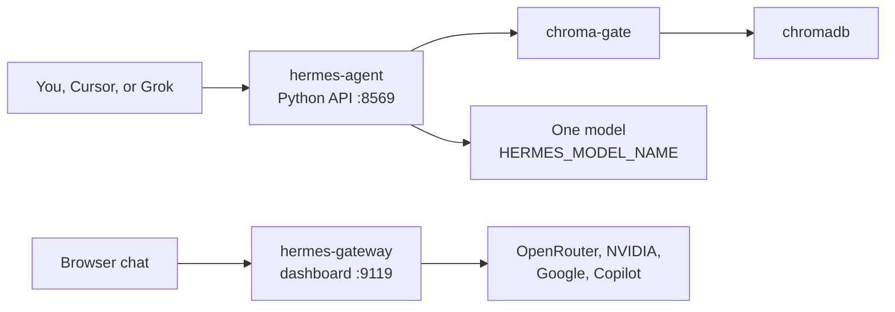

# Big picture

Production runs four containers. Two of them answer people. Two of them store and protect documents.

Start here. The detailed behavior of the Python API is [current.md](current.md).

| Service | What it does | How you reach it |
| --- | --- | --- |
| `hermes-agent` | The Python API in this repository (FastAPI). It answers health checks, runs completions, stores notes, lists skills, searches documents, and runs tools. When MCP is on, Cursor and Grok call it at `/mcp`. | Host port **8569**. On this deployment the public name is `api.hermes.newplanetit.com.au`. |
| `chromadb` | The document database. It keeps the searchable copies of documents (embeddings) on its own disk. | No host port. It sits on a private Docker network. |
| `chroma-gate` | The lock in front of that database. It checks `CHROMA_AUTH_TOKEN`, then forwards the request. It is the only container that can open `chromadb`. | No host port. `hermes-agent` calls `http://chroma-gate:8000`. |
| `hermes-gateway` | The Nous chat dashboard. A separate program (`nousresearch/hermes-agent`). You open it in a browser and chat there. | Host port **9119** (the website) and **8642** (its API). On this deployment the public name is `hermes.newplanetit.com.au`. |



## Two ways in

A call from you, Cursor, or Grok goes to `hermes-agent`.

A browser chat goes to `hermes-gateway`.

A document search follows one path: caller → `hermes-agent` → `chroma-gate` → `chromadb`.

## Recommended model setup

Only `hermes-agent` and `hermes-gateway` call a model. `chromadb` and `chroma-gate` do not. The install paste for these values is in [ubuntu-server.md](../deployment/ubuntu-server.md).

### `hermes-agent`

Use one cheap model for every API completion. Put these three lines in `docker/env/.env.prod`:

```text
HERMES_MODEL_BASE_URL=https://openrouter.ai/api/v1
HERMES_MODEL_NAME=google/gemini-flash-latest
HERMES_MODEL_API_KEY=the-openrouter-key
```

`google/gemini-flash-latest` is the everyday model: tool calls, vision, and a low per-token price. Leave `HERMES_MODEL_SMALL` unset. Production already runs Jev in soft mode, and with that variable unset every completion stays on `HERMES_MODEL_NAME`. Set `HERMES_MODEL_SMALL=nvidia/nemotron-3-ultra-550b-a55b:free` only when you want an easy turn (`small` / `ok`) to use the free NVIDIA model. The `~` prefix is gateway syntax. Leave it off `HERMES_MODEL_NAME`.

#### Embeddings for document search

Search quality depends on the embedding model, not on `HERMES_MODEL_NAME`. Without embed settings, the API uses keyword-overlap hash vectors. For search by meaning, reuse the OpenRouter key already set as `HERMES_MODEL_API_KEY`. The NVIDIA hosted embedding ids return 410 once retired and 403 when the key is not entitled to the current model.

```text
HERMES_EMBED_BASE_URL=https://openrouter.ai/api/v1
HERMES_EMBED_MODEL=openai/text-embedding-3-small
HERMES_EMBED_API_KEY=the-openrouter-key
HERMES_EMBED_INPUT_TYPE=off
```

The collection moves to `hermes-documents-v2`. Run `hermes migrate-documents --from hermes-documents` inside the agent container once, then compare with `scripts/eval_retrieval.py`. Turn on `HERMES_RAG_MODE=shadow` first and `soft` after the logged passages look right. The gateway gets the same passages through `search_documents`. Register `hermes-api` on the gateway volume and paste [document-search-policy.md](document-search-policy.md) into its `SOUL.md`.

### `chromadb`

No model. This container only stores document embeddings.

### `chroma-gate`

No model. This container only checks `CHROMA_AUTH_TOKEN` and forwards the request.

### `hermes-gateway`

Use the same flash model for everyday chat, and keep the paid keys off the default path. Keys go in gitignored `docker/env/.env.gateway`. Compose loads that file on this container only. The Python API does not receive those keys.

| Role | Provider | Model | Why |
| --- | --- | --- | --- |
| Everyday chat | OpenRouter | `~google/gemini-flash-latest` | Same family as the API. One gateway turn makes several calls, so the default stays cheap. |
| Fallback and compression | NVIDIA NIM | `nvidia/nemotron-3.5-super-vl-120b-a12b` | Free tier from `build.nvidia.com`. Background summaries do not spend the flash key. |
| Second fallback | Google AI Studio | `gemini-2.5-flash` | Direct Gemini when OpenRouter and NVIDIA both fail. A new key starts with `AQ.`. The free tier is too small to be the only model. |
| Hard turn, on purpose | GitHub Copilot | `gpt-5.4` | Use a personal fine-grained token (`github_pat_`) with the Account permission Copilot Requests. Leave it off the default so a tool loop does not spend the subscription on every message. |

Write that order in the gateway config at `/opt/data/config.yaml`:

```yaml
model:
  provider: openrouter
  default: "~google/gemini-flash-latest"
fallback_providers:
  - provider: nvidia
    model: nvidia/nemotron-3.5-super-vl-120b-a12b
  - provider: gemini
    model: gemini-2.5-flash
auxiliary:
  compression:
    provider: nvidia
    model: nvidia/nemotron-3.5-super-vl-120b-a12b
```

Confirm the OpenRouter id with `hermes model` inside the gateway container if OpenRouter has renamed the alias.

## What sits beside the API

Jev can score a turn when `HERMES_JEV_MODE` is `shadow` or `soft`. Production runs `soft`. Jev does not write the reply. The model named by `HERMES_MODEL_NAME` still does. See [jev-system-one.md](jev-system-one.md).

Cursor opens the connection to `/mcp` when `HERMES_MCP_ENABLED=on`. Hermes does not call Cursor and does not use Cursor's LLM. See [cursor-account.md](cursor-account.md).

Grok uses that same MCP route. `delegate_to_grok` can hand one task to Grok when `HERMES_GROK_HANDOFF=on`. See [grok-hermes.md](grok-hermes.md).

Development publishes the API on host port **8080** and Chroma on **8000**. Production keeps Chroma off the host. The install steps are [ubuntu-server.md](../deployment/ubuntu-server.md).
