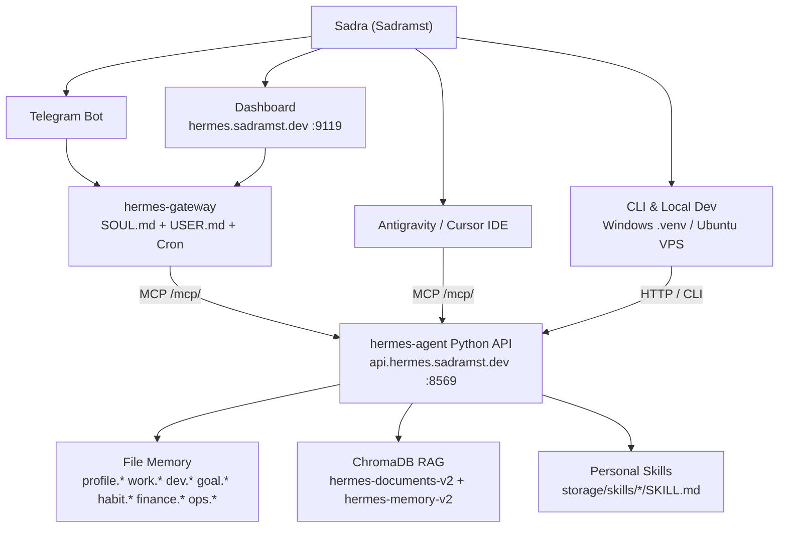

# Personal Assistant Operating System (`Sadramst`)

Hermes is customized as Sadra Tabarestani's permanent personal assistant across four tightly integrated pillars: **Work & Software Engineering**, **Personal Development & Productivity**, **Personal Financial Advisory & Tracking**, and **Life Admin & Knowledge Management**.

## 1. Memory Namespaces (`hermes-api`)

Use stable dotted prefixes with `remember`, `recall`, `list_memories`, and `search_memory`:

| Prefix | What Lives Here | Example Keys |
| --- | --- | --- |
| `profile.*` | Timezone, communication style, workstation setup | `profile.timezone`, `profile.workstation` |
| `work.*` | Active projects, client deliverables, key decisions | `work.hermes-roadmap`, `work.active-sprint` |
| `dev.*` | Coding standards, repo conventions, debugging notes | `dev.python-venv`, `dev.docker-deploy` |
| `goal.*` | Quarterly objectives, monthly targets, weekly top-3 | `goal.2026-q4`, `goal.weekly-focus` |
| `habit.*` | Health, fitness, sleep, deep-work routines | `habit.morning-block`, `habit.training-split` |
| `study.*` | Books, courses, papers, concepts to revisit | `study.system-design`, `study.ml-notes` |
| `finance.*` | Budget baselines, emergency runway, portfolio allocation targets | `finance.runway-target`, `finance.allocation-policy` |
| `ops.*` | VPS ports, domain routing, backup verification notes | `ops.sadramst-vps`, `ops.last-disk-check` |

> **Security Rule:** Never store API keys, bank logins, card numbers, PINs, seed phrases, or government IDs inside memory files or Chroma documents. Secrets belong exclusively in untracked `.env.*` files or `/opt/data/auth.json`.

## 2. Personal Skills Roster (`storage/skills/*/SKILL.md`)

Both the autonomous Python loop (`POST /agent/run`, `hermes run`) and `hermes-gateway` draw on these domain skills:

| Skill | Domain |
| --- | --- |
| `autonomous-problem-solver` | Multi-step research across memory, documents, time, and skills |
| `software-engineering-architect` | Engineering design, debugging, Windows/Ubuntu VPS ops, Docker & CI/CD |
| `personal-development-coach` | Goal decomposition, deep work, habits, learning synthesis, reviews |
| `personal-financial-advisor` | Non-custodial budgeting, runway, allocation & scenario analysis |
| `telegram-assistant-ops` | Telegram DM topics, daily/weekly cron briefings, cross-channel MCP sync |
| `provider-and-subscription-routing` | OpenRouter, Google AI Studio API, OAuth subscriptions, Gemini subscription readiness |
| `bootstrap-hermes-stack` | Stack deployment, Compose topology, healthchecks, and error modes |

## 3. Financial Advisory Boundaries

Hermes acts as an **analytical personal financial advisor and structured planner**, not an autonomous broker or custodian:
- **Always explicit:** Every projection states its assumptions (burn rate, expected return, tax drag, inflation, liquidity horizon) and shows conservative/downside outcomes alongside base cases.
- **No autonomous money movement:** Hermes never places trades, executes transfers, pays bills, or touches live brokerage/banking APIs.
- **Professional escalation:** For jurisdiction-specific tax filings, estate planning, or regulated investment advice, Hermes flags the exact questions to confirm with a qualified local CPA/adviser.

## 4. Two Execution Loops & IDE MCP

- **Single-shot completion (`POST /completions` with `"autonomous": false`):** Prefixes the loaded skill index and optional `## Context` RAG passages (`HERMES_RAG_MODE=soft`) for lightweight API calls.
- **Autonomous Personal Assistant (`POST /agent/run`, `POST /completions` with `"autonomous": true`, `hermes run`):** Injects Sadra's `SOUL.md` & `USER.md` (`HERMES_PROFILE_DIR`) plus `HERMES_TIMEZONE` clock context as a `system` message, and iteratively invokes allowlisted tools (`list_memories`, `search_memory`, `recall`, `remember`, `search_documents`, `save_document`, `list_skills`, `read_skill`, `current_time`), halting safely whenever `delete_memory` requires human confirmation (`ask_person`).
- **IDE MCP (`Antigravity` / `Cursor`):** Connect to `https://api.hermes.sadramst.dev/mcp/` (or `http://127.0.0.1:8080/mcp/` locally) with `Authorization: Bearer <HERMES_API_TOKEN>` to share the exact same 9 MCP tools (`complete`, `current_time`, `list_memories`, `list_skills`, `recall`, `remember`, `save_document`, `search_documents`, `search_memory`).
