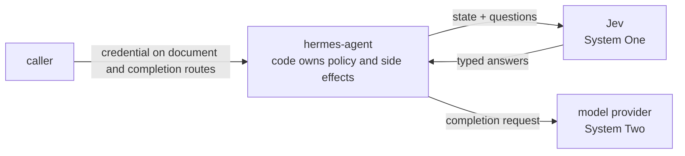

# Planned architecture

The model provider, the Hermes API credential, the agent capability drop, the completion skill index, and skill suggestion are part of the running stack. `HERMES_JEV_MODE` defaults to `off`.

Shadow logs Jev's skill winner and leaves the prompt unchanged. Soft mode adds one `skill_relevance` block the model may ignore. Soft search returns passages that reach the helping relevance level. Shadow search still returns every neighbor. Completions log a guardrail route. Shadow still returns the model text. Soft withholds it on review or block. Shadow memory writes log a kind and still store the record. Soft skips one-shot chatter. Hermes still plans, writes, and executes. The supervisor logs a loop and a completion judgment. Shadow leaves the tool results unchanged. Soft stops calls that follow a looping judgment and leaves the completion text unchanged. The model router logs a tier. Shadow still completes on the frontier model. Soft may use `HERMES_MODEL_SMALL` when it is set and the judge returns `small`/`ok`. Production runs soft (`HERMES_JEV_MODE=soft`); `HERMES_MODEL_SMALL` remains optional. The full plan is [jev-system-one.md](jev-system-one.md).

Jev is not the model behind `POST /completions` and not the Nous `hermes-gateway` LLM. Mode starts `off`, then `shadow`, then `soft` per question pack.

## Later improvements

Cursor calls this API over MCP when `HERMES_MCP_ENABLED` is `on`. The route defaults to off. Hermes does not call Cursor. The plan is [cursor-account.md](cursor-account.md).

Grok calls the same `/mcp` route on `https://api.hermes.sadramst.dev`. `delegate_to_grok` posts one task to Grok and returns the handoff id. `HERMES_GROK_HANDOFF` defaults to `off`. The plan is [grok-hermes.md](grok-hermes.md).

The numbered sequence is done. Soft promotion is done on production. The smaller-model switch code is shipped. The gateway skill-line MCP hook is live, and production gateway `SOUL.md` includes [gateway-skill-line-policy.md](gateway-skill-line-policy.md).

Shared knowledge across Telegram, Grok, and the API is tracked separately in [../superpowers/specs/2026-10-21-shared-knowledge-roadmap.md](../superpowers/specs/2026-10-21-shared-knowledge-roadmap.md). Steps 1–5 are done; see that roadmap for status.

1. **Set `HERMES_MODEL_SMALL` (optional, deferred).** Soft may complete on that id for `small`/`ok` router judgments; until set, soft stays on `HERMES_MODEL_NAME`. The recorded comparison at `tests/test_data/router/all-frontier-run.json` remains the freeze line and still matches `tests/test_data/router/tasks.json`.
