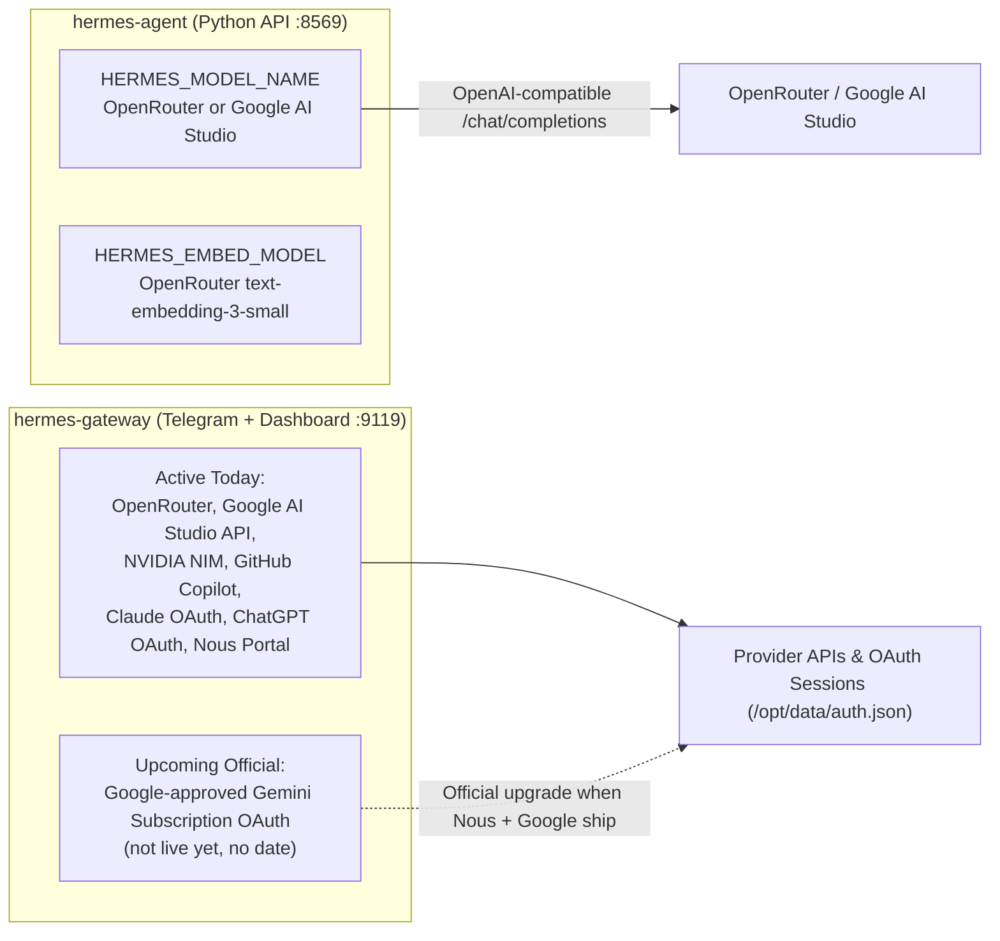

# Providers, Subscriptions & Gemini OAuth Readiness

Hermes runs across two model surfaces:
- **`hermes-agent` (Python API)** uses one OpenAI-compatible completion endpoint (`HERMES_MODEL_BASE_URL`, `HERMES_MODEL_NAME`, `HERMES_MODEL_API_KEY`) and one optional embeddings endpoint (`HERMES_EMBED_*`).
- **`hermes-gateway` (`nousresearch/hermes-agent:latest`)** handles Telegram, the Web Dashboard (`hermes.sadramst.dev`), cron briefings, context compression, and multi-provider OAuth/API routing.



## Official Provider Matrix (Today)

| Provider / Plan | Surface | Status | How to Configure |
| --- | --- | --- | --- |
| **OpenRouter** (`google/gemini-2.5-flash` / `~google/gemini-flash-latest`) | API + Gateway | **Live today** | `HERMES_MODEL_API_KEY` in `.env.prod` / `.env.local`; `OPENROUTER_API_KEY` in `.env.gateway` |
| **Google AI Studio** (`gemini-2.5-flash`, `GOOGLE_API_KEY` / `GEMINI_API_KEY`) | API + Gateway | **Live today (API key)** | Gateway: `GOOGLE_API_KEY` in `.env.gateway`; API: `https://generativelanguage.googleapis.com/v1beta/openai` |
| **NVIDIA NIM** (`nvidia/nemotron-3.5-super-vl-120b-a12b`) | Gateway | **Live today (free fallback & compression)** | `NVIDIA_API_KEY` in `docker/env/.env.gateway` |
| **GitHub Copilot** (`gpt-5.4`) | Gateway | **Live today (hard manual turns)** | Fine-grained `github_pat_` (Account → Copilot Requests) or `gho_` / `ghu_` in `.env.gateway` |
| **Claude Pro / Max** (Anthropic OAuth / setup-token) | Gateway | **Live today** | Run `hermes model` inside `hermes-gateway` and authenticate with Anthropic OAuth |
| **ChatGPT Plus / Pro** (OpenAI Codex OAuth) | Gateway | **Live today** | Run `hermes model` inside `hermes-gateway` and authenticate with OpenAI Codex OAuth |
| **Nous Portal** (unified OAuth gateway) | Gateway | **Live today** | Run `hermes setup --portal` inside `hermes-gateway` |
| **Google Gemini Subscription** (consumer plan OAuth) | Gateway | **Coming soon (not live yet, no date)** | Waiting on official Google-approved OAuth release from Nous Research + Google |

## Gemini Subscriptions — Official Status & Safe Policy

> Today, Gemini in Hermes runs on an **API key** (`OPENROUTER_API_KEY` or `GOOGLE_API_KEY` / `GEMINI_API_KEY`), **not** the consumer Gemini plan you pay for.
>
> - Nous Research is actively working with Google to bring Gemini subscriptions into Hermes the **approved** way, with Google's sign-off.
> - Third-party apps or plugins attempting to plug in a consumer Gemini plan today are **not** doing it in a Google-approved way.
> - **Not live yet, no release date.** Claude and ChatGPT subscribers can already bring their plans to Hermes (`hermes model`); Gemini is next in line.

### Rules for this repository
1. **No unapproved workarounds:** Never wire unofficial consumer Gemini web-cookie scrapers, undocumented local auth proxies, or account-spoofing bridges into `hermes-agent` or `hermes-gateway`.
2. **Recommended setup today:** Use **OpenRouter** (`google/gemini-2.5-flash` on the Python API, `~google/gemini-flash-latest` on `hermes-gateway`) as the everyday backbone, **Google AI Studio API key** (`gemini-2.5-flash`) as direct fallback, and **NVIDIA NIM** (`nvidia/nemotron-3.5-super-vl-120b-a12b`) for free fallback and background compression. Optionally link **Claude** or **ChatGPT** OAuth inside `hermes-gateway` if you hold those plans.
3. **Inspection without leaking secrets:** Check `GET /providers` (with `HERMES_API_TOKEN`), `GET /health`, or `hermes providers` to verify `provider.auth_mode` and `gemini_subscription` readiness.

## Upgrade Checklist When Official Gemini Subscription OAuth Ships

When Nous Research officially announces Google-approved Gemini subscription support in `nousresearch/hermes-agent`:

1. Pull the updated gateway image on the Ubuntu VPS:
   ```bash
   cd /opt/hermes-agent
   docker compose --env-file docker/env/.env.prod --env-file docker/env/.env.gateway \
     -f docker/docker-compose.prod.yml pull hermes-gateway
   docker compose --env-file docker/env/.env.prod --env-file docker/env/.env.gateway \
     -f docker/docker-compose.prod.yml up -d hermes-gateway
   ```
2. Run interactive auth inside `hermes-gateway` (stores official OAuth tokens in `/opt/data/auth.json`):
   ```bash
   docker compose --env-file docker/env/.env.prod --env-file docker/env/.env.gateway \
     -f docker/docker-compose.prod.yml exec -it hermes-gateway hermes model
   ```
3. Update `/opt/data/config.yaml` (`gateway/config.yaml.example`) to select the official Gemini OAuth provider, keeping NVIDIA NIM for compression and OpenRouter/API key as fallback.
4. Update `HERMES_PROVIDER_AUTH_MODE` in `.env.prod` if desired, and verify via Telegram and `https://hermes.sadramst.dev`.
