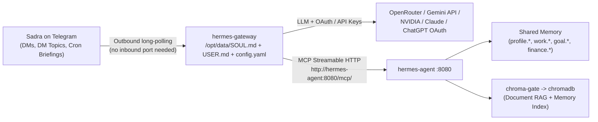

# Telegram Personal Assistant Gateway

Telegram is Sadra's primary always-on mobile and desktop chat interface to Hermes (`hermes-gateway` running `nousresearch/hermes-agent:latest`). Every Telegram session injects `SOUL.md` and `USER.md` from `/opt/data` and calls the shared Python API at `http://hermes-agent:8080/mcp/` so facts, documents, and skills stay synchronized with **Antigravity**, **Cursor**, **CLI**, and the **Web Dashboard** (`https://hermes.sadramst.dev`).



## 1. Create the Bot & Lock Down Access

1. In Telegram, open **`@BotFather`**, send `/newbot`, choose a display name (e.g., `Sadra Hermes Assistant`) and username (ending in `bot`), and copy the `TELEGRAM_BOT_TOKEN`.
2. Optional (recommended for clean domain separation): in `@BotFather` → **Bot Settings** → **Allow Groups?** (off if personal-only) and enable **Threaded Mode** if you want separate DM topic tabs (`General`, `Engineering & Ops`, `Personal Growth`, `Finance Advisory`, `Briefings & Alerts`).
3. Message **`@userinfobot`** in Telegram to get your numeric Telegram user ID.
4. Put both secrets in gitignored `docker/env/.env.gateway` on the server (or run `hermes gateway setup` inside `hermes-gateway`, which writes `/opt/data/.env`):
   ```env
   TELEGRAM_BOT_TOKEN=123456789:replace-with-botfather-token
   TELEGRAM_ALLOWED_USERS=123456789
   ```
   > **Important:** `docker/docker-compose.prod.yml` intentionally does **not** define empty `${TELEGRAM_BOT_TOKEN:-}` defaults in `environment:`. Uncommenting lines in `.env.gateway` injects them directly, while leaving them commented out preserves values saved interactively in `/opt/data/.env`.

## 2. Sync Sadra's Identity, Profile & Gateway Config

Version-controlled templates live in `gateway/`:
- [gateway/SOUL.md](../../gateway/SOUL.md) — Permanent personal assistant identity, engineering/personal-dev/financial-advisory operating rules, and `hermes-api` shared MCP policy.
- [gateway/USER.md](../../gateway/USER.md) — Sadra's personal profile, workstation/VPS topology, communication preferences, and dotted memory namespaces.
- [gateway/config.yaml.example](../../gateway/config.yaml.example) — Model fallback chain, Telegram DM topic template, and `mcp_servers.hermes-api` registration.
- [gateway/cron.yaml.example](../../gateway/cron.yaml.example) — Morning briefing, evening reflection, weekly personal/financial review, and VPS health reminder routines.

Run the bootstrap script on the Ubuntu server to sync `SOUL.md` (with automatic backups) and initialize `USER.md` and `config.yaml`:

```bash
cd /opt/hermes-agent
bash docker/scripts/bootstrap-gateway.sh
# Pass --force-user or --force-config only when you want to overwrite live volume customizations:
# bash docker/scripts/bootstrap-gateway.sh --force-user --force-config
```

Confirm the MCP bridge from inside `hermes-gateway`:

```bash
docker compose --env-file docker/env/.env.prod --env-file docker/env/.env.gateway \
  -f docker/docker-compose.prod.yml exec hermes-gateway hermes mcp test hermes-api
```

You should see the 9 shared tools: `complete`, `current_time`, `list_memories`, `list_skills`, `recall`, `remember`, `save_document`, `search_documents`, and `search_memory`. (`delete_memory` intentionally stays off `/mcp`.)

## 3. Daily & Weekly Telegram Workflows

- **Cross-channel capture:** Message the bot *"Remember my Q4 learning priority under `goal.q4-focus`"* → Telegram writes to `hermes-api` `remember` → immediately readable from Antigravity/Cursor/CLI.
- **Document & note indexing:** Paste runbooks, study summaries, or budget notes and ask Hermes to save them as a reference document (`save_document`) → searchable across all clients via `search_documents` with `[label]` citations.
- **Scheduled briefings (cron):** Configure routines matching [gateway/cron.yaml.example](../../gateway/cron.yaml.example) using `hermes cron` inside `hermes-gateway` (or directly in Telegram chat) with `HERMES_TIMEZONE` set in `.env.prod` so schedules align with your local clock.
- **No inbound firewall port needed for Telegram:** `hermes-gateway` connects outbound to Telegram's Bot API via long-polling. Only dashboard access (`9119`) and public MCP (`8569`) go through Nginx Proxy Manager (`hermes.sadramst.dev` and `api.hermes.sadramst.dev`).
