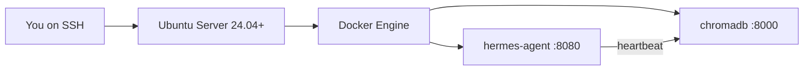

# Install Hermes Agent on Ubuntu Server 24.04 and newer

This guide walks through a first install on Ubuntu Server 24.04 LTS and later releases (24.10, 25.04, 25.10, 26.04, and so on). It assumes you can open an SSH session on the server and that you are comfortable copying commands into a terminal.

You will install Docker, clone the Git repository, then start one of three environments: development, test, or production.

## What you are installing

Hermes Agent is two containers on one Docker network:

| Container | Role | Port inside the container |
| --- | --- | --- |
| `hermes-agent` | HTTP API. Health check is `GET /health`. | 8080 |
| `chromadb` | Vector database (`chromadb/chroma:1.0.0`). | 8000 |

The agent talks to Chroma at `http://chromadb:8000` on the Docker network. You do not install Python or Chroma on the Ubuntu host. Docker runs both.



The diagram shows ports inside the containers. Host ports are in the table below.

## Pick an environment before you start

Development and production use different host ports, so they can run on the same machine. Development publishes **8080** and **8000**. Production publishes the agent on **8569** and does not publish Chroma.

| | Development | Test | Production |
| --- | --- | --- | --- |
| When to use it | You are changing the agent and want the API on the server | You want to run the automated tests inside Docker | You want the published image, with data kept across restarts |
| How the agent image arrives | Docker builds it on this server from the cloned source | Same as development | Docker pulls `ghcr.io/<owner>/hermes-agent:<tag>` |
| Command | `bash docker/scripts/deploy.sh dev` | `bash docker/scripts/deploy.sh test` | `bash docker/scripts/deploy.sh prod` |
| Host ports | Agent **8080**, Chroma **8000** | None | Agent **8569**. Chroma is not published |
| Agent data | Folders in the git clone (`storage/memory`, `storage/skills`) | Thrown away when the stack stops (tmpfs) | Docker volumes that survive `down` and reboot |
| Chroma data | Docker volume `hermes-dev-chroma` | Thrown away when the stack stops | Docker volume `hermes-prod-chroma` |
| Keeps running after you close SSH | Yes | No. The command exits when the tests finish | Yes |

Every environment still needs the git clone. The Compose files, env templates, and helper scripts live in the repository. Production does not build the agent image on the server; it pulls an image that was already published to GitHub Container Registry (GHCR).

## What the server needs

- Ubuntu Server **24.04 or newer**, 64-bit (`x86_64` or `arm64`).
- A user who can run `sudo`.
- Outbound internet so `apt`, `git`, and Docker can download packages and images.
- About **2 GB of RAM** and **10 GB of free disk**. The first build downloads an Ubuntu base image and the Chroma image, so more free disk is safer.
- For production, an image already published at `ghcr.io/<github-user-or-org>/hermes-agent:<tag>`. The publish steps are in [Part 6](#part-6-production).

Check the OS version:

```bash
lsb_release -a
```

You want `Release` of `24.04` or higher. `Description` will look like `Ubuntu 24.04.x LTS` or a later Ubuntu release.

## Part 1: Prepare the Ubuntu server

Run these commands over SSH. Lines that start with `sudo` need your password the first time.

### 1.1 Update Ubuntu

```bash
sudo apt-get update
sudo apt-get upgrade -y
```

### 1.2 Install Git and basic tools

```bash
sudo apt-get install -y ca-certificates curl git
```

Confirm Git works:

```bash
git --version
```

### 1.3 Install Docker Engine and Compose

Use Docker’s own apt repository. That installs a current Docker Engine and the Compose plugin (`docker compose`, with a space). The project scripts call `docker compose`.

Remove older Docker packages if they are present. `apt-get remove` is safe when a package is already absent.

```bash
sudo apt-get remove -y docker.io docker-compose docker-compose-v2 docker-doc podman-docker containerd runc
```

Add Docker’s signing key and repository. The codename comes from this server (`noble` on 24.04, a later name on newer Ubuntu), so the same commands work across 24.04 and above as long as Docker publishes packages for that release.

```bash
sudo install -m 0755 -d /etc/apt/keyrings
sudo curl -fsSL https://download.docker.com/linux/ubuntu/gpg -o /etc/apt/keyrings/docker.asc
sudo chmod a+r /etc/apt/keyrings/docker.asc

echo "deb [arch=$(dpkg --print-architecture) signed-by=/etc/apt/keyrings/docker.asc] https://download.docker.com/linux/ubuntu $(. /etc/os-release && echo "$VERSION_CODENAME") stable" | sudo tee /etc/apt/sources.list.d/docker.list > /dev/null

sudo apt-get update
sudo apt-get install -y docker-ce docker-ce-cli containerd.io docker-buildx-plugin docker-compose-plugin
```

If `apt-get update` reports that the Docker repository has no Release file, that Ubuntu release is newer than the packages Docker has published. Use Ubuntu 24.04 LTS, or check the current install page: [Install Docker Engine on Ubuntu](https://docs.docker.com/engine/install/ubuntu/).

Start Docker on every boot, and start it now:

```bash
sudo systemctl enable --now docker
sudo systemctl status docker --no-pager
```

`Active: active (running)` means Docker is up.

### 1.4 Let your user run Docker

Replace `ubuntu` with the user you SSH in as (`whoami` prints it).

```bash
sudo usermod -aG docker "$USER"
```

Group membership applies to **new** logins. Disconnect SSH and connect again. Then run:

```bash
docker version
docker compose version
```

Both commands should print a client and, for `docker version`, a server section. If you see `permission denied` on `/var/run/docker.sock`, you are still in the old session. Log out and back in. `sudo docker version` works before that, but the deploy scripts expect your user to run Docker directly.

## Part 2: Get the code from GitHub

Clone the repository. This example uses `/opt/hermes-agent`. Any directory you can write to is fine, such as a folder in your home directory.

```bash
sudo mkdir -p /opt/hermes-agent
sudo chown "$USER:$USER" /opt/hermes-agent
git clone https://github.com/Sadramst/hermes-agent.git /opt/hermes-agent
cd /opt/hermes-agent
```

If the repository is private, GitHub will ask you to sign in. A personal access token with repository read access works as the password for HTTPS. An SSH remote works too:

```bash
git clone git@github.com:Sadramst/hermes-agent.git /opt/hermes-agent
```

Confirm you are at the project root. You should see `docker`, `src`, and `README.md`:

```bash
pwd
ls
```

All later commands assume your shell is in `/opt/hermes-agent`.

### Keep the clone up to date

When you want a newer Compose file or source tree:

```bash
cd /opt/hermes-agent
git pull
```

Pulling the git repository updates the files on disk. It does not restart containers. Restart steps are in [Part 7](#part-7-day-to-day-commands).

## Part 3: Files you will use

| Path | What it is |
| --- | --- |
| `docker/docker-compose.dev.yml` | Development stack. Builds the image and mounts the source tree. |
| `docker/docker-compose.test.yml` | Test stack. Builds the image, then runs pytest. |
| `docker/docker-compose.prod.yml` | Production stack. Pulls the GHCR image. |
| `docker/env/.env.dev` | Development settings. `GHCR_OWNER=local` and `IMAGE_TAG=dev` are already set. |
| `docker/env/.env.test` | Test settings. |
| `docker/env/.env.prod` | Production settings. You must set `GHCR_OWNER` and `IMAGE_TAG` before the first production start. |
| `docker/scripts/deploy.sh` | Starts the environment you name: `dev`, `test`, or `prod`. |
| `docker/scripts/init.sh` | Creates `storage/memory` and `storage/skills`. `deploy.sh` calls this for you. |
| `docker/scripts/cleanup-disk.sh` | Safe disk cleanup (Docker prune, apt, journal). Default keeps volumes and tagged images. |
| `docker/scripts/build.sh` | Builds the runtime image and tags it for GHCR. |
| `docker/scripts/push.sh` | Pushes that tag to GHCR. |
| `docker/Dockerfile` | Image definition. The published image is the `runtime` stage. |

The shell scripts are stored without the executable bit. Call them with `bash`:

```bash
bash docker/scripts/deploy.sh dev
```

## Part 4: Development

Development builds the image on the server, mounts the Python source so edits apply with reload, and publishes:

- Agent: `http://<server>:8080/health`
- Chroma: `http://<server>:8000/api/v2/heartbeat`

### 4.1 Check the env file

```bash
cat docker/env/.env.dev
```

The template is enough to start. Relevant lines:

```text
HERMES_ENV=dev
GHCR_OWNER=local
IMAGE_TAG=dev
CHROMA_IMAGE=chromadb/chroma:1.0.0
```

`GHCR_OWNER=local` only names the local image (`ghcr.io/local/hermes-agent:dev`). Development does not contact GHCR.

Leave `CHROMA_AUTH_TOKEN` empty. The client sends no token when it is empty. Leave `HERMES_API_TOKEN` and the `HERMES_MODEL_*` variables empty in development unless you want document routes locked and completions enabled.

### 4.2 Start the stack

```bash
cd /opt/hermes-agent
bash docker/scripts/deploy.sh dev
```

What that command does:

1. Creates `storage/memory` and `storage/skills` if they are missing.
2. Builds `ghcr.io/local/hermes-agent:dev` from `docker/Dockerfile` (target `runtime`).
3. Pulls `chromadb/chroma:1.0.0` if it is not already on the server.
4. Starts both containers in the background on the network `hermes-dev-net`.

The first build often takes several minutes. Later starts are faster.

### 4.3 Confirm it is healthy

```bash
docker compose --env-file docker/env/.env.dev -f docker/docker-compose.dev.yml ps
curl -sS http://127.0.0.1:8080/health
echo
curl -sS -o /dev/null -w "chroma_http_status=%{http_code}\n" http://127.0.0.1:8000/api/v2/heartbeat
```

A healthy agent responds with HTTP 200 and JSON like:

```json
{
  "status": "ok",
  "environment": "dev",
  "version": "0.1.0",
  "chroma": {
    "reachable": true,
    "host": "chromadb",
    "port": 8000
  }
}
```

`status` is `ok` when the API process is up. `chroma.reachable` is `true` when the agent can reach Chroma. From another computer, replace `127.0.0.1` with the server’s IP address. If that connection times out, open the ports in [Part 8](#part-8-firewall).

### 4.4 Where development files live

- Memory files: `/opt/hermes-agent/storage/memory` on the host, mounted at `/app/storage/memory`.
- Skills: `/opt/hermes-agent/storage/skills` on the host, mounted at `/app/storage/skills`.
- Embeddings: Docker volume `hermes-dev-chroma`.

Editing files under `src/` on the host is visible inside the container because that directory is bind-mounted and uvicorn runs with `--reload`.

## Part 5: Test

The test stack builds the agent, starts Chroma with temporary storage, waits until both are healthy, then runs:

```text
pytest -q -m "not integration"
```

Nothing is published on the host. Memory, skills, and Chroma data are in-memory tmpfs mounts and disappear when the containers stop. Containers are not restarted after a reboot.

The test stack uses its own network (`hermes-test-net`) and publishes no host ports, so it can run while development holds 8080 and 8000 or production holds 8569. It still builds images and uses CPU.

```bash
cd /opt/hermes-agent
bash docker/scripts/deploy.sh test
```

The command stays in the foreground. When pytest finishes, Compose stops the stack and the script exits with pytest’s status code. Exit code `0` means the tests passed.

To read logs from a run that is still going, open a second SSH session:

```bash
cd /opt/hermes-agent
docker compose --env-file docker/env/.env.test -f docker/docker-compose.test.yml logs -f hermes-tests
```

## Part 6: Production

Production pulls a pre-built image and keeps data in named Docker volumes:

| Volume | Container path | Contents |
| --- | --- | --- |
| `hermes-prod-memory` | `/app/storage/memory` | Memory files |
| `hermes-prod-skills` | `/app/storage/skills` | Skill files |
| `hermes-prod-chroma` | `/data` | Chroma embeddings |

Production publishes the agent on host port **8569**. The process inside that container still listens on 8080. Chroma still listens on 8000, and that port is not published on the host.

| Service | Host port | Container port |
| --- | --- | --- |
| `hermes-agent` | **8569** | 8080 |
| `chroma-gate` | none | 8000 |
| `chromadb` | none | 8000 |

Other machines reach the API at port 8569. They cannot open Chroma directly. On the Docker network the agent calls `http://chroma-gate:8000`, and the gate forwards authorized requests to `http://chromadb:8000`.

The first time Docker creates `hermes-prod-skills`, it copies the skills that were baked into the image, including `bootstrap-hermes-stack`.

### 6.1 Publish the image to GHCR

Do this once per version, from any machine that has Docker and the git clone (your laptop or this server). The production server only needs to pull.

The image name is:

```text
ghcr.io/<github-user-or-org>/hermes-agent:<tag>
```

For this repository the owner is `sadramst`, so a version tag looks like:

```text
ghcr.io/sadramst/hermes-agent:v0.1.0
ghcr.io/sadramst/hermes-agent:latest
```

You can publish in either of these ways.

#### Option A: GitHub Actions on a version tag

Pushing a git tag that matches `v*.*.*` (for example `v0.1.0`) runs `.github/workflows/release.yml`. That workflow builds the `runtime` stage and pushes two tags:

- `ghcr.io/sadramst/hermes-agent:v0.1.0`
- `ghcr.io/sadramst/hermes-agent:latest`

On a machine that already has the clone and permission to push to GitHub:

```bash
cd /opt/hermes-agent
git tag v0.1.0
git push origin v0.1.0
```

Watch the **release** workflow in the GitHub Actions tab until it succeeds. The package then appears under the repository’s **Packages** page.

The workflow needs `packages: write`, which the file already requests. The repository’s Actions settings must allow the default `GITHUB_TOKEN` to create and update packages.

#### Option B: Build and push from the shell

Create a GitHub personal access token that can write packages (`write:packages`). For a classic token, enable `write:packages` and `read:packages`. Then, on the build machine:

```bash
cd /opt/hermes-agent
export GITHUB_USER=sadramst
export GHCR_OWNER=sadramst
export IMAGE_TAG=v0.1.0
# Paste the token when read -s asks. It will not be echoed.
read -s GITHUB_TOKEN
echo
echo "$GITHUB_TOKEN" | docker login ghcr.io -u "$GITHUB_USER" --password-stdin
bash docker/scripts/build.sh
bash docker/scripts/push.sh
```

`build.sh` refuses to run until `GHCR_OWNER` and `IMAGE_TAG` are set. It tags the **runtime** stage. A plain `docker build` without `--target runtime` builds the test stage, which is the last stage in the Dockerfile, and is the wrong image for production.

### 6.2 Make the package readable

On GitHub, open the package (`hermes-agent`) and set the visibility.

- A **public** package can be pulled by `docker compose pull` with no login.
- A **private** package requires `docker login ghcr.io` on the server with a token that has `read:packages`.

On the server, for a private package:

```bash
export GITHUB_USER=sadramst
read -s GITHUB_TOKEN
echo
echo "$GITHUB_TOKEN" | docker login ghcr.io -u "$GITHUB_USER" --password-stdin
```

Docker stores the login in `~/.docker/config.json` for this user. Deploy with the same user.

### 6.3 Set the production env file

On the server:

```bash
cd /opt/hermes-agent
nano docker/env/.env.prod
```

Set the owner and tag to the image you published. Example for the tag created above:

```text
HERMES_ENV=prod
HERMES_HOST=0.0.0.0
HERMES_PORT=8080
HERMES_LOG_LEVEL=INFO
HERMES_MEMORY_DIR=/app/storage/memory
HERMES_SKILLS_DIR=/app/storage/skills
CHROMA_HOST=chroma-gate
CHROMA_PORT=8000
CHROMA_AUTH_TOKEN=paste-openssl-rand-hex-32-here
HERMES_API_TOKEN=paste-a-second-openssl-rand-hex-32-here
HERMES_MODEL_BASE_URL=https://api.example/v1
HERMES_MODEL_NAME=your-model-id
HERMES_MODEL_API_KEY=paste-the-provider-key-here
GHCR_OWNER=sadramst
IMAGE_TAG=v0.1.0
CHROMA_IMAGE=chromadb/chroma:1.0.0
```

Create the token on the server and paste it into `CHROMA_AUTH_TOKEN`:

```bash
openssl rand -hex 32
```

`HERMES_PORT=8080` and `CHROMA_PORT=8000` are the ports inside the containers. Compose publishes the agent on the host as **8569**. It does not publish Chroma. Leave those two values as they are.

`IMAGE_TAG=latest` also works after the release workflow has pushed `latest`. A version tag such as `v0.1.0` is easier to roll back.

`GHCR_OWNER` and `IMAGE_TAG` are required. Compose stops immediately when either one is empty. The checked-in template sets `GHCR_OWNER=your-github-org` and `IMAGE_TAG=latest`, which are non-empty, so Docker will try to pull `ghcr.io/your-github-org/hermes-agent:latest` until you replace them with the owner and tag you published.

`CHROMA_AUTH_TOKEN` is required in production. Compose stops immediately when it is empty or shorter than 16 characters. The health response never includes the token. `docker/env/.env.prod` is gitignored. `deploy.sh` still reads that file, so create it on the server and keep the real owner, tag, and token there.

`HERMES_API_TOKEN` is a second token for the agent HTTP routes. Generate it with `openssl rand -hex 32` and do not reuse the Chroma token. Callers send `Authorization: Bearer <HERMES_API_TOKEN>` on `POST /documents`, `GET /documents/search`, `POST /completions`, and `POST /tools`. `GET /health` does not require it.

`HERMES_MODEL_BASE_URL`, `HERMES_MODEL_NAME`, and `HERMES_MODEL_API_KEY` configure the completion provider. The agent posts to `{HERMES_MODEL_BASE_URL}/chat/completions`. Keep the provider key in this file.

### 6.4 Start production

Production uses host port 8569, so it does not clash with a development stack on 8080 and 8000. Stop development first if you only want the production stack running. The image must include `POST /documents` and `chroma-gate` before this deploy. Publish that image first (Part 6.1), then set `IMAGE_TAG` to it.

```bash
cd /opt/hermes-agent
bash docker/scripts/deploy.sh prod
```

That command pulls the agent image (`pull_policy: always` is also set in the Compose file), pulls Chroma if needed, and starts both containers in the background on `hermes-prod-net`.

### 6.5 Confirm production

```bash
docker compose --env-file docker/env/.env.prod -f docker/docker-compose.prod.yml ps
curl -sS http://127.0.0.1:8569/health
```

Expect `"environment": "prod"` and `"chroma": { "reachable": true, "host": "chroma-gate", "port": 8000 }`. The host has no Chroma port. A document round trip from the server:

```bash
curl -sS -X POST http://127.0.0.1:8569/documents \
  -H 'Content-Type: application/json' \
  -d '{"id":"note-1","text":"Tuesday planning meeting"}'
echo
curl -sS 'http://127.0.0.1:8569/documents/search?q=tuesday'
```

### 6.6 Open the web dashboard

The health URL is the small API in this repository. The web dashboard is a second container, `hermes-gateway`, from `nousresearch/hermes-agent`. It stores config, API keys, sessions, and skills in the volume `hermes-prod-gateway` at `/opt/data`.

Add these lines to `docker/env/.env.prod`. Use a long random secret (`openssl rand -hex 32`) and a password you will type in the browser:

```text
HERMES_GATEWAY_IMAGE=nousresearch/hermes-agent:latest
HERMES_DASHBOARD=1
HERMES_DASHBOARD_BASIC_AUTH_USERNAME=admin
HERMES_DASHBOARD_BASIC_AUTH_PASSWORD=choose-a-password
HERMES_DASHBOARD_BASIC_AUTH_SECRET=paste-the-openssl-hex-here
```

Put the gateway model keys in `docker/env/.env.gateway`, not in `.env.prod`. `deploy.sh prod` creates that file from `docker/env/.env.gateway.example` when it is missing. `hermes-agent` does not load it.

```text
OPENROUTER_API_KEY=paste-the-openrouter-key
NVIDIA_API_KEY=paste-the-nvidia-nim-key
GOOGLE_API_KEY=paste-the-google-ai-studio-key
COPILOT_GITHUB_TOKEN=paste-a-gho-or-github-pat-token
```

Uncomment a line only after you have the key. Compose turns a missing value into an empty string inside `hermes-gateway`, and that empty string hides the same name in `/opt/data/.env`. Hermes reads `COPILOT_GITHUB_TOKEN` (`gho_`, `github_pat_`, or `ghu_`). A classic `ghp_` token does not work. `GITHUB_COPILOT_TOKEN` is accepted only as a fallback name for that same value. `GEMINI_API_KEY` fills `GOOGLE_API_KEY` when the Google line is empty.

These four keys are the Nous gateway's model providers. They do not replace `HERMES_MODEL_API_KEY` on `hermes-agent`.

Budget default for the gateway, written in `/opt/data/config.yaml` after the keys are present:

```yaml
model:
  provider: openrouter
  default: "~google/gemini-flash-latest"
fallback_providers:
  - provider: nvidia
    model: nvidia/nemotron-3.5-super-vl-120b-a12b
  - provider: gemini
    model: gemini-2.5-flash
auxiliary:
  compression:
    provider: nvidia
    model: nvidia/nemotron-3.5-super-vl-120b-a12b
```

`~google/gemini-flash-latest` is OpenRouter's current cheap flash family. It is the everyday model: tool calls, vision, and a low per-token price. Confirm the id with `hermes model` inside the gateway container if OpenRouter has renamed the alias. NVIDIA NIM (`NVIDIA_API_KEY` from `build.nvidia.com`) is the free fallback and the compression model, so background summaries do not spend the flash key. Direct Gemini is the second fallback. Google's free tier is too small to be the only model, because one gateway turn makes several calls. Use Copilot (`gpt-5.4`) for a hard turn when that subscription is already paid. Leave it off the default so a tool loop does not consume the subscription on every message.

The Python API stays on one OpenAI-compatible endpoint. A matching budget pair in `.env.prod` is `HERMES_MODEL_BASE_URL=https://openrouter.ai/api/v1`, `HERMES_MODEL_NAME=google/gemini-flash-latest`, and the OpenRouter key as `HERMES_MODEL_API_KEY`. Optional `HERMES_MODEL_SMALL=nvidia/nemotron-3-ultra-550b-a55b:free` is used only when Jev soft mode routes a turn to `small`/`ok`. The `~` prefix is gateway syntax. Do not put it in `HERMES_MODEL_NAME`.

Run setup once, in a real SSH session, so the wizard can ask for the model provider key. Stop the gateway first so two processes do not write the same data directory:

```bash
cd /opt/hermes-agent
docker compose --env-file docker/env/.env.prod -f docker/docker-compose.prod.yml stop hermes-gateway
docker compose --env-file docker/env/.env.prod -f docker/docker-compose.prod.yml run --rm -it hermes-gateway setup
bash docker/scripts/deploy.sh prod
```

The dashboard is on port **9119**. The gateway API is on port **8642**.

In Nginx Proxy Manager, forward `hermes.newplanetit.com.au` to `http://192.168.16.113:9119`. Then open `https://hermes.newplanetit.com.au` and sign in with the username and password from the env file.

Forward a second name, `api.hermes.newplanetit.com.au`, to `http://192.168.16.113:8569` when Grok or Cursor should call `/mcp`. Leave the dashboard name on 9119. The steps are [grok-hermes.md](../architecture/grok-hermes.md).

After `HERMES_MCP_ENABLED=on`, register MCP server `hermes-api` in the gateway's `/opt/data/config.yaml` and paste the document policy into `SOUL.md`. Both steps are in [document-search-policy.md](../architecture/document-search-policy.md). The entry lives on the volume `hermes-prod-gateway`. A new image does not recreate it. Deleting that volume does.

Before the next production start, copy `docker/env/.env.agent.example` to `docker/env/.env.agent`. `deploy.sh prod` does that copy when the file is missing. Leave `HERMES_GROK_HANDOFF=off` until the Grok channel exists. The alias token stays in `.env.agent`. `hermes-gateway` does not load that file.

On the server, the same page is `http://127.0.0.1:9119`.

## Part 7: Day-to-day commands

Set `ENV` to the stack you started (`dev`, `test`, or `prod`).

```bash
cd /opt/hermes-agent
ENV=prod
```

### Status

```bash
docker compose --env-file docker/env/.env.$ENV -f docker/docker-compose.$ENV.yml ps
```

`STATUS` should show `healthy` for `hermes-agent` and `chromadb` after the start period (about 20 seconds).

### Logs

```bash
docker compose --env-file docker/env/.env.$ENV -f docker/docker-compose.$ENV.yml logs -f --tail 100
```

`Ctrl+C` stops following logs. It does not stop the containers.

### Free disk space

When `/` is tight (gateway pulls or `Memory directory is not writable`), run:

```bash
bash docker/scripts/cleanup-disk.sh --dry-run
bash docker/scripts/cleanup-disk.sh
# after a release leaves old tags behind:
bash docker/scripts/cleanup-disk.sh --unused-images
```

Default mode never deletes volumes or images used by running containers. `--volumes` requires typing `YES` and can wipe data if the stack is down — avoid it on production unless you know the volumes are disposable.

### Restart

```bash
docker compose --env-file docker/env/.env.$ENV -f docker/docker-compose.$ENV.yml restart
```

### Stop and remove containers

This stops the stack and removes containers and the Compose network. Named volumes are kept, so production memory, skills, and embeddings remain.

```bash
docker compose --env-file docker/env/.env.$ENV -f docker/docker-compose.$ENV.yml down
```

### Update development after a git pull

```bash
cd /opt/hermes-agent
git pull
bash docker/scripts/deploy.sh dev
```

`deploy.sh dev` rebuilds the image and recreates the containers.

### Update production to a new image tag

1. Publish the new tag (Part 6.1).
2. On the server, set `IMAGE_TAG` in `docker/env/.env.prod` to that tag.
3. Run:

```bash
cd /opt/hermes-agent
git pull
bash docker/scripts/deploy.sh prod
```

`git pull` refreshes Compose files. The deploy command pulls the image tag named in the env file. Volumes stay in place, so existing memory and embeddings are kept.

To return to an older tag, set `IMAGE_TAG` back to the previous tag and run `bash docker/scripts/deploy.sh prod` again.

### Reboot

Docker is enabled, and development and production use `restart: unless-stopped`. After a reboot, those containers start again without running `deploy.sh`. Confirm with:

```bash
docker ps
curl -sS http://127.0.0.1:8080/health
curl -sS http://127.0.0.1:8569/health
```

Use port 8080 after a development reboot and port 8569 after a production reboot.

The test stack uses `restart: "no"` and does not come back after a reboot.

## Part 8: Firewall

`curl` to `127.0.0.1` works even when the firewall blocks other machines. To reach the API from your laptop, allow the port through Ubuntu’s firewall and through any cloud security group.

Check whether UFW is on:

```bash
sudo ufw status
```

If it is active, allow SSH first so you do not lock yourself out, then allow the ports for the environment you run.

Development:

```bash
sudo ufw allow OpenSSH
sudo ufw allow 8080/tcp comment 'hermes-agent-dev'
sudo ufw allow 8000/tcp comment 'chromadb-dev'
sudo ufw status
```

Production:

```bash
sudo ufw allow OpenSSH
sudo ufw allow 8569/tcp comment 'hermes-agent'
sudo ufw status
```

If an earlier setup allowed port 8008, remove it. Production Chroma is not published:

```bash
sudo ufw delete allow 8008/tcp
```

Port **8569** is the production agent. Port **8080** and port **8000** are the development host ports. Open only the ports for the stack on that server.

On a cloud VM, also add the same inbound TCP ports (and TCP 22 for SSH) in the provider’s security group or network security group.

## Part 9: Environment variables

Compose reads the matching `docker/env/.env.<environment>` file. These are the variables that matter:

| Variable | Required | Meaning |
| --- | --- | --- |
| `HERMES_ENV` | Yes | `dev`, `test`, or `prod`. |
| `CHROMA_HOST` | Yes | Hostname of Chroma. Development and test use `chromadb`. Production Compose sets `chroma-gate`. |
| `CHROMA_PORT` | No | Listen port on the Docker network. Default `8000`. Production does not publish it. |
| `CHROMA_AUTH_TOKEN` | Production | Bearer token, at least 16 characters. Empty is allowed in development and test. |
| `HERMES_API_TOKEN` | Production | Bearer token for document and completion routes. `GET /health` stays open. |
| `HERMES_MODEL_BASE_URL` | Production | Provider base URL. The client appends `/chat/completions`. |
| `HERMES_MODEL_NAME` | Production | Model id sent with the completion request (frontier). |
| `HERMES_MODEL_SMALL` | No | Optional smaller model id for soft + router `small`/`ok`. Leave empty to keep soft on `HERMES_MODEL_NAME`. |
| `HERMES_MODEL_API_KEY` | Production | Bearer key for the model provider. At least 16 characters. |
| `HERMES_HOST` | No | Bind address inside the container. Default `0.0.0.0`. |
| `HERMES_PORT` | No | Listen port inside the agent container. Default `8080`. Production publishes it on the host as `8569`. |
| `HERMES_LOG_LEVEL` | No | `DEBUG`, `INFO`, `WARNING`, `ERROR`, or `CRITICAL`. |
| `HERMES_MEMORY_DIR` | No | Default `/app/storage/memory` in the container. |
| `HERMES_SKILLS_DIR` | No | Default `/app/storage/skills` in the container. |
| `GHCR_OWNER` | Production | GitHub user or organization that owns the image. |
| `IMAGE_TAG` | Production | Tag to pull, such as `v0.1.0` or `latest`. |
| `CHROMA_IMAGE` | No | Default `chromadb/chroma:1.0.0`. |

A fuller comparison of the three environments is in [environments.md](environments.md).

## Part 10: Troubleshooting

### `permission denied` while connecting to the Docker socket

Your user is not in the `docker` group in this login session.

```bash
sudo usermod -aG docker "$USER"
```

Disconnect SSH, connect again, and retry `docker version`.

### `docker: command not found` or `docker compose` is unknown

The Compose plugin package is `docker-compose-plugin`. Re-run the install in [Part 1.3](#13-install-docker-engine-and-compose). The command contains a space: `docker compose version`.

### `container hermes-prod-chromadb-1 is unhealthy`

`chromadb/chroma:1.0.0` has no `python` binary, so a healthcheck that runs `python` fails and Compose never starts the agent. The image stores data at `/data`. After the Compose file uses the `apt-helper` probe and mounts the volume at `/data`, run deploy again:

```bash
bash docker/scripts/deploy.sh prod
```

To see why a check failed:

```bash
docker compose --env-file docker/env/.env.prod -f docker/docker-compose.prod.yml logs --tail 80 chromadb
```

### `Permission denied` on `init.sh` or `deploy.sh`

The scripts are not marked executable. `deploy.sh` starts `init.sh` with `bash`, so this is enough:

```bash
bash docker/scripts/deploy.sh prod
```

If the error is still `init.sh: Permission denied`, the server has an older `deploy.sh` that runs `init.sh` directly. Pull the latest clone, then run the same command again.

### A published port is already in use

Development binds host ports 8080 and 8000. Production binds host port 8569. See which process holds the port you need:

```bash
sudo ss -ltnp | grep -E '8080|8000|8569|8008'
docker ps --format 'table {{.Names}}\t{{.Ports}}\t{{.Status}}'
```

Stop the stack you do not want to keep. Development:

```bash
docker compose --env-file docker/env/.env.dev -f docker/docker-compose.dev.yml down
```

Production:

```bash
docker compose --env-file docker/env/.env.prod -f docker/docker-compose.prod.yml down
```

### `GHCR_OWNER is required` or `IMAGE_TAG is required`

You started production without those variables, or `build.sh` / `push.sh` ran without them exported. For production, edit `docker/env/.env.prod`. For a manual build, export both variables in the shell before `build.sh`.

### `pull access denied` or `manifest unknown`

- `manifest unknown`: that owner/tag does not exist yet. Publish the image (Part 6.1) and make sure `IMAGE_TAG` matches the tag GitHub pushed (`v0.1.0`, not `0.1.0`, when the git tag is `v0.1.0`).
- `access denied` or `unauthorized`: the package is private and this user is not logged in to `ghcr.io`, or the token lacks `read:packages`. Repeat the `docker login ghcr.io` step.

### The agent is up but `chroma.reachable` is false

The API process is running. The heartbeat to Chroma failed. Check the Chroma container:

```bash
docker compose --env-file docker/env/.env.dev -f docker/docker-compose.dev.yml ps
docker compose --env-file docker/env/.env.dev -f docker/docker-compose.dev.yml logs --tail 100 chromadb
```

Swap `dev` for `prod` on a production server. Chroma needs a healthy status before the agent is started (`depends_on` with `service_healthy`). If Chroma is still starting, wait for the health check and request `/health` again.

### The first `deploy.sh dev` fails while installing apt packages in the image build

The server must reach `archive.ubuntu.com` and Docker Hub (`chromadb/chroma`) during the build. Retry after `sudo apt-get update` works on the host. A proxy or DNS failure usually shows up as `Temporary failure resolving` in the build log.

### Containers did not return after a reboot

```bash
sudo systemctl status docker --no-pager
docker ps -a
```

`docker` should be `active (running)`. A container with restart policy `unless-stopped` comes back. If you previously ran `docker compose ... down`, the containers were removed and you start them again with `bash docker/scripts/deploy.sh <env>`.

### Reset development data

Stopping the stack keeps the bind-mounted folders and the Chroma volume. To wipe development embeddings:

```bash
docker compose --env-file docker/env/.env.dev -f docker/docker-compose.dev.yml down
docker volume rm hermes-dev-chroma
bash docker/scripts/deploy.sh dev
```

Memory and skills on disk under `storage/` stay until you delete those files yourself.

### Reset production data

This deletes memory, skills stored in the volume, and embeddings. Copy anything you need first.

```bash
docker compose --env-file docker/env/.env.prod -f docker/docker-compose.prod.yml down
docker volume rm hermes-prod-memory hermes-prod-skills hermes-prod-chroma
bash docker/scripts/deploy.sh prod
```

## Quick reference

```bash
cd /opt/hermes-agent

# Development: build locally, host ports 8080 and 8000
bash docker/scripts/deploy.sh dev
curl -sS http://127.0.0.1:8080/health

# Test: build locally, run pytest, then exit
bash docker/scripts/deploy.sh test

# Production: pull ghcr.io/$GHCR_OWNER/hermes-agent:$IMAGE_TAG, host port 8569
bash docker/scripts/deploy.sh prod
curl -sS http://127.0.0.1:8569/health

# Stop one stack (volumes are kept)
docker compose --env-file docker/env/.env.dev -f docker/docker-compose.dev.yml down
```

## Related docs

- [Docker deployment](docker.md): volumes, networks, and health checks
- [Environments](environments.md): how DEV, TEST, and PROD differ
- [GitHub Container Registry](ghcr.md): image name, login, and the release workflow
