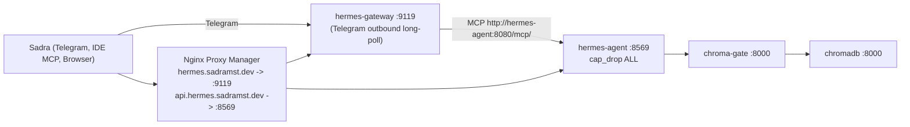

# Install & Operate Hermes Agent on Ubuntu Server 24.04+

This guide walks through deploying Sadra's personal assistant stack (`Sadramst/hermes-agent`) on Ubuntu Server 24.04 LTS and newer (`dev`, `test`, or `prod`), including Docker Compose, GHCR image releases, ChromaDB, Telegram (`hermes-gateway`), Web Dashboard (`hermes.sadramst.dev`), and public MCP (`api.hermes.sadramst.dev`).

## Stack Topology

| Container | Role | Host Ports (PROD) |
| --- | --- | --- |
| `hermes-agent` | FastAPI + MCP + Chroma RAG + Autonomous Tool Loop (`ghcr.io/sadramst/hermes-agent`). | **8569** (`api.hermes.sadramst.dev`) |
| `hermes-gateway` | Nous personal gateway (`nousresearch/hermes-agent:latest`) running Telegram, Cron, and Web Dashboard. | **9119** (`hermes.sadramst.dev`), **8642** (gateway API) |
| `chroma-gate` | Bearer-token proxy (`CHROMA_AUTH_TOKEN`) guarding `chromadb`. | None (Docker network only) |
| `chromadb` | Vector database (`chromadb/chroma:1.0.0`). | None (private `hermes-prod-chroma-net`) |



## Environments at a Glance

| | DEV | TEST | PROD |
| --- | --- | --- | --- |
| Compose file | `docker/docker-compose.dev.yml` | `docker/docker-compose.test.yml` | `docker/docker-compose.prod.yml` |
| Env file(s) | `docker/env/.env.dev` | `docker/env/.env.test` | `docker/env/.env.prod` + `.env.gateway` |
| Command | `bash docker/scripts/deploy.sh dev` | `bash docker/scripts/deploy.sh test` | `bash docker/scripts/deploy.sh prod` |
| Host ports | Agent **8080**, Chroma **8000** | None | Agent **8569**, Gateway **9119** / **8642** |
| Storage | Bind mounts (`storage/`) + `hermes-dev-chroma` | Ephemeral `tmpfs` | Named volumes (`hermes-prod-*`) |

## 1. Prepare Ubuntu Server & Docker

```bash
sudo apt-get update && sudo apt-get upgrade -y
sudo apt-get install -y ca-certificates curl git

sudo apt-get remove -y docker.io docker-compose docker-compose-v2 docker-doc podman-docker containerd runc || true
sudo install -m 0755 -d /etc/apt/keyrings
sudo curl -fsSL https://download.docker.com/linux/ubuntu/gpg -o /etc/apt/keyrings/docker.asc
sudo chmod a+r /etc/apt/keyrings/docker.asc
echo "deb [arch=$(dpkg --print-architecture) signed-by=/etc/apt/keyrings/docker.asc] https://download.docker.com/linux/ubuntu $(. /etc/os-release && echo "$VERSION_CODENAME") stable" | sudo tee /etc/apt/sources.list.d/docker.list > /dev/null

sudo apt-get update
sudo apt-get install -y docker-ce docker-ce-cli containerd.io docker-buildx-plugin docker-compose-plugin
sudo systemctl enable --now docker
sudo usermod -aG docker "$USER"
```

Log out and back in so the `docker` group applies, then clone the repository:

```bash
sudo mkdir -p /opt/hermes-agent
sudo chown "$USER:$USER" /opt/hermes-agent
git clone https://github.com/Sadramst/hermes-agent.git /opt/hermes-agent
cd /opt/hermes-agent
```

## 2. Publish or Pull the GHCR Image

- **GitHub Actions (recommended):** Pushing a tag like `v0.5.0` triggers `.github/workflows/release.yml`, publishing `ghcr.io/sadramst/hermes-agent:v0.5.0` and `ghcr.io/sadramst/hermes-agent:latest`.
- **Manual build & push:**
  ```bash
  export GITHUB_USER=sadramst GHCR_OWNER=sadramst IMAGE_TAG=v0.5.0
  echo "$GITHUB_TOKEN" | docker login ghcr.io -u "$GITHUB_USER" --password-stdin
  bash docker/scripts/build.sh
  bash docker/scripts/push.sh
  ```
- If the GHCR package is private, run `docker login ghcr.io` on the production VPS with a token carrying `read:packages`.

## 3. Configure Production Environment Files

### 3.1 `docker/env/.env.prod` (gitignored)

```bash
cp docker/env/.env.prod.example docker/env/.env.prod
chmod 600 docker/env/.env.prod
openssl rand -hex 32   # generate CHROMA_AUTH_TOKEN
openssl rand -hex 32   # generate HERMES_API_TOKEN
openssl rand -hex 32   # generate HERMES_DASHBOARD_BASIC_AUTH_SECRET
```

Fill in `docker/env/.env.prod`:

```text
HERMES_ENV=prod
HERMES_HOST=0.0.0.0
HERMES_PORT=8080
HERMES_LOG_LEVEL=INFO
HERMES_MEMORY_DIR=/app/storage/memory
HERMES_SKILLS_DIR=/app/storage/skills
HERMES_PROFILE_DIR=/app/gateway
HERMES_TIMEZONE=Asia/Singapore

CHROMA_HOST=chroma-gate
CHROMA_PORT=8000
CHROMA_AUTH_TOKEN=paste-first-hex-token
HERMES_API_TOKEN=paste-second-hex-token

HERMES_PROVIDER_AUTH_MODE=openrouter
HERMES_MODEL_BASE_URL=https://openrouter.ai/api/v1
HERMES_MODEL_NAME=google/gemini-2.5-flash
HERMES_MODEL_API_KEY=paste-openrouter-key

HERMES_EMBED_BASE_URL=https://openrouter.ai/api/v1
HERMES_EMBED_MODEL=openai/text-embedding-3-small
HERMES_EMBED_API_KEY=paste-openrouter-key
HERMES_EMBED_INPUT_TYPE=off
HERMES_RAG_MODE=soft
HERMES_MEMORY_INDEX=on

HERMES_MCP_ENABLED=on
HERMES_MCP_ALLOWED_HOSTS=hermes-agent,api.hermes.sadramst.dev

HERMES_GATEWAY_IMAGE=nousresearch/hermes-agent:latest
HERMES_DASHBOARD=1
HERMES_DASHBOARD_BASIC_AUTH_USERNAME=sadra
HERMES_DASHBOARD_BASIC_AUTH_PASSWORD=choose-a-strong-password
HERMES_DASHBOARD_BASIC_AUTH_SECRET=paste-third-hex-token

GHCR_OWNER=sadramst
IMAGE_TAG=latest
CHROMA_IMAGE=chromadb/chroma:1.0.0
```

### 3.2 `docker/env/.env.gateway` (gitignored)

`deploy.sh prod` copies `docker/env/.env.gateway.example` automatically if missing. Uncomment only keys you actively set:

```text
OPENROUTER_API_KEY=paste-openrouter-key
NVIDIA_API_KEY=paste-nvidia-nim-key
GOOGLE_API_KEY=paste-google-ai-studio-key
# COPILOT_GITHUB_TOKEN=paste-github-pat
TELEGRAM_BOT_TOKEN=paste-botfather-token
TELEGRAM_ALLOWED_USERS=paste-numeric-telegram-id
```

> **Providers & Gemini Subscriptions:** Today Gemini uses `OPENROUTER_API_KEY` or `GOOGLE_API_KEY`. Official Google-approved Gemini Subscription OAuth is pending Nous + Google release (not live yet, no date). To link Claude Pro/Max or ChatGPT/Codex OAuth in `hermes-gateway`, run `hermes model` inside the container (tokens save to `/opt/data/auth.json`). See [providers-and-subscriptions.md](../architecture/providers-and-subscriptions.md).

## 4. Deploy, Sync Personal Profile & Verify

```bash
cd /opt/hermes-agent
bash docker/scripts/deploy.sh prod
bash docker/scripts/bootstrap-gateway.sh --force-config
```

Verify health, providers, and MCP:

```bash
curl -sS http://127.0.0.1:8569/health
docker compose --env-file docker/env/.env.prod --env-file docker/env/.env.gateway \
  -f docker/docker-compose.prod.yml exec hermes-gateway hermes mcp test hermes-api
```

Expected: `status: "ok"`, `chroma.reachable: true`, `assistant.profile_loaded: true`, `mcp.enabled: true`, and `hermes mcp test hermes-api` lists all 9 tools (`complete`, `current_time`, `list_memories`, `list_skills`, `recall`, `remember`, `save_document`, `search_documents`, `search_memory`).

To run interactive gateway setup or OAuth (`hermes model`, `hermes setup --portal`, `hermes gateway setup`, `hermes cron`):

```bash
docker compose --env-file docker/env/.env.prod --env-file docker/env/.env.gateway \
  -f docker/docker-compose.prod.yml exec -it hermes-gateway hermes model
```

## 5. Nginx Proxy Manager & Firewall

- **Dashboard (`hermes.sadramst.dev`):** Forward to `http://<vps-ip>:9119` (Websockets ON, SSL forced).
- **API & MCP (`api.hermes.sadramst.dev`):** Forward to `http://<vps-ip>:8569` (Websockets ON, SSL forced, **preserve original `Host` header** so `/mcp` does not return `421`).
- **Telegram:** Uses outbound long-polling—no inbound port required.
- **UFW Firewall (if enabled):**
  ```bash
  sudo ufw allow OpenSSH
  sudo ufw allow 8569/tcp comment 'hermes-agent-api'
  sudo ufw allow 9119/tcp comment 'hermes-gateway-dashboard'
  sudo ufw status
  ```

## 6. Day-to-Day Operations & Cleanup

```bash
cd /opt/hermes-agent
# Status & logs
docker compose --env-file docker/env/.env.prod -f docker/docker-compose.prod.yml ps
docker compose --env-file docker/env/.env.prod -f docker/docker-compose.prod.yml logs -f --tail 100

# Update containers after git pull or new GHCR tag
git pull && bash docker/scripts/deploy.sh prod
bash docker/scripts/bootstrap-gateway.sh

# Safe disk cleanup (keeps named volumes & active images)
bash docker/scripts/cleanup-disk.sh --dry-run
bash docker/scripts/cleanup-disk.sh

# Run offline tests inside Docker
bash docker/scripts/deploy.sh test
```

## 7. Key Environment Variables

| Variable | Required | Purpose |
| --- | --- | --- |
| `HERMES_ENV` | Yes | `dev`, `test`, or `prod`. |
| `CHROMA_HOST` / `CHROMA_PORT` | Yes | `chromadb:8000` (dev/test) or `chroma-gate:8000` (prod). |
| `CHROMA_AUTH_TOKEN` | Prod | Bearer token (>= 16 chars) checked by `chroma-gate`. |
| `HERMES_API_TOKEN` | Prod / MCP | Bearer token (>= 16 chars) for `/documents`, `/memories`, `/providers`, `/completions`, `/agent/run`, `/tools`, and `/mcp`. |
| `HERMES_MODEL_BASE_URL` / `HERMES_MODEL_NAME` / `HERMES_MODEL_API_KEY` | Prod | OpenAI-compatible LLM endpoint and credentials. |
| `HERMES_EMBED_BASE_URL` / `HERMES_EMBED_MODEL` / `HERMES_EMBED_API_KEY` | No | Provider embeddings (`openai/text-embedding-3-small`); moves collections to `hermes-documents-v2` / `hermes-memory-v2`. |
| `HERMES_RAG_MODE` | No | `off` (default), `shadow`, or `soft` (injects `## Context` and returns `sources`). |
| `HERMES_MEMORY_INDEX` | No | `off` (default) or `on` (semantic `search_memory`). Run `hermes reindex-memory` once after enabling. |
| `HERMES_MCP_ENABLED` / `HERMES_MCP_ALLOWED_HOSTS` | No | `on` exposes streamable HTTP `/mcp` to allowed public/Docker hosts. |
| `HERMES_PROFILE_DIR` | No | Path to personal `SOUL.md` & `USER.md` (`gateway` in dev, `/app/gateway` in prod). |
| `HERMES_TIMEZONE` | No | Local timezone (`UTC`, `UTC+08:00`, or `Asia/Singapore`) for clock grounding & gateway `TZ`. |
| `HERMES_PROVIDER_AUTH_MODE` | No | Active auth label (`api_key`, `openrouter`, `google_ai_studio`, `nous_portal`, `claude_oauth`, `chatgpt_oauth`, `gemini_subscription_pending`). |
| `TELEGRAM_BOT_TOKEN` / `TELEGRAM_ALLOWED_USERS` | Telegram | BotFather token and allowed numeric user IDs in `.env.gateway`. |
