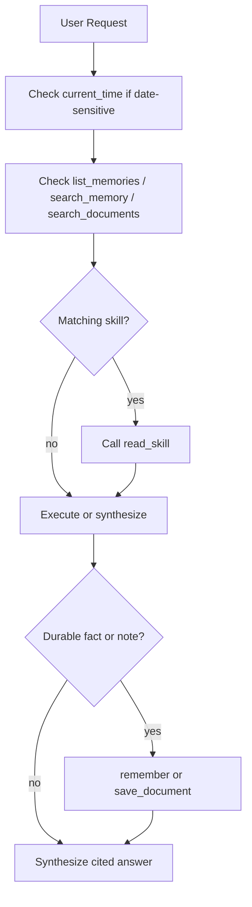

# Purpose

Solve multi-step user requests autonomously by checking time, memory, documents, and skills first, persisting durable findings under clean namespaces, and synthesizing a cited answer.

# Inputs

- User prompt or task description
- Loaded skill index (`list_skills`, `read_skill`)
- Persistent memory store (`list_memories`, `search_memory`, `recall`, `remember`)
- ChromaDB document store (`search_documents`, `save_document`)
- Clock context (`current_time`)

# Outputs

- Executed tool call trace (`steps`)
- Grounded assistant response (`text`) citing `[label]` for any retrieved document passages
- Durable facts persisted under dotted keys (`profile.*`, `work.*`, `dev.*`, `goal.*`, `habit.*`, `finance.*`, `ops.*`) when requested or clearly lasting

# Execution flow

1. Call `current_time` when the task depends on today's date, schedule, or financial period.
2. Check `list_memories`, `search_memory`, or `search_documents` before guessing prior preferences, server facts, goals, or financial assumptions.
3. When a skill in the index matches the domain, call `read_skill` to follow its exact workflow.
4. When the user supplies lasting facts, store them with `remember` under dotted namespaces (or `save_document` for multi-paragraph references).
5. Synthesize a concise, grounded final answer citing `[label]` for any retrieved passages.

# Error handling

- If `search_documents` or `search_memory` returns no matches, state clearly that no stored records matched instead of fabricating facts.
- If an irreversible tool (`delete_memory`) returns `ask_person`, report that human confirmation is required and stop calling tools.

# Logging

Tool invocations are logged under `hermes` as `tools.run name=<tool> status=<status> env=<HERMES_ENV>`, omitting argument values and user prompt text.

# Versioning

Skill version `1.1.0` tracks updates to the autonomous tool roster and dotted memory conventions.

# Test coverage

- `tests/unit/test_autonomous_loop.py`
- `tests/unit/test_personal_assistant.py`

# Documentation references

- `docs/architecture/personal-assistant.md`
- `README.md`
