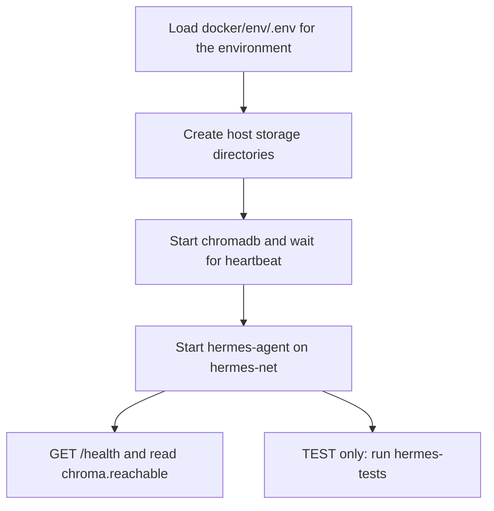

# Purpose

Bring up the Hermes Agent service with ChromaDB and persistent memory and skills for one environment: `dev`, `test`, or `prod`.

# Inputs

- Environment name: `dev`, `test`, or `prod`
- Env file: `docker/env/.env.<environment>`
- Image tag variables: `GHCR_OWNER` and `IMAGE_TAG` (required for `prod` image pulls and for `build.sh`)
- Production model provider: `HERMES_MODEL_BASE_URL`, `HERMES_MODEL_NAME`, and `HERMES_MODEL_API_KEY`
- Production API credential: `HERMES_API_TOKEN`

# Outputs

- Docker network `hermes-<environment>-net`
- `hermes-agent` serving `GET /health` on container port 8080. Development publishes host port 8080. Production publishes host port 8569.
- `chromadb` accepting heartbeat requests on port 8000 inside the network. Development publishes host port 8000. Production keeps Chroma unpublished and reaches it through `chroma-gate` with `CHROMA_AUTH_TOKEN`.
- `POST /documents` and `GET /documents/search` on the agent for collection `hermes-documents`. Shadow logs a `chroma-passage` judgment and returns every neighbor. Soft returns passages whose relevance score reaches the level that says the passage states an answer. A Jev error returns every neighbor.
- `POST /completions` sending one chat completion to the configured model provider, with the loaded skill index prefixed onto the caller prompt. Soft mode also inserts a `skill_relevance` block between that index and the request. The model may ignore the block. Shadow logs a `guardrails` route for the caller prompt and the model reply and still returns the model text. Soft withholds that text on `review` or `block`. A Jev error on that pack logs `review`.
- Mounted memory and skills paths, or a passing `hermes-tests` container in test. Shadow logs a `memory-write` judgment and still keeps the file. Soft skips one-shot chatter and keeps a durable kind. A Jev error still keeps the file.
- `POST /tools` running `recall`, `remember`, and `list_skills` from an allowlist. `delete_memory` asks a person and does not delete. A batch past the step limit runs nothing. Shadow logs a `tool-call` judgment and still runs that allowlist. Soft holds a call unless Jev picked it and the score is clear. A Jev error in soft asks a person instead of running. Shadow and soft log a `model-router` tier and still send the completion to the frontier model named by `HERMES_MODEL_NAME`. Shadow logs a `supervisor` judgment and still returns the same tool results and the same completion text. Soft stops tool calls that follow a looping judgment and still returns the completion text.
- Health JSON with `status`, `environment`, `chroma.reachable`, `model.configured`, `jev.mode`, and `jev.configured`. The response omits `HERMES_JEV_API_KEY`.
- Agent container with `cap_drop: ALL` after the startup check confirms an unprivileged listen port and writable memory

# Execution flow

Run `docker/scripts/deploy.sh dev`, `docker/scripts/deploy.sh test`, or `docker/scripts/deploy.sh prod`.

# Error handling

- An unknown environment name exits with status 1 and prints usage.
- `prod` compose interpolation fails closed when `GHCR_OWNER` or `IMAGE_TAG` is empty.
- The agent waits until the Chroma healthcheck passes before it starts.
- A failed Chroma heartbeat leaves `/health` at HTTP 200 with `chroma.reachable` set to `false` and a debug log line.
- Invalid memory keys and broken skill front matter raise `ValueError` and are logged under `hermes.skills` or the memory store.
- Production refuses to start when `HERMES_API_TOKEN` or the model provider variables are missing or shorter than 16 characters.
- `POST /documents`, `GET /documents/search`, `POST /completions`, and `POST /tools` return HTTP 401 when `HERMES_API_TOKEN` is set and the bearer token does not match. `GET /health` stays open.
- A failed model request returns HTTP 502 and omits the provider response. A missing provider returns HTTP 503.

# Logging

The process logger name is `hermes`. Lines use the format `timestamp level [hermes] message` and include `env=<HERMES_ENV>` on agent, skill, memory, and health events. A completion log line includes `model=`, `skills=`, and `env=` and omits the prompt and the provider key. When `HERMES_JEV_MODE` is `shadow` or `soft`, logger `hermes.jev` records `jev.decision` with the suggested skill name or an empty suggestion, a `chroma-passage` line with the neighbor ids and the ids that reach the helping level, and a `memory-write` line with the memory key, kind, and whether the file was stored. A tool line names the allowlisted tool and its status and omits the argument values. A `tool-call` line names the logged calls, Jev's choice, and the statuses Hermes actually ran. It omits argument values. A `model-router` line names the tier and omits the caller prompt. A `supervisor` line names the side, whether the steps are looping, whether the gathered evidence looks complete, and whether Hermes stopped later calls. It omits tool output, the caller prompt, and the model reply. Those lines omit the caller prompt, the model reply, the search query, the passage text, the memory value, and `HERMES_JEV_API_KEY`. Dev templates set `HERMES_LOG_LEVEL=DEBUG`. Test and prod templates use `INFO`.

# Versioning

Skill version `1.19.0` is independent of the application version in `pyproject.toml` (`0.1.0`). Bump the skill version when inputs, outputs, or the execution flow change.

# Test coverage

- `tests/unit/test_skills.py` loads this document and checks the required sections.
- `tests/unit/test_prompt.py` checks that the skill index includes this skill's purpose.
- `tests/unit/test_health.py` checks the health payload.
- `tests/e2e/test_stack_contract.py` checks compose services, volumes, network, and the GHCR image name.
- `tests/integration/test_chroma_config.py` calls a live heartbeat and skips when Chroma is down.

# Documentation references

- `docs/deployment/docker.md`
- `docs/deployment/environments.md`
- `docs/deployment/ghcr.md`
- `docs/architecture/overview.md`
- `docs/architecture/current.md`
- `docs/testing/strategy.md`
