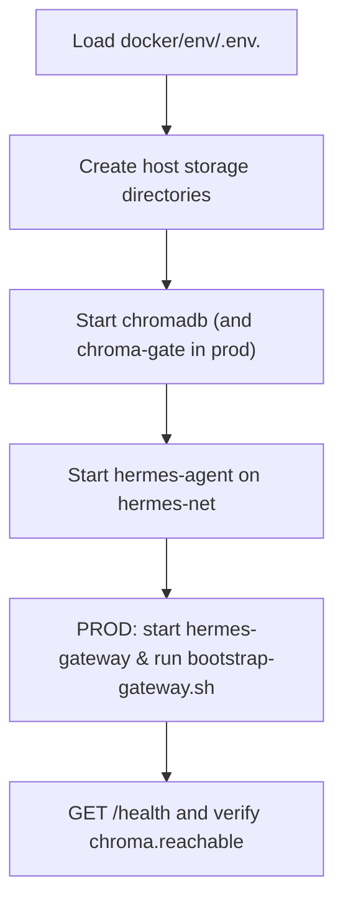

# Purpose

Bring up the Hermes Agent service with ChromaDB, persistent memory and skills, and Telegram gateway for `dev`, `test`, or `prod`.

# Inputs

- Environment name: `dev`, `test`, or `prod`
- Env files: `docker/env/.env.<environment>` and (for `prod`) `docker/env/.env.gateway`
- Image tag variables: `GHCR_OWNER` (`sadramst`) and `IMAGE_TAG`
- Production model provider: `HERMES_MODEL_BASE_URL`, `HERMES_MODEL_NAME`, and `HERMES_MODEL_API_KEY`
- Production credentials: `HERMES_API_TOKEN` and `CHROMA_AUTH_TOKEN`

# Outputs

- Docker network `hermes-<environment>-net`
- `hermes-agent` serving `GET /health` on container port 8080 (`8080` host in dev, `8569` host in prod)
- `chromadb` accepting heartbeat requests on port 8000 (`8000` host in dev, isolated behind `chroma-gate` on `hermes-prod-chroma-net` in prod)
- `hermes-gateway` (prod) running Telegram + Web Dashboard (`9119` / `8642`) synced from `gateway/`
- `POST /documents`, `GET /documents/search`, `GET /memories`, `GET /memory/search`, `POST /completions`, `POST /agent/run`, `POST /tools`, and `/mcp`

# Execution flow

Run `bash docker/scripts/deploy.sh dev`, `bash docker/scripts/deploy.sh test`, or `bash docker/scripts/deploy.sh prod` (followed by `bash docker/scripts/bootstrap-gateway.sh` in prod).

# Error handling

- An unknown environment name exits with status 1 and prints usage.
- `prod` compose fails closed when `GHCR_OWNER`, `IMAGE_TAG`, `CHROMA_AUTH_TOKEN`, `HERMES_API_TOKEN`, or `HERMES_MODEL_*` are missing.
- `POST /documents`, `GET /documents/search`, `GET /memories`, `GET /memory/search`, `GET /providers`, `POST /completions`, `POST /agent/run`, `POST /tools`, and `/mcp` return HTTP 401 when `HERMES_API_TOKEN` is set and the bearer token does not match. `GET /health` stays open.

# Logging

The logger name is `hermes`. Log lines follow `timestamp level [hermes] message` and include `env=<HERMES_ENV>` while omitting prompts, memory values, and API keys.

# Versioning

Skill version `1.19.0` is independent of the application version in `pyproject.toml` (`0.5.0`).

# Test coverage

- `tests/unit/test_skills.py`
- `tests/unit/test_prompt.py`
- `tests/unit/test_health.py`
- `tests/e2e/test_stack_contract.py`

# Documentation references

- `README.md`
- `docs/deployment/ubuntu-server.md`
- `docs/architecture/telegram-gateway.md`
