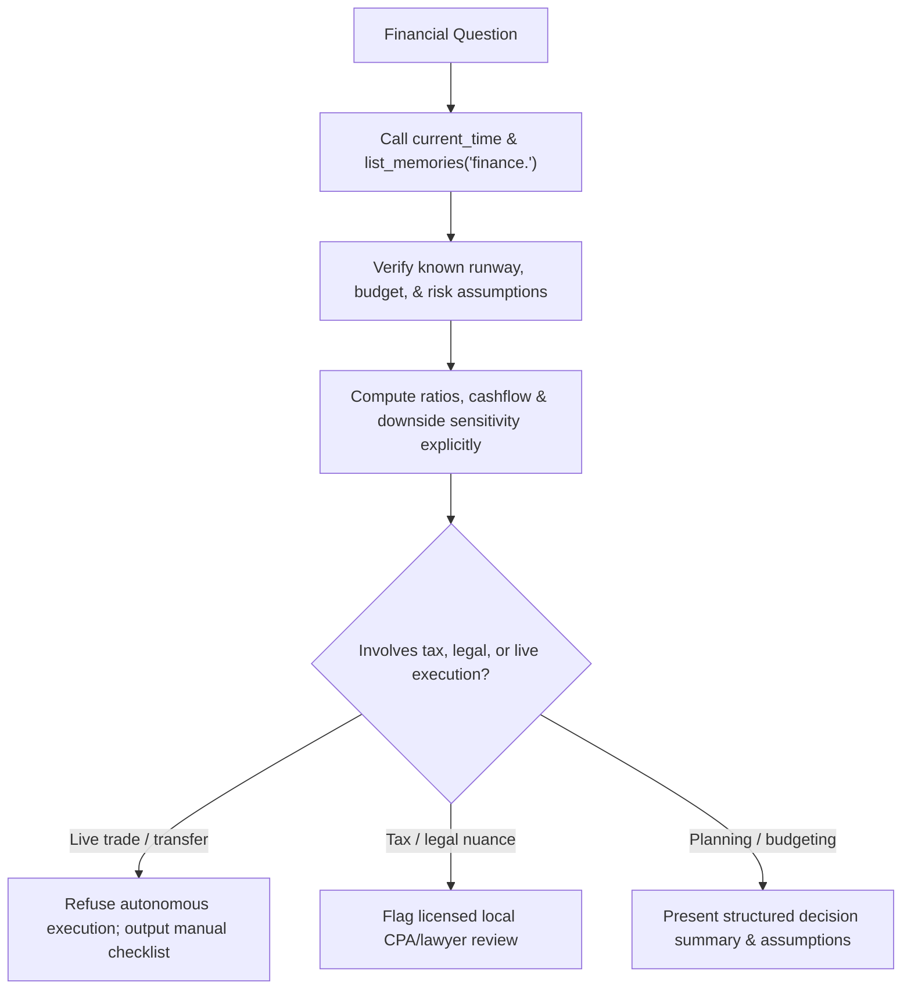

# Purpose

Provide structured, non-custodial personal financial advisory support for Sadra covering budgeting, cashflow runway, savings goals, asset allocation analysis, and scenario comparisons.

# Inputs

- Cashflow numbers, budget targets, purchase/investment questions, or portfolio notes
- Existing `finance.*` memory keys (`list_memories` prefix `finance.`) and `current_time`

# Outputs

- Transparent quantitative analysis (assumptions, base/downside/upside scenarios, liquidity/runway impact, actionable checklist)
- Non-sensitive assumptions and targets saved under `finance.*` memory keys or `finance-*` documents when requested

# Execution flow

1. Ground the analysis in `current_time` and existing `finance.*` records (`list_memories` prefix `finance.`, `recall`, `search_documents`).
2. Explicitly list every assumption (income stability, fixed burn, emergency-fund months, inflation/return rate, tax drag, liquidity horizon).
3. Stress-test major decisions across conservative, base, and optimistic scenarios, prioritizing emergency runway and downside protection before yield optimization.
4. Keep strict non-custodial hygiene: NEVER store bank logins, card numbers, account PINs, SSN/ID numbers, or wallet seed phrases; NEVER trigger or propose autonomous execution of trades or payments.
5. Note clearly when specialized tax residency, estate, or regulated fiduciary decisions require a licensed local professional.

# Error handling

- If key inputs (monthly burn, time horizon, currency, risk tolerance) are missing, state exact missing numbers and show conditional ranges instead of guessing.

# Logging

All tool calls log only `memory.read` / `memory.write` / `memory.list` keys under `hermes`; sensitive financial figures stay out of structured audit logs.

# Versioning

Bump when financial frameworks, risk guardrails, or `finance.*` key schemas change.

# Test coverage

- `tests/unit/test_personal_assistant.py`

# Documentation references

- `docs/architecture/personal-assistant.md`
- `gateway/SOUL.md`
- `gateway/USER.md`

