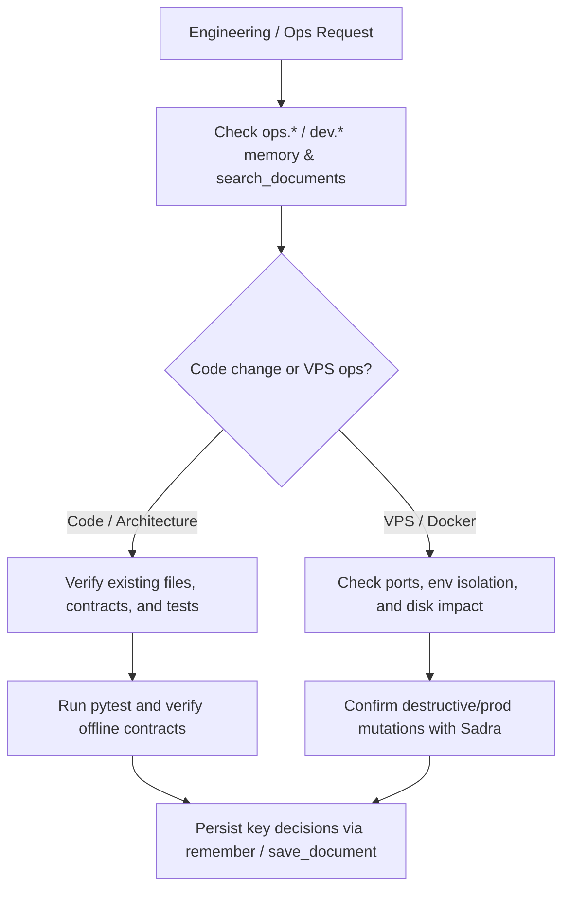

# Purpose

Guide software architecture, debugging, code review, Docker Compose, GitHub CI/CD, and Ubuntu VPS operations for Sadra across Windows local dev and `sadramst.dev` production.

# Inputs

- Engineering task, bug report, architecture question, or VPS ops request
- Stored engineering context (`list_memories` prefix `dev.` / `work.` / `ops.`, `search_documents`)

# Outputs

- Concrete implementation plan, root-cause diagnosis, diffs, or verified CLI/Docker commands
- Updated `dev.*`, `work.*`, or `ops.*` memory keys or runbook documents when architecture decisions change

# Execution flow

1. Query `search_documents` and `list_memories` (`ops.`, `dev.`, `work.`) for existing port mappings (`8080` dev, `8569` prod API, `9119` dashboard), DNS (`api.hermes.sadramst.dev`, `hermes.sadramst.dev`), or repo conventions.
2. Read the actual code/configs/tests before proposing edits; preserve all contract tests (`tests/e2e/test_docs_contract.py`, `tests/e2e/test_stack_contract.py`).
3. Keep secrets out of git (`docker/env/.env.prod`, `.env.gateway`, `.env.local` stay untracked) and preserve `cap_drop: ALL` and `chroma-gate` isolation.
4. For production VPS operations (`deploy.sh prod`, volume prunes, restarts), double-check rollback paths (`IMAGE_TAG` rollback, `bootstrap-gateway.sh` backups) before proposing execution.

# Error handling

- If a runbook or memory entry is missing, state the gap rather than inventing server paths or credentials.
- Refuse or pause before any irreversible data deletion (`--volumes`, `delete_memory`, destructive migrations).

# Logging

Logged via `hermes` (`tools.run`, `documents.search`, `memory.read`, `memory.write`) without leaking secrets or code payloads.

# Versioning

Bump when Sadra's engineering stack, deployment ports, or VPS topology changes.

# Test coverage

- `tests/e2e/test_stack_contract.py`
- `tests/unit/test_personal_assistant.py`

# Documentation references

- `README.md`
- `docs/deployment/ubuntu-server.md`
- `docs/architecture/personal-assistant.md`

